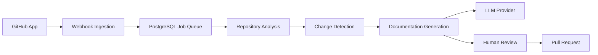

<div align="center">

# DocSync

**A developer documentation automation platform that keeps technical documentation synchronized with the actual state of a software repository.**

[](https://openjdk.org/)
[](https://spring.io/projects/spring-boot)
[](https://www.postgresql.org/)
[](https://vitejs.dev/)
[](#testing)
[](#license)

<br />

DocSync connects to source-code repositories, detects relevant changes, identifies potentially affected documentation, validates examples, and proposes documentation updates through reviewable pull requests.

</div>

---

## Table of Contents

- [Overview](#overview)
- [Architecture](#architecture)
- [Features](#features)
- [Technology Stack](#technology-stack)
- [Quick Start](#quick-start)
- [Configuration](#configuration)
- [Testing](#testing)
- [Documentation](#documentation)
- [Known Limitations](#known-limitations)
- [License](#license)

---

## Overview

DocSync is a modular monolith built with Spring Boot and React. It uses GitHub App authentication, durable PostgreSQL-backed background jobs, Java source analysis, and a provider-agnostic LLM layer to generate documentation updates for human review.

The backend exposes a REST API under `/api/v1`. The frontend is a responsive developer dashboard that integrates with the backend APIs and supports light and dark themes.

---

## Architecture



Key modules:

- Identity and organizations
- Repository connections and onboarding
- Webhook ingestion and durable jobs
- Repository analysis and code entities
- Change detection and documentation impact
- AI documentation generation and review
- Frontend dashboard and API integration

---

## Features

| Area | Status | Details |
| --- | --- | --- |
| Authentication | Implemented | Email/password and GitHub OAuth |
| Organizations | Implemented | Tenant isolation, roles, memberships |
| GitHub App onboarding | Implemented | Installation webhooks, connections, repository import |
| Repository sync | Implemented | Shallow clone/fetch with installation tokens |
| Webhook processing | Implemented | HMAC-SHA256 verification, idempotency, durable jobs |
| Repository analysis | Implemented | Java parsing, documentation discovery, findings |
| Change detection | Implemented | Added, modified, removed, and renamed files |
| Documentation generation | Implemented | Mock provider included; OpenAI adapter available |
| Documentation review | Implemented | Preview, diff, approve, reject, regenerate |
| Frontend | Implemented | React, TypeScript, Vite, responsive UI |

---

## Technology Stack

### Backend
- Java 21
- Spring Boot 3.2.5
- Spring Security
- Spring Data JPA
- PostgreSQL 16
- Flyway
- H2 for tests

### Frontend
- React 19
- TypeScript
- Vite
- TanStack Query
- Axios
- Tailwind CSS

### External Integrations
- GitHub App and GitHub REST API
- OpenAI-compatible LLM provider
- System `git` binary for repository operations

---

## Quick Start

### Prerequisites

- Java 21+
- Maven 3.9+
- Node.js 20+ and npm
- Docker and Docker Compose
- PostgreSQL 16
- Git 2.40+

### Backend

```bash
docker-compose up -d
mvn clean package
mvn spring-boot:run
```

Verify health:

```bash
curl http://localhost:8080/actuator/health
```

### Frontend

```bash
cd frontend
npm install
npm run dev
```

The frontend runs on `http://localhost:5173` and proxies `/api` to the backend on `http://localhost:8080`.

---

## Configuration

Configure these environment variables without committing secrets:

```text
GITHUB_APP_ID
GITHUB_APP_PRIVATE_KEY
GITHUB_WEBHOOK_SECRET
GITHUB_API_URL
DATABASE_URL
DATABASE_USERNAME
DATABASE_PASSWORD
JWT_SECRET
ENCRYPTION_KEY
REPOSITORY_WORKSPACE_ROOT
REPOSITORY_CLONE_HOST
REPOSITORY_GIT_TIMEOUT_SECONDS
LLM_PROVIDER
LLM_API_KEY
LLM_MODEL
```

GitHub webhook endpoint:

```text
POST /api/v1/webhooks/github
```

For local development with Smee, configure GitHub to send events to:

```text
https://smee.io/IBsk2fCOLoO40Ga0
```

and forward them to:

```text
http://localhost:8080/api/v1/webhooks/github
```

---

## Testing

### Backend

```bash
mvn test
mvn -DskipTests package
```

### Frontend

```bash
cd frontend
npm run test
npm run lint
npm run build
```

---

## Documentation

See the [docs/](docs/) directory for comprehensive project documentation:

- [Product Requirements](docs/PRD.md)
- [High-Level Design](docs/HLD.md)
- [Low-Level Design](docs/LLD.md)
- [API Specification](docs/API_SPEC.md)
- [Data Model](docs/DATA_MODEL.md)
- [Deployment Guide](docs/DEPLOYMENT.md)
- [Implementation Plan](docs/IMPLEMENTATION_PLAN.md)
- [Implementation Progress](docs/IMPLEMENTATION_PROGRESS.md)
- [Current Status](docs/progress/CURRENT_STATUS.md)
- [Final Acceptance Report](docs/qa/final-acceptance-report.md)

---

## Known Limitations

- GitHub webhook forwarding through Smee is currently affected by an `Expect` header incompatibility.
- Installation ownership requires a DocSync user linked to the GitHub installer identity.
- PostgreSQL-specific automated tests have not been run against PostgreSQL.
- Real GitHub, Git, and live LLM integrations have limited verification outside automated tests.
- The frontend has one smoke test; broader component and E2E coverage is still needed.

---

## License

Proprietary - All rights reserved.