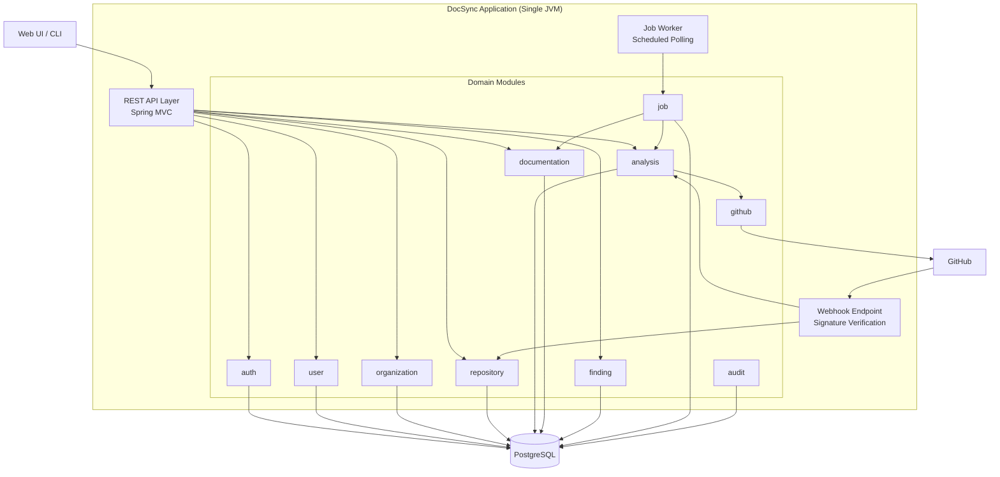

# ADR-001: Modular Monolith Architecture

| Field      | Value                     |
| ---------- | ------------------------- |
| **Status** | Accepted                  |
| **Date**   | 2024-01-10                |
| **Author** | DocSync Architecture Team |

## Context

DocSync is a developer documentation automation platform that analyzes source code repositories, identifies documentation gaps, and generates documentation. The system needs to handle:

- REST API serving for the web UI and integrations
- Webhook ingestion from GitHub
- Background processing for code analysis and documentation generation
- Multi-tenant data isolation
- Integration with GitHub APIs and (optionally) LLM providers

As a new product with a small team (2–4 engineers), we need an architecture that:

1. Allows rapid feature development without excessive boilerplate
2. Supports the full feature set without premature infrastructure complexity
3. Can be decomposed later if scaling demands it
4. Is straightforward to deploy, monitor, and debug

## Decision

We will build DocSync as a **modular monolith** using Java 21 and Spring Boot 3.x.

The application is a single deployable unit (one JAR/container), but internally organized into well-defined modules with explicit boundaries:

```
com.docsync
├── auth/          # Authentication, JWT, API key management
├── user/          # User profiles, account management
├── organization/  # Multi-tenant organization management
├── repository/    # Repository connection and configuration
├── analysis/      # Code analysis orchestration
├── documentation/ # Documentation generation and serving
├── finding/       # Documentation quality findings
├── job/           # Background job queue and execution
├── webhook/       # Webhook ingestion and dispatch
├── github/        # GitHub API client (App auth, REST/GraphQL)
├── audit/         # Audit event logging
└── common/        # Shared utilities, base entities, exceptions
```

### Module Rules

1. **Each module owns its entities, repositories, and services.** No module directly accesses another module's JPA repositories.
2. **Inter-module communication** uses service interfaces (not direct repository access). Modules expose a public API (service interfaces + DTOs) and hide internals.
3. **Shared kernel** (`common`) contains only base classes, utilities, and cross-cutting concerns (security filters, exception handlers).
4. **Database is shared** but each module's tables are logically grouped. There is no separate schema per module at this stage.
5. **Background processing** runs in the same JVM using a database-backed job queue (see ADR-004), not a separate worker process.

### Architectural Diagram



## Alternatives Considered

### 1. Microservices

Decompose into independent services: auth-service, analysis-service, doc-generation-service, etc.

**Pros:**
- Independent scaling of analysis workers
- Independent deployment and release cycles
- Technology diversity per service

**Cons:**
- Significant operational overhead for a small team (service mesh, distributed tracing, per-service CI/CD, multiple databases)
- Distributed transaction complexity (analysis → doc-generation spans services)
- Network latency and reliability concerns for inter-service calls
- Premature optimization—we don't yet know which components need independent scaling

**Rejected because:** The operational cost is disproportionate to the team size and current scale. We can extract services later when scaling data justifies the complexity.

### 2. Serverless (AWS Lambda / Cloud Functions)

Implement each endpoint and background job as a serverless function.

**Pros:**
- Zero infrastructure management
- Automatic scaling
- Pay-per-invocation cost model

**Cons:**
- Cold start latency (Java + Spring Boot cold starts are 5–15 seconds, unacceptable for API endpoints)
- 15-minute execution limit is too short for large repository analysis
- Difficult to maintain state across analysis pipeline steps
- Vendor lock-in
- Complex local development and testing

**Rejected because:** Java/Spring cold starts and execution time limits make serverless a poor fit for this workload. Code analysis of large repositories can run for several minutes.

## Consequences

### Positive

- **Simple deployment:** One container, one health check, one log stream.
- **Easy debugging:** Stack traces span the full request path. No distributed tracing needed initially.
- **Refactoring speed:** Rename, move, and restructure across modules with IDE support and compile-time safety.
- **Transaction simplicity:** Local transactions across modules when needed (e.g., creating a repository and its initial job in one transaction).
- **Fast onboarding:** New developers learn one codebase, one build system, one deployment pipeline.

### Negative

- **Vertical scaling only** (initially). The single JVM must handle both API requests and background analysis. Mitigation: background workers run on a thread pool with configurable concurrency, and the job queue allows running multiple instances of the app with competing consumers.
- **Module discipline required.** Without physical service boundaries, developers may take shortcuts and create tight coupling. Mitigation: ArchUnit tests enforce module boundaries at build time.
- **Full redeployment.** Any change requires redeploying the entire application. Mitigation: The application starts in <10 seconds, and blue-green deployments minimize downtime.

### Extraction Path

If a module needs independent scaling (most likely: the analysis engine), it can be extracted into a separate service by:

1. Promoting the module's service interface to a REST/gRPC API
2. Moving its database tables to a separate schema or database
3. Replacing in-process calls with HTTP/messaging calls
4. Deploying it as a separate container

The modular structure makes this extraction mechanical rather than architectural.
