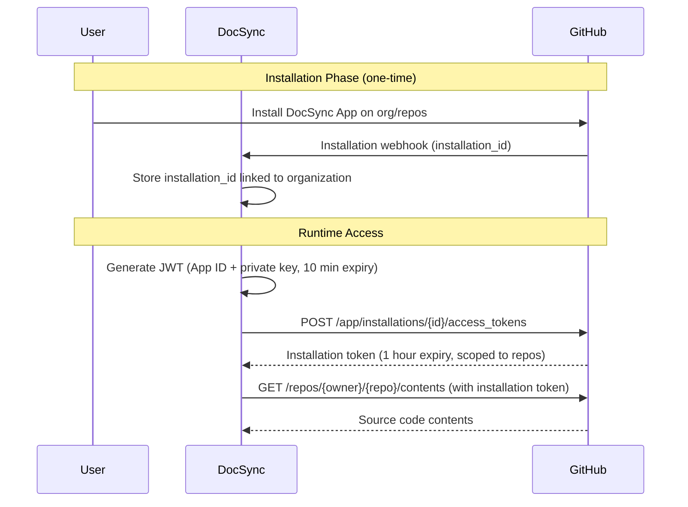

# ADR-003: GitHub App Integration Approach

| Field      | Value                     |
| ---------- | ------------------------- |
| **Status** | Accepted                  |
| **Date**   | 2024-01-15                |
| **Author** | DocSync Architecture Team |

## Context

DocSync needs to access source code from user repositories to perform analysis and generate documentation. The integration must support:

1. **Reading source code:** Clone or fetch file contents from repositories
2. **Receiving change notifications:** Know when code is pushed or pull requests are created
3. **Posting feedback:** Comment on pull requests with documentation findings
4. **Respecting permissions:** Only access repositories the user has explicitly authorized
5. **Multi-tenant safety:** One user's tokens cannot access another user's repositories
6. **Scalability:** Support organizations with hundreds of repositories

GitHub is our initial (and currently only) supported code hosting provider.

### Security Requirements

- Principle of least privilege: request only the permissions we actually use
- No long-lived user credentials stored by DocSync
- Token rotation and expiration
- Clear audit trail of which repositories were accessed and when

## Decision

We will integrate with GitHub using a **GitHub App** with **installation access tokens** and narrow, explicitly declared permissions.

### GitHub App Configuration

**App Permissions (requested at installation):**

| Permission       | Access       | Reason                                          |
| ---------------- | ------------ | ----------------------------------------------- |
| Repository contents | Read-only | Fetch source code for analysis                  |
| Pull requests    | Read & Write | Read PR details; post documentation review comments |
| Metadata         | Read-only    | List repositories available to the installation |
| Webhooks         | Receive      | Push and pull_request event notifications       |

**Webhook Events Subscribed:**

- `push` — Trigger analysis on code changes to monitored branches
- `pull_request` — Analyze PRs and post documentation findings
- `installation` — Track when the app is installed/uninstalled

### Authentication Flow



### Token Management

1. **App JWT:** Generated on-demand using the App's private key. Expires in 10 minutes. Used only to request installation tokens.
2. **Installation Access Token:** Requested per-installation, expires in 1 hour. Scoped to the specific repositories the installation has access to. Cached in-memory with TTL-based eviction (50 minutes to allow buffer).
3. **No user OAuth tokens stored.** The GitHub App model doesn't require storing user-level tokens for repository access. Users authenticate to DocSync via email/password; repository access uses installation tokens.

### Implementation Details

```java
@Service
public class GitHubTokenService {
    
    private final Cache<Long, InstallationToken> tokenCache;
    
    /**
     * Get or create an installation access token.
     * Tokens are cached for 50 minutes (10-minute buffer before expiry).
     */
    public String getInstallationToken(long installationId) {
        return tokenCache.get(installationId, id -> {
            String jwt = generateAppJwt();
            return gitHubClient.createInstallationToken(jwt, id);
        }).getToken();
    }
    
    private String generateAppJwt() {
        // RS256 JWT with:
        // - iss: GitHub App ID
        // - iat: now - 60 seconds (clock skew buffer)
        // - exp: now + 10 minutes
    }
}
```

### Webhook Verification

All incoming webhooks are verified using HMAC-SHA256:

```java
@Component
public class GitHubWebhookVerifier {
    
    public boolean verify(String payload, String signatureHeader, String webhookSecret) {
        String expected = "sha256=" + hmacSha256(webhookSecret, payload);
        return MessageDigest.isEqual(
            expected.getBytes(UTF_8), 
            signatureHeader.getBytes(UTF_8)
        );
    }
}
```

> [!IMPORTANT]
> The webhook secret is stored as an environment variable (`GITHUB_WEBHOOK_SECRET`), never in the database or application.yml. Signature verification uses constant-time comparison to prevent timing attacks.

## Alternatives Considered

### 1. OAuth App

GitHub OAuth Apps authenticate on behalf of a user using OAuth 2.0 flow.

**Pros:**
- Simpler setup (no App registration, just OAuth client)
- User-level access—DocSync acts as the user

**Cons:**
- **Over-privileged:** OAuth tokens grant access to ALL repositories the user can access, not just the ones they want DocSync to analyze. Violates least-privilege principle.
- **Token lifecycle tied to user:** If the authorizing user leaves the organization, access is lost for the entire organization.
- **No webhook integration:** OAuth Apps don't receive webhooks natively; would need to configure webhooks separately per repository.
- **Rate limits per-user:** Shared 5,000 requests/hour across all apps the user has authorized.
- **User token storage:** We'd need to store OAuth refresh tokens, adding PII and credential management complexity.

**Rejected because:** OAuth Apps grant too-broad access, tie repository access to individual users, and don't provide webhook integration. GitHub Apps are the recommended approach for integrations that act on behalf of an organization.

### 2. Personal Access Tokens (PATs)

Users provide their GitHub PAT to DocSync for repository access.

**Pros:**
- Simplest integration—just store the token and use it for API calls
- No GitHub App registration required
- Fine-grained PATs (released 2022) allow permission scoping

**Cons:**
- **Credential storage risk:** DocSync must store long-lived user credentials. A database breach exposes all tokens.
- **No automatic rotation:** PATs don't expire unless the user sets an expiration. Stale tokens are a security liability.
- **User-scoped, not org-scoped:** Each user must provide their own token. If the user revokes it or leaves, the organization loses access.
- **No webhooks:** Would need separate webhook configuration per repository.
- **Manual setup:** Users must manually create tokens with the right scopes—error-prone and poor UX.

**Rejected because:** Storing user credentials is a security liability we want to avoid entirely. PATs also provide a poor user experience (manual creation, no webhook integration) compared to the one-click GitHub App installation flow.

### 3. GitHub App with User-to-Server Tokens

GitHub Apps can also issue user-to-server tokens (OAuth-like flow where the App acts on behalf of a specific user).

**Pros:**
- Actions are attributed to the specific user (better audit trail on GitHub's side)
- Can access user-specific resources (e.g., user's private repos not installed on the App)

**Cons:**
- More complex auth flow (OAuth redirect for each user)
- Still requires storing per-user tokens
- Unnecessary for our use case—DocSync analyzes organization repositories, not user-specific resources

**Not adopted for initial implementation.** We may add user-to-server tokens later if we need user-attributed actions (e.g., creating commits on behalf of a user). For now, installation tokens are sufficient.

## Consequences

### Positive

- **Least privilege enforced by GitHub.** The App can only access repositories where it's installed, with only the permissions declared in the App manifest. Users see exactly what permissions DocSync requests before installing.
- **No user credentials stored.** Installation tokens are short-lived (1 hour) and cached in memory, not persisted. The App's private key is the only long-lived secret, stored as an environment variable.
- **Organization-scoped access.** Installing the App on an organization grants access regardless of individual user turnover. Access survives team changes.
- **Built-in webhooks.** The GitHub App receives webhook events automatically for installed repositories—no per-repo webhook configuration needed.
- **Higher rate limits.** GitHub Apps get 5,000 requests/hour per installation (not per user), scaling with the number of installations.
- **Professional UX.** One-click installation from the GitHub Marketplace with clear permission disclosure.

### Negative

- **GitHub App registration required.** We must register and maintain a GitHub App, including managing the private key and webhook secret. Mitigation: This is a one-time setup with established processes.
- **Installation token expiry handling.** We must handle token refresh and cache invalidation correctly. A bug here causes authentication failures. Mitigation: Comprehensive integration tests using WireMock to simulate GitHub API responses.
- **Single-provider for now.** The GitHub App model is GitHub-specific. Supporting GitLab or Bitbucket will require provider-specific integration implementations. Mitigation: The `github` module is isolated behind a provider-agnostic interface (`CodeHostingProvider`), making it straightforward to add implementations for other providers.
- **Webhook delivery is best-effort.** GitHub retries failed webhook deliveries, but events can still be lost. Mitigation: Manual re-sync capability and periodic polling as a fallback for critical repositories.

### Security Considerations

| Threat                     | Mitigation                                              |
| -------------------------- | ------------------------------------------------------- |
| Private key compromise     | Stored as env var, rotatable via GitHub App settings     |
| Webhook forgery            | HMAC-SHA256 signature verification on every webhook      |
| Token theft from memory    | Tokens expire in 1 hour; no persistent storage           |
| Over-privileged access     | Permissions declared in App manifest; auditable by users |
| Cross-tenant access        | Installation tokens are scoped to specific installations |
