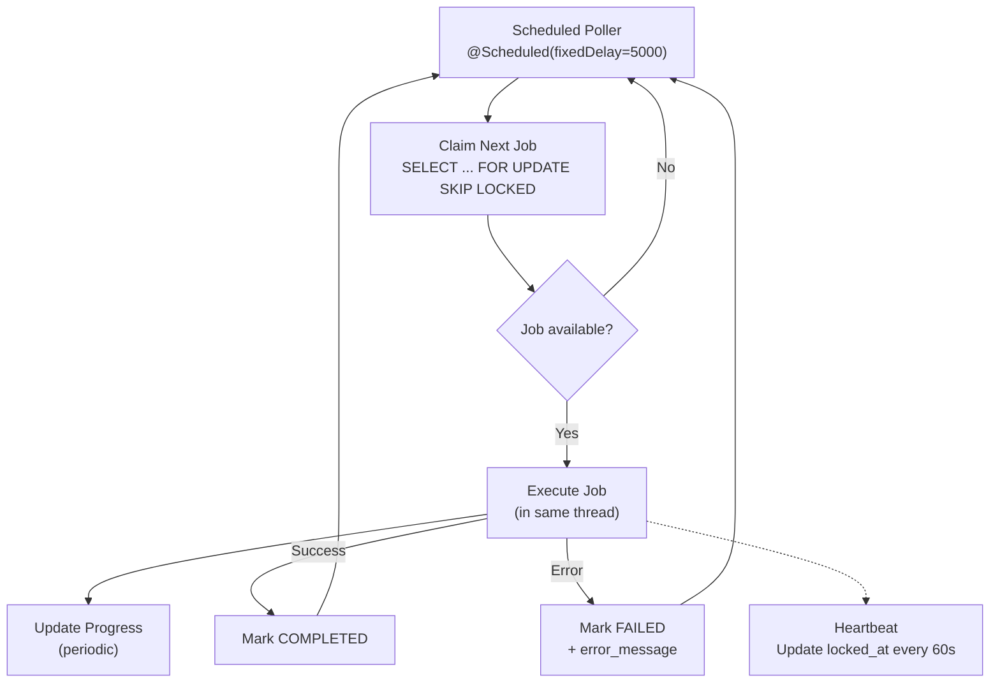

# ADR-004: Database-Backed Job Queue for Background Processing

| Field      | Value                     |
| ---------- | ------------------------- |
| **Status** | Accepted                  |
| **Date**   | 2024-01-18                |
| **Author** | DocSync Architecture Team |

## Context

DocSync performs several operations that cannot complete within the lifecycle of an HTTP request:

1. **Repository analysis:** Fetching source code, parsing ASTs, extracting code entities, and identifying documentation gaps. Can take 30 seconds to several minutes for large repositories.
2. **Documentation generation:** Generating documentation pages from analysis results, optionally invoking an LLM for prose. Can take 10–60 seconds depending on scope and AI usage.
3. **Repository sync:** Initial clone/fetch of repository metadata after connection. Takes 5–30 seconds.
4. **Retention cleanup:** Periodic deletion of expired webhook events, audit logs, and old job records.

### Requirements

- **Reliability:** Jobs must not be lost if the application crashes mid-processing. Failed jobs should be retryable.
- **Concurrency control:** Multiple application instances must be able to process jobs without duplicate execution.
- **Visibility:** Job status and progress must be queryable via the API for UI feedback.
- **Ordering:** Jobs should be processed roughly in priority order, with FIFO within the same priority.
- **Simplicity:** The solution should not introduce new infrastructure dependencies.
- **At-most-once delivery** for analysis (running duplicate analyses wastes resources and can produce inconsistent results).

## Decision

We will implement a **PostgreSQL-backed job queue** using an `analysis_jobs` table with **polling workers** and **optimistic locking** for job claiming.

### Job Table Design

See [DATA_MODEL.md](../DATA_MODEL.md) for the full `AnalysisJob` entity definition. The critical columns for queue behavior are:

| Column       | Queue Role                                                    |
| ------------ | ------------------------------------------------------------- |
| `status`     | Queue state: `QUEUED` → `RUNNING` → `COMPLETED`/`FAILED`     |
| `priority`   | Higher values are processed first                             |
| `locked_by`  | Worker instance ID that claimed the job                       |
| `locked_at`  | Timestamp of claim (used for stale lock detection)            |
| `version`    | Optimistic lock for atomic claiming                           |

### Job Claiming Strategy

Workers claim jobs using `SELECT ... FOR UPDATE SKIP LOCKED`, which is the PostgreSQL-idiomatic approach for competing consumers:

```sql
-- Claim the next available job (executed within a transaction)
UPDATE analysis_jobs
SET status = 'RUNNING',
    locked_by = :workerId,
    locked_at = NOW(),
    started_at = NOW(),
    version = version + 1
WHERE id = (
    SELECT id FROM analysis_jobs
    WHERE status = 'QUEUED'
    ORDER BY priority DESC, created_at ASC
    FOR UPDATE SKIP LOCKED
    LIMIT 1
)
RETURNING *;
```

**Key behaviors:**
- `FOR UPDATE` locks the selected row, preventing other workers from claiming it.
- `SKIP LOCKED` skips rows locked by other concurrent transactions, avoiding contention.
- `LIMIT 1` ensures each worker claims one job at a time.
- The `version` increment enables detection of stale updates.

### Worker Architecture



### Implementation

```java
@Component
public class JobWorker {

    private static final String WORKER_ID = 
        InetAddress.getLocalHost().getHostName() + "-" + ProcessHandle.current().pid();
    
    @Scheduled(fixedDelay = 5000) // Poll every 5 seconds
    public void pollAndExecute() {
        Optional<AnalysisJob> job = jobRepository.claimNextJob(WORKER_ID);
        job.ifPresent(this::executeJob);
    }
    
    private void executeJob(AnalysisJob job) {
        try {
            JobExecutor executor = executorRegistry.getExecutor(job.getType());
            executor.execute(job, this::updateProgress);
            jobRepository.markCompleted(job.getId());
        } catch (Exception e) {
            jobRepository.markFailed(job.getId(), e.getMessage());
        }
    }
    
    private void updateProgress(UUID jobId, int current, int total, String step) {
        jobRepository.updateProgress(jobId, current, total, step);
    }
}
```

### Stale Lock Detection

If a worker crashes while processing a job, the job remains in `RUNNING` status with a stale `locked_at` timestamp. A sweeper process detects and requeues these jobs:

```java
@Scheduled(fixedRate = 60000) // Every 60 seconds
public void recoverStaleJobs() {
    Instant threshold = Instant.now().minus(5, ChronoUnit.MINUTES);
    int recovered = jobRepository.requeueStaleJobs(threshold);
    if (recovered > 0) {
        log.warn("Recovered {} stale jobs", recovered);
        meterRegistry.counter("jobs.recovered").increment(recovered);
    }
}
```

```sql
UPDATE analysis_jobs
SET status = 'QUEUED',
    locked_by = NULL,
    locked_at = NULL,
    started_at = NULL,
    version = version + 1
WHERE status = 'RUNNING'
  AND locked_at < :threshold;
```

### Concurrency Configuration

```yaml
docsync:
  jobs:
    poll-interval-ms: 5000       # Time between polls
    max-concurrent: 3            # Max jobs per instance
    stale-threshold-minutes: 5   # Requeue jobs locked longer than this
    heartbeat-interval-ms: 60000 # Heartbeat to keep lock alive
```

Workers use a `Semaphore` to limit concurrent job execution per instance. With 3 concurrent jobs and 2 application instances, the system processes up to 6 jobs simultaneously.

## Alternatives Considered

### 1. RabbitMQ

**Pros:**
- Purpose-built message broker with robust delivery guarantees
- Consumer acknowledgment model (at-least-once delivery)
- Built-in retry with dead-letter queues
- Decouples producers from consumers
- Higher throughput than database polling

**Cons:**
- **New infrastructure dependency:** Requires deploying, managing, and monitoring a RabbitMQ cluster (or using a managed service). Adds operational cost and failure modes.
- **No built-in job visibility:** Messages in a RabbitMQ queue are not easily queryable. We'd need a separate database table to track job status anyway, duplicating state.
- **At-least-once semantics require idempotency:** RabbitMQ can redeliver messages, so every job handler must be idempotent. Our analysis pipeline has side effects (writing to the database) that make idempotency complex.
- **Message size limits:** Large job payloads (analysis results) need to be stored externally anyway.

**Rejected because:** We'd need to maintain job status in the database regardless (for API visibility), making RabbitMQ an additional component without eliminating the database dependency. The throughput benefits are unnecessary at our current scale (~100 jobs/day).

### 2. Redis Queues (e.g., Bull, Sidekiq-style)

**Pros:**
- Very fast enqueue/dequeue operations
- Built-in delayed jobs and retries
- Pub/sub for real-time notifications

**Cons:**
- **New infrastructure dependency:** Redis instance to manage.
- **Persistence concerns:** Redis persistence (RDB/AOF) is less durable than PostgreSQL's WAL. Jobs could be lost on Redis crash depending on configuration.
- **No transactional enqueue:** Cannot atomically insert a database record AND enqueue a job in the same transaction. This creates a window where the analysis record exists but no job is enqueued (or vice versa).
- **Limited query capabilities:** Cannot easily query jobs by arbitrary criteria (e.g., "all failed jobs for repository X in the last 24 hours").

**Rejected because:** The inability to transactionally enqueue jobs alongside database writes is a significant drawback. We'd need to implement outbox pattern or saga, adding complexity that exceeds the benefits.

### 3. Spring Batch

**Pros:**
- Mature framework for batch processing
- Built-in chunk processing, retry, skip logic
- Job repository for tracking execution
- Spring ecosystem integration

**Cons:**
- **Designed for batch ETL, not job queues.** Spring Batch excels at processing large datasets in chunks (read-process-write). Our workload is individual jobs triggered by events, not batch processing.
- **Complex configuration.** Spring Batch's `Job` → `Step` → `Tasklet`/`Chunk` model is heavyweight for simple background tasks.
- **Overkill for our use case.** We don't need chunk-oriented processing, skip/retry policies on individual records, or batch restart semantics.
- **Limited real-time progress.** Spring Batch's job repository tracks step completion, not fine-grained progress within a step.

**Rejected because:** Spring Batch solves a different problem (batch ETL) than what we need (event-triggered background jobs with progress tracking).

### 4. Transactional Outbox + Polling Publisher

**Pros:**
- Guarantees at-least-once delivery even with an external message broker
- Decouples message production from consumption

**Cons:**
- Adds complexity for a problem we don't have (we're not integrating with an external broker)
- Still requires polling, but with additional table and state management

**Not adopted:** This pattern is valuable when integrating with external message brokers. Since we're using the database directly as the queue, the outbox pattern is unnecessary indirection.

## Consequences

### Positive

- **Zero additional infrastructure.** The job queue uses the same PostgreSQL database, requiring no new services to deploy, monitor, or maintain.
- **Transactional job creation.** Creating an analysis record and enqueuing its job happen in the same database transaction—no inconsistency window.
- **Full job visibility.** Job status, progress, and history are queryable via standard SQL and exposed through the REST API. Debugging is straightforward.
- **ACID guarantees.** Job claiming is race-condition-free thanks to `FOR UPDATE SKIP LOCKED`.
- **Simple horizontal scaling.** Running additional application instances automatically adds more workers. No consumer group configuration needed.

### Negative

- **Polling overhead.** Workers poll the database every 5 seconds, even when no jobs are available. At 2 instances × 1 poll/5s = 0.4 queries/second, this is negligible, but it's not zero-cost.
  - *Mitigation:* PostgreSQL `LISTEN`/`NOTIFY` can be added later to trigger immediate polling when a job is enqueued, reducing unnecessary polls.
- **Database load.** Job queue operations (polling, progress updates, heartbeats) add load to the primary database.
  - *Mitigation:* At current scale (<100 jobs/day), this load is insignificant. If job volume grows 100x, the job table can be moved to a dedicated database.
- **No built-in retry backoff.** We implement retry logic manually (requeue with incremented retry count and delay).
  - *Mitigation:* A `retry_count` and `next_retry_at` column enable configurable exponential backoff.
- **5-second maximum latency.** A newly enqueued job waits up to 5 seconds before being picked up.
  - *Mitigation:* Acceptable for our use case (analysis takes minutes). Can be reduced or eliminated with `LISTEN`/`NOTIFY`.

### Metrics to Monitor

| Metric                          | Alert Threshold          |
| ------------------------------- | ------------------------ |
| `jobs.queue.depth`              | > 50 queued jobs         |
| `jobs.execution.duration`       | p99 > 5 minutes          |
| `jobs.failed.count`             | > 5 in 1 hour            |
| `jobs.recovered.count`          | Any (indicates crashes)  |
| `jobs.poll.empty.rate`          | Informational only       |
| `jobs.claim.contention.rate`    | > 10% skip-locked misses |

### Evolution Path

If job volume grows beyond what database polling can handle efficiently:

1. **Phase 1:** Add `LISTEN`/`NOTIFY` to eliminate empty polls (no new infrastructure)
2. **Phase 2:** Move the job table to a dedicated PostgreSQL instance (reduces load on primary)
3. **Phase 3:** Migrate to RabbitMQ/Redis if throughput exceeds ~10,000 jobs/hour (keep database table for visibility, use outbox pattern for reliable enqueue)
