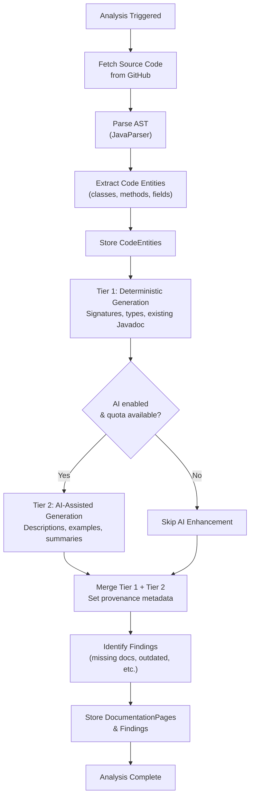

# ADR-005: Documentation Generation Strategy

| Field      | Value                     |
| ---------- | ------------------------- |
| **Status** | Accepted                  |
| **Date**   | 2024-01-22                |
| **Author** | DocSync Architecture Team |

## Context

DocSync's core value proposition is automatically generating and maintaining developer documentation from source code. The documentation generation system must:

1. **Produce accurate reference documentation** — API signatures, class hierarchies, method parameters, and return types must be correct and complete.
2. **Generate readable prose** — Beyond raw signatures, documentation should include descriptions, usage examples, and architectural context.
3. **Track provenance** — Users must know whether a piece of documentation was deterministically extracted from code or generated by AI, and how confident the system is in the output.
4. **Be reproducible** — Running the same analysis on the same code should produce the same deterministic output. AI-generated content may vary but should be flagged.
5. **Work without AI** — The system must produce useful documentation even without an LLM provider configured (free tier, air-gapped environments).
6. **Support incremental updates** — When code changes, only affected documentation should be regenerated, not the entire doc set.

### Quality Concerns

- **Accuracy over fluency.** Incorrect documentation is worse than no documentation. A method documented with wrong parameter types actively harms developers.
- **Hallucination risk.** LLMs can generate plausible-sounding but incorrect descriptions, especially for domain-specific logic.
- **Cost control.** LLM API calls have direct monetary cost. Regenerating all documentation on every commit is wasteful.

## Decision

We will use a **two-tier generation strategy**:

1. **Tier 1: Deterministic generation** for all structural/reference documentation (always runs, no AI required)
2. **Tier 2: AI-assisted generation** for prose descriptions, usage examples, and architectural summaries (optional, configurable)

All generated content includes **provenance metadata** indicating how it was produced and a confidence score.

### Tier 1: Deterministic Generation

Deterministic generation extracts documentation directly from source code artifacts using static analysis. The output is always accurate and reproducible.

**Sources:**

| Source                | Extracted Documentation                                     |
| --------------------- | ----------------------------------------------------------- |
| Class/interface declarations | Name, modifiers, type parameters, implemented interfaces, inheritance chain |
| Method signatures     | Parameters (name, type, nullability), return type, exceptions declared |
| Javadoc comments      | Existing `@param`, `@return`, `@throws`, `@since`, `@deprecated` tags |
| Annotations           | `@RestController`, `@GetMapping`, `@RequestBody`, validation annotations |
| Field declarations    | Name, type, default values, annotations                     |
| Enum values           | Constants with their associated fields                       |
| Package structure     | Module organization, package-info.java contents              |

**Output Format:**

```markdown
# UserService

**Package:** `com.acme.service`  
**Type:** Class  
**Modifiers:** `public`  
**Implements:** `UserOperations`

## Methods

### createUser

```java
public UserResponse createUser(CreateUserRequest request)
    throws DuplicateEmailException
```

**Parameters:**

| Name      | Type                | Description                     |
| --------- | ------------------- | ------------------------------- |
| `request` | `CreateUserRequest` | *(from Javadoc)* The user creation payload |

**Returns:** `UserResponse`  
**Throws:** `DuplicateEmailException` — *(from Javadoc)* When the email is already registered
```

**Provenance:** `method: DETERMINISTIC, confidence: 1.00`

### Tier 2: AI-Assisted Generation

AI-assisted generation uses an LLM to produce human-readable prose that goes beyond what can be extracted from code structure alone.

**What AI generates:**

| Content Type            | Input to LLM                                     | Example Output                                    |
| ----------------------- | ------------------------------------------------ | ------------------------------------------------- |
| Class overview          | Class structure, method list, relationships       | "UserService manages the user lifecycle including registration, profile updates, and account deactivation." |
| Method descriptions     | Signature, body summary, call graph               | "Creates a new user account, validates the email is unique, hashes the password, and sends a welcome notification." |
| Usage examples          | Method signature, related tests                   | Code snippets showing how to call the method       |
| Architecture summaries  | Package structure, dependency graph                | "The service layer follows a hexagonal architecture pattern with ports defined as interfaces in the domain package." |
| Parameter descriptions  | Parameter name, type, validation annotations       | Readable descriptions of what each parameter controls |

**AI Generation Rules:**

1. **AI never overrides deterministic data.** Method signatures, parameter types, and return types always come from Tier 1. AI only supplements with descriptions and context.
2. **AI output is always marked.** Every AI-generated section carries `provenance.method = AI_ASSISTED` and a confidence score.
3. **AI is optional.** If no LLM provider is configured, Tier 1 documentation is served without AI enhancements. The documentation is still useful.
4. **AI is cacheable.** AI-generated content is cached per `(entity_id, commit_sha)`. If the code entity hasn't changed, the cached AI content is reused.
5. **AI is rate-limited.** AI generation respects the organization's `aiTokens` quota. When the quota is exhausted, only Tier 1 documentation is generated.

### Provenance Tracking

Every `DocumentationPage` includes provenance metadata:

```java
public record Provenance(
    ProvenanceMethod method,   // DETERMINISTIC or AI_ASSISTED
    double confidence          // 0.00 to 1.00
) {}
```

| Method           | Confidence | Meaning                                                    |
| ---------------- | ---------- | ---------------------------------------------------------- |
| `DETERMINISTIC`  | `1.00`     | Extracted directly from source code; guaranteed accurate    |
| `AI_ASSISTED`    | `0.70–0.95`| AI-generated based on code context; may contain inaccuracies |

**Confidence scoring for AI content:**

- `0.90–0.95`: AI had access to existing Javadoc + method body + tests → high context
- `0.80–0.89`: AI had method signature + body but no existing documentation
- `0.70–0.79`: AI had only the method signature (minimal context)

The confidence score is displayed in the UI and API, allowing users to prioritize review of low-confidence content.

### Generation Pipeline



### Incremental Updates

When an `INCREMENTAL` analysis runs (triggered by a push to the monitored branch):

1. **Diff detection:** Compare the new commit's file tree against the previous analysis's commit to identify changed files.
2. **Affected entity resolution:** Determine which `CodeEntity` records are in changed files.
3. **Targeted regeneration:** Only regenerate documentation pages linked to affected entities.
4. **Unchanged pages preserved:** Pages for unaffected entities are carried forward as-is.

```java
public class IncrementalAnalysisStrategy {
    
    public Set<String> getChangedFiles(String baseCommit, String headCommit) {
        // Use GitHub Compare API to get changed file paths
        return gitHubClient.compareCommits(baseCommit, headCommit)
            .getFiles()
            .stream()
            .map(GitHubFile::getFilename)
            .collect(toSet());
    }
    
    public Set<UUID> getAffectedEntityIds(UUID repoId, Set<String> changedFiles) {
        return codeEntityRepository
            .findByRepositoryIdAndFilePathIn(repoId, changedFiles)
            .stream()
            .map(CodeEntity::getId)
            .collect(toSet());
    }
}
```

## Alternatives Considered

### 1. Fully AI-Generated Documentation

Use an LLM for all documentation generation, including structural reference docs.

**Pros:**
- Potentially more readable and contextual output
- Simpler pipeline (one generation path)
- Can infer intent and context beyond what's in the code

**Cons:**
- **Accuracy risk:** LLMs can hallucinate method signatures, parameter types, and return types. A method documented as returning `Optional<User>` when it actually returns `User` (nullable) causes bugs.
- **Non-deterministic:** Same input produces different output across runs. Diffs between documentation versions become noisy.
- **Cost:** Generating all documentation through an LLM is expensive ($0.01–0.05 per page × hundreds of pages per repo × every analysis run).
- **Latency:** LLM generation adds 2–10 seconds per page. For 200 pages, that's 7–33 minutes of wall-clock time (even with parallelism limited by rate limits).
- **Dependency:** Documentation generation fails completely if the LLM provider is down or the quota is exhausted.
- **No free tier possible:** Cannot offer useful functionality without AI costs.

**Rejected because:** Structural reference documentation (signatures, types, parameters) must be 100% accurate. Deterministic extraction guarantees this. AI-generated signatures are not reliable enough for developer documentation.

### 2. Template-Only Generation (No AI)

Generate documentation purely from templates filled with extracted code metadata. No LLM involvement.

**Pros:**
- Completely deterministic and reproducible
- No external API dependencies
- No per-generation cost
- Fast generation (milliseconds per page)

**Cons:**
- **Robotic output:** Template-generated prose reads like "This method takes a parameter of type X and returns type Y." It's technically correct but not helpful for understanding intent or usage.
- **No usage examples:** Cannot generate meaningful code examples from signatures alone.
- **No architectural insight:** Cannot describe how components relate or why they exist.
- **Limited value-add:** If the output is just reformatted signatures, developers might as well read the source code directly.

**Not fully rejected but insufficient as the sole approach.** Template-only generation is our Tier 1 baseline. It provides useful reference docs, but the AI enhancement (Tier 2) is what makes DocSync's output meaningfully better than raw Javadoc.

### 3. Manual Documentation with AI Suggestions

Instead of generating documentation, suggest documentation improvements to developers (like a linter).

**Pros:**
- Developers maintain full control over documentation content
- No accuracy risk (humans write the docs)
- Simpler system (analysis + findings only, no generation)

**Cons:**
- **Doesn't solve the core problem:** Developers don't write documentation because it's tedious. Telling them to write more documentation doesn't change behavior.
- **Slower feedback loop:** Suggestions without generated content require manual action before documentation exists.
- **Lower perceived value:** "Here's what's missing" is less compelling than "Here's your documentation."

**Partially adopted:** Our Findings system (see API spec) does provide suggestions and identifies gaps. But the core value is in actually generating the documentation, with findings as a complementary feature.

## Consequences

### Positive

- **Always-useful output.** Even without AI, deterministic documentation provides accurate, up-to-date reference material.
- **Trust through transparency.** Provenance metadata lets users know exactly what was machine-extracted vs. AI-generated, and how confident the system is.
- **Cost control.** AI is only used for supplementary content, not structural data. Organizations can disable AI entirely or set token quotas.
- **Graceful degradation.** If the LLM provider is down, documentation generation still succeeds—it just produces Tier 1 content only.
- **Incremental efficiency.** Only regenerating affected pages saves LLM costs and reduces analysis time for incremental runs by 60–90%.

### Negative

- **Two-tier complexity.** The generation pipeline has two paths that must be tested independently and in combination. Merging Tier 1 and Tier 2 content requires careful logic to avoid AI content overwriting deterministic data.
  - *Mitigation:* Clear separation of concerns—Tier 1 produces the structural skeleton, Tier 2 fills in description slots. The merge is slot-based, not free-form.
- **AI quality variance.** Different LLM providers and models produce different quality outputs. Switching providers may change documentation quality.
  - *Mitigation:* Provider-agnostic interface with provider-specific prompt engineering. Evaluate quality when switching models.
- **Confidence scoring is heuristic.** The confidence score is based on available context (Javadoc exists? Method body available? Tests exist?) rather than actual accuracy measurement.
  - *Mitigation:* Clearly document that confidence is a context-availability metric, not an accuracy guarantee. Consider user feedback signals to improve calibration over time.
- **Cache invalidation complexity.** AI-generated content is cached by `(entity_id, commit_sha)`. Cache must be invalidated when the AI model changes or prompt engineering is updated.
  - *Mitigation:* Include model version in the cache key. Provide a "regenerate all AI content" admin action.

### LLM Provider Integration

The AI generation layer uses a provider-agnostic interface:

```java
public interface DocumentationAiProvider {
    
    AiGeneratedContent generateClassOverview(ClassContext context);
    AiGeneratedContent generateMethodDescription(MethodContext context);
    AiGeneratedContent generateUsageExample(MethodContext context);
    AiGeneratedContent generateArchitectureSummary(PackageContext context);
    
    record AiGeneratedContent(
        String content,
        double confidence,
        int tokensUsed
    ) {}
}
```

Initial implementation will support OpenAI's GPT-4o. The interface allows adding providers (Anthropic Claude, self-hosted models) without changing the generation pipeline.

### Prompt Engineering Principles

1. **Provide full context:** Include the method signature, class structure, relevant imports, and any existing Javadoc.
2. **Request structured output:** Ask for specific sections (overview, parameters, returns, example) rather than free-form text.
3. **Include negative instructions:** "Do not invent parameter types or return types. Use only the types shown in the signature."
4. **Temperature = 0.2:** Favor consistency over creativity. Documentation should be factual, not creative.
5. **Version prompts:** Store prompt templates in version control. Tag each generated page with the prompt version used.
