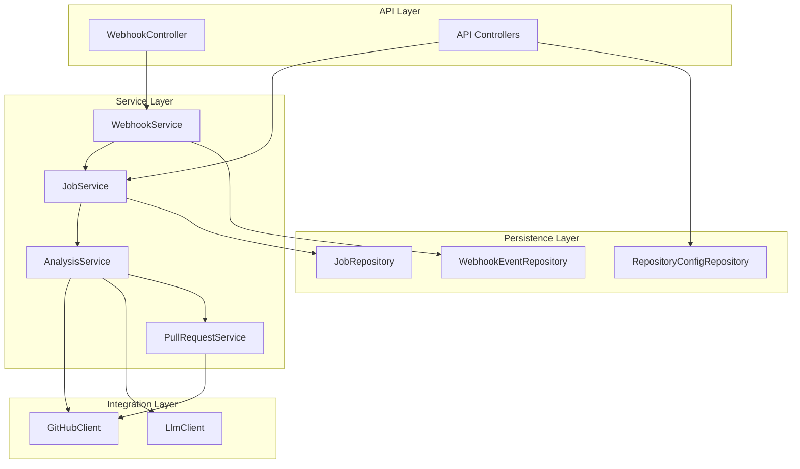

# Contributing to DocSync

Thank you for your interest in contributing to DocSync! This guide covers everything you need to know to contribute effectively.

---

## Table of Contents

- [Getting Started](#getting-started)
- [Development Workflow](#development-workflow)
- [Code Style](#code-style)
- [Architecture Overview](#architecture-overview)
- [How to Add a New Feature](#how-to-add-a-new-feature)
- [Testing Requirements](#testing-requirements)
- [Documentation Requirements](#documentation-requirements)
- [PR Review Checklist](#pr-review-checklist)
- [Release Process](#release-process)
- [Code of Conduct](#code-of-conduct)

---

## Getting Started

### Prerequisites

| Tool           | Version  | Installation                                  |
|----------------|----------|-----------------------------------------------|
| Java (JDK)     | 21+      | [Eclipse Temurin](https://adoptium.net/)       |
| Maven          | 3.9+     | [maven.apache.org](https://maven.apache.org/)  |
| Docker         | 24+      | [docker.com](https://www.docker.com/)          |
| Docker Compose | 2.20+    | Included with Docker Desktop                   |
| Git            | 2.40+    | [git-scm.com](https://git-scm.com/)           |

### Local Setup

1. Fork the repository and clone your fork:
   ```bash
   git clone https://github.com/<your-username>/docsync.git
   cd docsync
   ```

2. Add the upstream remote:
   ```bash
   git remote add upstream https://github.com/<org>/docsync.git
   ```

3. Follow the [Deployment Guide](DEPLOYMENT.md#local-development-setup) to set up your local environment.

4. Verify everything works:
   ```bash
   mvn clean verify
   ```

> [!TIP]
> Integration tests use Testcontainers and require Docker to be running. If you only want to run unit tests during initial setup, use `mvn test`.

---

## Development Workflow

### Branch Naming Convention

```
<type>/<ticket-id>-<short-description>
```

| Type       | Purpose                              | Example                              |
|------------|--------------------------------------|--------------------------------------|
| `feature`  | New functionality                    | `feature/DS-42-webhook-retry-logic`  |
| `bugfix`   | Bug fix                              | `bugfix/DS-108-null-pointer-on-push` |
| `hotfix`   | Urgent production fix                | `hotfix/DS-200-fix-auth-bypass`      |
| `chore`    | Build, CI, dependency updates        | `chore/DS-55-upgrade-spring-boot`    |
| `docs`     | Documentation only changes           | `docs/DS-60-update-api-docs`         |
| `refactor` | Code restructuring, no behavior change | `refactor/DS-77-extract-analyzer`  |

### Commit Conventions

We follow [Conventional Commits](https://www.conventionalcommits.org/):

```
<type>(<scope>): <description>

[optional body]

[optional footer(s)]
```

**Examples:**

```
feat(webhook): add retry mechanism for failed deliveries

Implements exponential backoff with jitter for webhook processing
retries. Maximum 3 retries with a base delay of 5 seconds.

Closes #42
```

```
fix(analysis): handle empty file list in push events

Previously, a push event with no file changes caused a
NullPointerException in the analyzer. Now returns early
with a no-op result.

Fixes #108
```

**Types:**

| Type       | Semantic                    |
|------------|------------------------------|
| `feat`     | New feature                  |
| `fix`      | Bug fix                      |
| `docs`     | Documentation change         |
| `style`    | Formatting, no code change   |
| `refactor` | Code change, no behavior change |
| `test`     | Adding or updating tests     |
| `chore`    | Build, CI, tooling changes   |
| `perf`     | Performance improvement      |

### Workflow Steps

1. **Create a branch** from `main`:
   ```bash
   git checkout main
   git pull upstream main
   git checkout -b feature/DS-42-webhook-retry-logic
   ```

2. **Make your changes** in small, focused commits.

3. **Run tests locally** before pushing:
   ```bash
   mvn clean verify
   ```

4. **Push your branch** and open a pull request:
   ```bash
   git push origin feature/DS-42-webhook-retry-logic
   ```

5. **Address review feedback** with additional commits (do not force-push during review).

6. **Merge** once approved — the maintainer will squash-merge into `main`.

---

## Code Style

### Google Java Style

DocSync follows the [Google Java Style Guide](https://google.github.io/styleguide/javaguide.html) with the following specifics:

| Setting              | Value                                     |
|----------------------|-------------------------------------------|
| Indentation          | 2 spaces (no tabs)                        |
| Max line length      | 120 characters                            |
| Import ordering      | Static imports first, then regular imports, alphabetized |
| Braces               | K&R style (opening brace on same line)    |
| Naming               | `camelCase` for methods/variables, `PascalCase` for classes, `UPPER_SNAKE_CASE` for constants |

### EditorConfig

The repository includes an `.editorconfig` file. Ensure your IDE/editor supports it:

```ini
root = true

[*]
charset = utf-8
end_of_line = lf
indent_style = space
indent_size = 2
insert_final_newline = true
trim_trailing_whitespace = true

[*.java]
indent_size = 2
max_line_length = 120

[*.xml]
indent_size = 4

[*.md]
trim_trailing_whitespace = false
```

### IDE Setup

- **IntelliJ IDEA:** Import the Google Java Style scheme via Settings → Editor → Code Style → Java → Import Scheme. Install the [google-java-format plugin](https://plugins.jetbrains.com/plugin/8527-google-java-format).
- **VS Code:** Install the [EditorConfig extension](https://marketplace.visualstudio.com/items?itemName=EditorConfig.EditorConfig).

### Static Analysis

The build runs these checks automatically:

| Tool         | Purpose              | Config Location              |
|--------------|----------------------|------------------------------|
| Checkstyle   | Style enforcement    | `config/checkstyle.xml`      |
| SpotBugs     | Bug detection        | Maven plugin configuration   |
| PMD          | Code quality rules   | `config/pmd-ruleset.xml`     |

Fix all violations before submitting a PR. Run locally:

```bash
mvn checkstyle:check spotbugs:check pmd:check
```

---

## Architecture Overview

DocSync follows a layered architecture. For the complete design, see [HLD.md](HLD.md).



**Key design principles:**

- Controllers are thin — validation and delegation only
- Services contain business logic
- Repositories handle data access via Spring Data JPA
- External integrations (GitHub, LLM) are behind interfaces for testability
- Jobs are processed asynchronously via a database-backed queue

---

## How to Add a New Feature

Use this checklist when implementing a new feature:

### Planning

- [ ] Create an issue describing the feature, expected behavior, and acceptance criteria
- [ ] Discuss the design in the issue before writing code (for non-trivial features)
- [ ] Identify which architectural layer(s) the feature touches

### Implementation

- [ ] Create a feature branch from `main`
- [ ] Write or update the database migration if schema changes are needed
- [ ] Implement the feature following the existing architectural patterns
- [ ] Add appropriate logging (see [OBSERVABILITY.md](OBSERVABILITY.md#logging-strategy))
- [ ] Add metrics for observable business operations (see [OBSERVABILITY.md](OBSERVABILITY.md#custom-business-metrics))
- [ ] Handle errors gracefully — no swallowed exceptions, no generic catch-all handlers

### Testing

- [ ] Write unit tests for all new service and utility classes (target: >80% line coverage)
- [ ] Write integration tests for new API endpoints and database interactions
- [ ] Test error paths and edge cases, not just the happy path
- [ ] Verify all tests pass: `mvn clean verify`

### Documentation

- [ ] Add/update Javadoc for public classes and methods
- [ ] Update relevant markdown documentation if user-facing behavior changes
- [ ] Update the environment variable reference if new configuration is introduced
- [ ] Add a changelog entry

### PR Submission

- [ ] Self-review your diff before requesting review
- [ ] Ensure CI passes (all checks green)
- [ ] Request review from at least one maintainer

---

## Testing Requirements

### Test Categories

| Category        | Location                     | Tool              | Run Command    |
|-----------------|------------------------------|-------------------|----------------|
| Unit tests      | `src/test/java/**/*Test.java` | JUnit 5, Mockito  | `mvn test`     |
| Integration tests | `src/test/java/**/*IT.java` | Testcontainers    | `mvn verify`   |

### What to Test

| Layer          | Test Focus                                              | Mocking Strategy                |
|----------------|----------------------------------------------------------|---------------------------------|
| Controllers    | Request validation, HTTP status codes, response shape   | Mock services                   |
| Services       | Business logic, edge cases, error handling              | Mock repositories & integrations |
| Repositories   | Custom queries, data mapping                            | Testcontainers (real DB)        |
| Integrations   | API call construction, response parsing, error handling | WireMock or MockWebServer       |
| Jobs           | Lifecycle, retry logic, state transitions               | Mock dependencies               |

### Testing Guidelines

1. **Name tests descriptively:**
   ```java
   @Test
   void processWebhook_withInvalidSignature_returns401() { ... }
   
   @Test
   void analyzeFiles_withEmptyFileList_returnsNoChanges() { ... }
   ```

2. **Use the Arrange-Act-Assert pattern:**
   ```java
   @Test
   void createPullRequest_withValidAnalysis_returnsPrUrl() {
       // Arrange
       var analysis = AnalysisFixtures.completedAnalysis();
       when(githubClient.createPullRequest(any())).thenReturn(new PrResult("https://..."));

       // Act
       var result = service.createPullRequest(analysis);

       // Assert
       assertThat(result.url()).startsWith("https://github.com/");
       verify(githubClient).createPullRequest(any());
   }
   ```

3. **Test edge cases:** null inputs, empty collections, boundary values, concurrent access.

4. **Integration tests must be self-contained:** use `@Testcontainers` for database tests, don't depend on external services.

5. **Never test implementation details:** test behavior and outcomes, not internal method calls.

### Coverage

- **Minimum:** 80% line coverage for new code
- **Measured by:** JaCoCo (integrated into Maven build)
- **View report:** `target/site/jacoco/index.html` after running `mvn verify`

---

## Documentation Requirements

### Code Documentation

- All **public classes** must have a Javadoc class-level comment explaining purpose and usage.
- All **public methods** must have Javadoc with `@param`, `@return`, and `@throws` tags.
- Complex **private methods** should have an inline comment explaining the algorithm or rationale.

### Project Documentation

When your change affects any of the following, update the corresponding docs:

| Change Type                      | Document to Update                     |
|----------------------------------|----------------------------------------|
| New environment variable         | [DEPLOYMENT.md](DEPLOYMENT.md)         |
| New metric or log change         | [OBSERVABILITY.md](OBSERVABILITY.md)   |
| Operational procedure change     | [OPERATIONS_RUNBOOK.md](OPERATIONS_RUNBOOK.md) |
| New API endpoint                 | API documentation (Swagger/OpenAPI)    |
| Architecture change              | [HLD.md](HLD.md)                      |
| New dependency                   | `pom.xml` + relevant docs             |

---

## PR Review Checklist

Reviewers should verify the following before approving:

### Code Quality

- [ ] Code follows Google Java Style and passes static analysis
- [ ] No unnecessary complexity — simple solutions preferred
- [ ] Error handling is appropriate (no swallowed exceptions, meaningful error messages)
- [ ] No hardcoded secrets, URLs, or environment-specific values

### Correctness

- [ ] Feature works as described in the issue/PR description
- [ ] Edge cases are handled
- [ ] Database migrations are backward-compatible
- [ ] No breaking changes to public APIs without a migration path

### Testing

- [ ] New code has adequate test coverage (>80%)
- [ ] Tests are meaningful (not just for coverage)
- [ ] Integration tests use Testcontainers (not external services)
- [ ] All existing tests still pass

### Security

- [ ] No secrets or credentials in code or logs
- [ ] Input validation is present for all external inputs
- [ ] Webhook signature verification is not bypassed
- [ ] No SQL injection, XSS, or other OWASP Top 10 vulnerabilities

### Observability

- [ ] Appropriate log statements added (info for business events, error for failures)
- [ ] No sensitive data logged (see [OBSERVABILITY.md](OBSERVABILITY.md#what-to-log))
- [ ] Metrics added for new business operations where applicable

### Documentation

- [ ] Javadoc added for public APIs
- [ ] Project documentation updated if behavior changed
- [ ] PR description clearly explains the "what" and "why"

---

## Release Process

### Versioning

DocSync follows [Semantic Versioning](https://semver.org/):

- **MAJOR** (`X.0.0`): Breaking API changes, incompatible database migrations
- **MINOR** (`0.X.0`): New features, backward-compatible
- **PATCH** (`0.0.X`): Bug fixes, performance improvements

### Release Steps

1. **Ensure `main` is stable:** all CI checks green, no known critical issues.

2. **Update the version:**
   ```bash
   mvn versions:set -DnewVersion=1.2.0
   mvn versions:commit
   ```

3. **Update `CHANGELOG.md`:** move items from `Unreleased` to the new version section with the release date.

4. **Create a release commit:**
   ```bash
   git add -A
   git commit -m "chore(release): v1.2.0"
   ```

5. **Tag the release:**
   ```bash
   git tag -a v1.2.0 -m "Release v1.2.0"
   git push upstream main --tags
   ```

6. **CI builds and publishes:**
   - Docker image tagged as `docsync:1.2.0` and `docsync:latest`
   - GitHub Release created automatically from the tag

7. **Deploy to production** following the [Deployment Guide](DEPLOYMENT.md).

### Hotfix Process

For urgent production fixes:

1. Branch from the release tag: `git checkout -b hotfix/DS-200-fix-auth v1.2.0`
2. Apply the fix with tests.
3. Bump the patch version: `1.2.0` → `1.2.1`
4. Merge into `main` and tag.
5. Deploy immediately.

---

## Code of Conduct

This project follows the [Contributor Covenant Code of Conduct](https://www.contributor-covenant.org/version/2/1/code_of_conduct/).

### Summary

- **Be respectful** and constructive in all interactions.
- **Be inclusive** — welcome contributors of all experience levels and backgrounds.
- **Focus on the work** — technical disagreements are healthy; personal attacks are not.
- **Report issues** — if you witness or experience unacceptable behavior, report it to the maintainers at `conduct@docsync.dev`.

Violations may result in temporary or permanent exclusion from the project.
