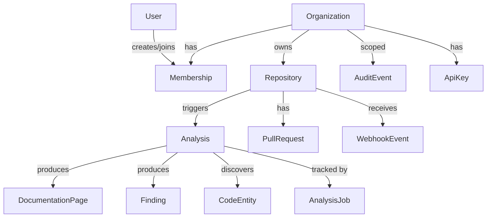
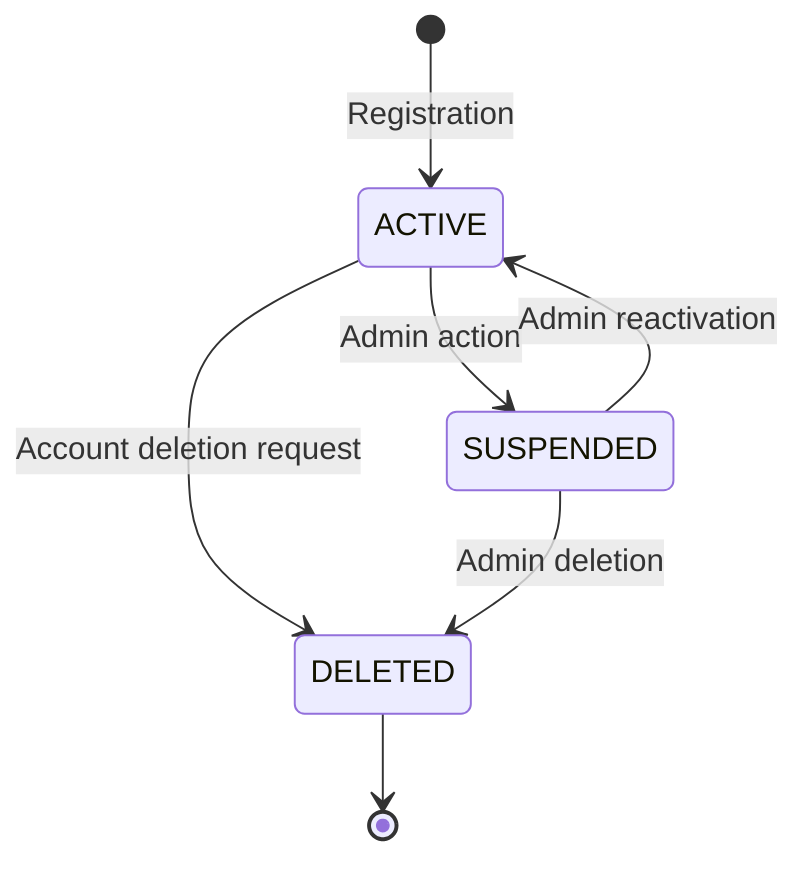
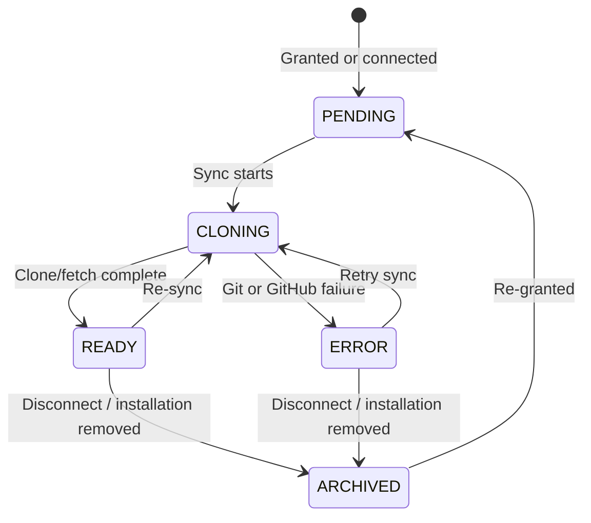
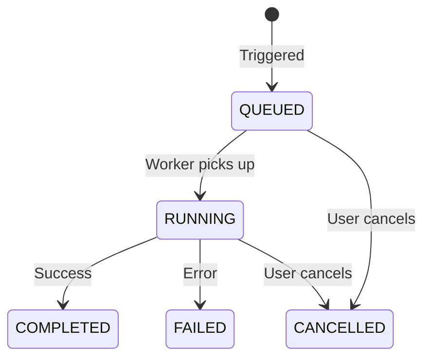
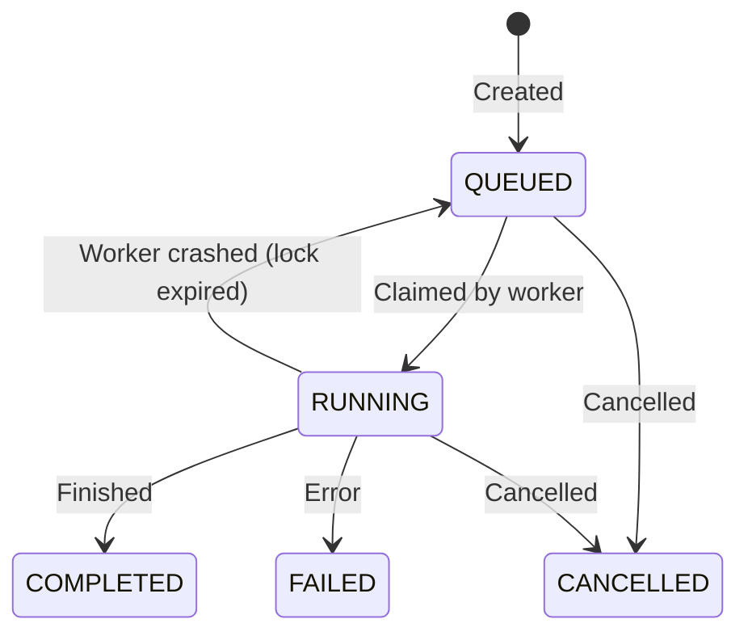
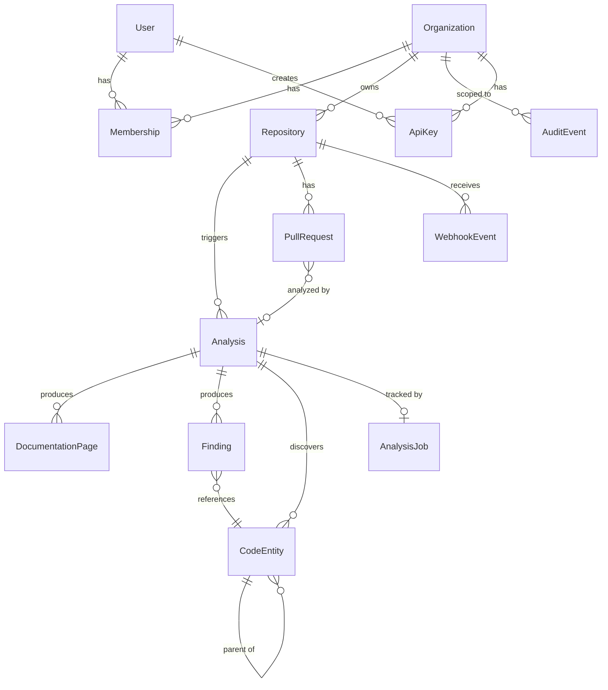

# DocSync Data Model

> Persistence: Spring Data JPA + PostgreSQL 16 | Migrations: Flyway | IDs: UUID v4

## Table of Contents

- [Entity Ownership Hierarchy](#entity-ownership-hierarchy)
- [Entity Definitions](#entity-definitions)
- [Persistence Strategy](#persistence-strategy)
- [Migration Strategy](#migration-strategy)
- [Entity Lifecycle Rules](#entity-lifecycle-rules)
- [Soft Delete vs Hard Delete](#soft-delete-vs-hard-delete)
- [JSONB Usage Guidelines](#jsonb-usage-guidelines)
- [Optimistic Locking](#optimistic-locking)
- [Data Access Conventions](#data-access-conventions)
- [Retention Policies](#retention-policies)
- [Index Strategy](#index-strategy)
- [ID Generation Strategy](#id-generation-strategy)

---

## Entity Ownership Hierarchy



**Tenant Isolation Rule:** Every query that returns data **must** filter by `organizationId`. There are no cross-organization queries outside of platform administration.

---

## Entity Definitions

### User

| Column        | Type         | Constraints                    | Description                     |
| ------------- | ------------ | ------------------------------ | ------------------------------- |
| `id`          | `UUID`       | PK                             | Unique user identifier          |
| `email`       | `VARCHAR(255)` | UNIQUE, NOT NULL             | Login email                     |
| `display_name`| `VARCHAR(100)` | NOT NULL                     | Display name                    |
| `avatar_url`  | `VARCHAR(512)` |                              | Profile image URL               |
| `password_hash` | `VARCHAR(255)` | NULL                       | bcrypt hash; null for GitHub-only accounts |
| `github_id`   | `BIGINT`      | UNIQUE                       | GitHub numeric user ID          |
| `github_login`| `VARCHAR(255)` |                             | GitHub username                 |
| `status`      | `VARCHAR(20)` | NOT NULL, DEFAULT 'ACTIVE'    | `ACTIVE`, `SUSPENDED`, `DELETED`|
| `created_at`  | `TIMESTAMPTZ` | NOT NULL                     | Account creation time           |
| `updated_at`  | `TIMESTAMPTZ` | NOT NULL                     | Last profile update             |
| `version`     | `BIGINT`      | NOT NULL, DEFAULT 0           | Optimistic lock version         |

**Index:** case-insensitive unique index on `LOWER(email)` (emails are normalised to lowercase on write).

---

### Organization

| Column           | Type           | Constraints                  | Description                    |
| ---------------- | -------------- | ---------------------------- | ------------------------------ |
| `id`             | `UUID`         | PK                           | Unique org identifier          |
| `name`           | `VARCHAR(100)` | NOT NULL                     | Display name                   |
| `slug`           | `VARCHAR(100)` | UNIQUE, NOT NULL             | URL-safe identifier            |
| `plan`           | `VARCHAR(20)`  | NOT NULL, DEFAULT 'FREE'     | `FREE`, `TEAM`, `ENTERPRISE`  |
| `billing_email`  | `VARCHAR(255)` |                              | Billing contact                |
| `created_at`     | `TIMESTAMPTZ`  | NOT NULL                     | Creation time                  |
| `updated_at`     | `TIMESTAMPTZ`  | NOT NULL                     | Last update                    |

---

### Membership

| Column            | Type          | Constraints                           | Description                    |
| ----------------- | ------------- | ------------------------------------- | ------------------------------ |
| `id`              | `UUID`        | PK                                    | Unique membership ID           |
| `user_id`         | `UUID`        | FK → User, NOT NULL                   | Member user                    |
| `organization_id` | `UUID`        | FK → Organization, NOT NULL           | Owning organization            |
| `role`            | `VARCHAR(20)` | NOT NULL                              | `OWNER`, `ADMIN`, `MEMBER`, `VIEWER` |
| `status`          | `VARCHAR(20)` | NOT NULL, DEFAULT 'ACTIVE'            | `PENDING`, `ACTIVE`, `REMOVED` |
| `joined_at`       | `TIMESTAMPTZ` | NOT NULL                              | When accepted/created          |

**Unique constraint:** `(user_id, organization_id)`

---

### Repository

| Column             | Type           | Constraints                        | Description                          |
| ------------------ | -------------- | ---------------------------------- | ------------------------------------ |
| `id`               | `UUID`         | PK                                 | Unique repo identifier               |
| `organization_id`  | `UUID`         | FK → Organization, NOT NULL        | Owning organization                  |
| `connection_id`    | `UUID`         | FK → RepositoryConnection, NOT NULL | Installation link                   |
| `provider`         | `VARCHAR(20)`  | NOT NULL                           | `GITHUB`                             |
| `installation_id`  | `BIGINT`       | NOT NULL                           | GitHub App installation ID           |
| `external_id`      | `BIGINT`       | NOT NULL                           | GitHub repository ID                 |
| `name`             | `VARCHAR(255)` | NOT NULL                           | Repository name (e.g., `backend-api`)|
| `full_name`        | `VARCHAR(512)` | NOT NULL                           | Full name (e.g., `acme-corp/backend-api`) |
| `clone_url`        | `VARCHAR(1024)`|                                    | Informational HTTPS clone URL        |
| `default_branch`   | `VARCHAR(100)` | NOT NULL, DEFAULT 'main'           | Branch to analyze/monitor            |
| `status`           | `VARCHAR(20)`  | NOT NULL, DEFAULT 'PENDING'        | `PENDING`, `CLONING`, `INDEXING`, `READY`, `ERROR`, `ARCHIVED` |
| `configuration`    | `JSONB`        | NOT NULL, DEFAULT '{}'             | Analysis configuration (see JSONB section) |
| `error_message`    | `TEXT`         |                                    | Last sync/clone failure (sanitized)  |
| `last_synced_at`   | `TIMESTAMPTZ`  |                                    | Last successful clone/fetch          |
| `last_commit_sha`  | `VARCHAR(40)`  |                                    | HEAD commit at last sync             |
| `last_analysis_at` | `TIMESTAMPTZ`  |                                    | Most recent completed analysis       |
| `created_at`       | `TIMESTAMPTZ`  | NOT NULL                           | Connection time                      |
| `updated_at`       | `TIMESTAMPTZ`  | NOT NULL                           | Last update                          |
| `version`          | `BIGINT`       | NOT NULL, DEFAULT 0                | Optimistic lock version              |

**Unique constraint:** `(organization_id, provider, external_id)`

---

### RepositoryConnection

A GitHub App installation. It may exist without an organization link (`PENDING`) until the
installer claims it or a webhook auto-links it. Installation tokens are **never** stored.

| Column                | Type           | Constraints                       | Description                       |
| --------------------- | -------------- | --------------------------------- | --------------------------------- |
| `id`                  | `UUID`         | PK                                | Unique connection ID              |
| `organization_id`     | `UUID`         | FK → Organization, nullable       | Linked tenant (null = pending)    |
| `provider`            | `VARCHAR(20)`  | NOT NULL                          | `GITHUB`                          |
| `installation_id`     | `BIGINT`       | NOT NULL                          | GitHub App installation ID        |
| `account_login`       | `VARCHAR(255)` |                                   | Installing account login          |
| `account_type`        | `VARCHAR(50)`  |                                   | `User` or `Organization`          |
| `installer_github_id` | `BIGINT`       |                                   | GitHub user who installed the App |
| `status`              | `VARCHAR(20)`  | NOT NULL, DEFAULT 'PENDING'       | `PENDING`, `ACTIVE`, `SUSPENDED`, `REVOKED`, `ERROR` |
| `created_at`          | `TIMESTAMPTZ`  | NOT NULL                          | First observed                    |
| `updated_at`          | `TIMESTAMPTZ`  | NOT NULL                          | Last update                       |
| `version`             | `BIGINT`       | NOT NULL, DEFAULT 0               | Optimistic lock version           |

**Unique constraint:** `(provider, installation_id)`

---

### Analysis

| Column           | Type           | Constraints                      | Description                        |
| ---------------- | -------------- | -------------------------------- | ---------------------------------- |
| `id`             | `UUID`         | PK                               | Unique analysis ID                 |
| `repository_id`  | `UUID`         | FK → Repository, NOT NULL        | Analyzed repository                |
| `branch`         | `VARCHAR(255)` | NOT NULL                         | Branch analyzed                    |
| `commit_sha`     | `VARCHAR(40)`  | NOT NULL                         | Commit analyzed                    |
| `scope`          | `VARCHAR(20)`  | NOT NULL                         | `FULL`, `INCREMENTAL`             |
| `status`         | `VARCHAR(20)`  | NOT NULL, DEFAULT 'QUEUED'       | `QUEUED`, `RUNNING`, `COMPLETED`, `FAILED` |
| `stats`          | `JSONB`        |                                  | Analysis statistics (counts, duration) |
| `error_message`  | `TEXT`         |                                  | Failure reason if `FAILED`         |
| `job_id`         | `UUID`         | FK → AnalysisJob                 | Associated background job          |
| `created_at`     | `TIMESTAMPTZ`  | NOT NULL                         | When queued                        |
| `started_at`     | `TIMESTAMPTZ`  |                                  | When processing began              |
| `completed_at`   | `TIMESTAMPTZ`  |                                  | When processing finished           |

---

### DocumentationPage

| Column            | Type           | Constraints                      | Description                        |
| ----------------- | -------------- | -------------------------------- | ---------------------------------- |
| `id`              | `UUID`         | PK                               | Unique page ID                     |
| `repository_id`   | `UUID`         | FK → Repository, NOT NULL        | Owning repository                  |
| `analysis_id`     | `UUID`         | FK → Analysis, NOT NULL          | Analysis that generated this page  |
| `title`           | `VARCHAR(255)` | NOT NULL                         | Page title                         |
| `type`            | `VARCHAR(30)`  | NOT NULL                         | `API_REFERENCE`, `GUIDE`, `ARCHITECTURE`, `DATA_MODEL` |
| `path`            | `VARCHAR(512)` | NOT NULL                         | Logical path in doc tree           |
| `content`         | `TEXT`         | NOT NULL                         | Rendered Markdown content          |
| `format`          | `VARCHAR(20)`  | NOT NULL, DEFAULT 'MARKDOWN'     | Content format                     |
| `provenance_method` | `VARCHAR(30)` | NOT NULL                        | `DETERMINISTIC`, `AI_ASSISTED`     |
| `provenance_confidence` | `DECIMAL(3,2)` |                             | Confidence score (0.00–1.00)       |
| `created_at`      | `TIMESTAMPTZ`  | NOT NULL                         | Generation time                    |
| `updated_at`      | `TIMESTAMPTZ`  | NOT NULL                         | Last regeneration                  |

**Unique constraint:** `(repository_id, path)`

---

### CodeEntity

| Column            | Type           | Constraints                      | Description                        |
| ----------------- | -------------- | -------------------------------- | ---------------------------------- |
| `id`              | `UUID`         | PK                               | Unique entity ID                   |
| `repository_id`   | `UUID`         | FK → Repository, NOT NULL        | Owning repository                  |
| `analysis_id`     | `UUID`         | FK → Analysis, NOT NULL          | Discovery analysis                 |
| `type`            | `VARCHAR(30)`  | NOT NULL                         | `CLASS`, `INTERFACE`, `METHOD`, `FIELD`, `ENDPOINT`, `ENUM` |
| `qualified_name`  | `VARCHAR(1000)`| NOT NULL                         | Fully qualified name               |
| `simple_name`     | `VARCHAR(255)` | NOT NULL                         | Short name                         |
| `file_path`       | `VARCHAR(1000)`| NOT NULL                         | Source file path                   |
| `line_number`     | `INTEGER`      |                                  | Start line in source               |
| `modifiers`       | `VARCHAR(100)` |                                  | `public`, `static`, etc.           |
| `signature`       | `TEXT`         |                                  | Method/constructor signature       |
| `javadoc`         | `TEXT`         |                                  | Existing documentation             |
| `parent_entity_id`| `UUID`         | FK → CodeEntity (self)           | Enclosing class/interface          |
| `created_at`      | `TIMESTAMPTZ`  | NOT NULL                         | Discovery time                     |

---

### Finding

| Column            | Type           | Constraints                      | Description                        |
| ----------------- | -------------- | -------------------------------- | ---------------------------------- |
| `id`              | `UUID`         | PK                               | Unique finding ID                  |
| `repository_id`   | `UUID`         | FK → Repository, NOT NULL        | Owning repository                  |
| `analysis_id`     | `UUID`         | FK → Analysis, NOT NULL          | Producing analysis                 |
| `severity`        | `VARCHAR(20)`  | NOT NULL                         | `CRITICAL`, `WARNING`, `INFO`      |
| `category`        | `VARCHAR(30)`  | NOT NULL                         | `MISSING_DOCS`, `OUTDATED`, `INCONSISTENT`, `INCOMPLETE` |
| `title`           | `VARCHAR(255)` | NOT NULL                         | Short summary                      |
| `description`     | `TEXT`         | NOT NULL                         | Detailed explanation               |
| `entity_id`       | `UUID`         | FK → CodeEntity                  | Related code entity                |
| `file_path`       | `VARCHAR(1000)`|                                  | Source file                        |
| `line_number`     | `INTEGER`      |                                  | Source line                        |
| `status`          | `VARCHAR(20)`  | NOT NULL, DEFAULT 'OPEN'         | `OPEN`, `RESOLVED`, `IGNORED`      |
| `created_at`      | `TIMESTAMPTZ`  | NOT NULL                         | Detection time                     |
| `updated_at`      | `TIMESTAMPTZ`  | NOT NULL                         | Last status change                 |

---

### AnalysisJob

| Column            | Type           | Constraints                      | Description                        |
| ----------------- | -------------- | -------------------------------- | ---------------------------------- |
| `id`              | `UUID`         | PK                               | Unique job ID                      |
| `type`            | `VARCHAR(30)`  | NOT NULL                         | `ANALYSIS`, `DOCUMENTATION_GENERATION`, `REPOSITORY_SYNC` |
| `status`          | `VARCHAR(20)`  | NOT NULL, DEFAULT 'QUEUED'       | `QUEUED`, `RUNNING`, `COMPLETED`, `FAILED`, `CANCELLED` |
| `priority`        | `INTEGER`      | NOT NULL, DEFAULT 0              | Higher = more urgent               |
| `progress_current`| `INTEGER`      |                                  | Current step count                 |
| `progress_total`  | `INTEGER`      |                                  | Total step count                   |
| `current_step`    | `VARCHAR(255)` |                                  | Human-readable step description    |
| `metadata`        | `JSONB`        |                                  | Job-specific data (repo ID, branch, etc.) |
| `error_message`   | `TEXT`         |                                  | Failure details                    |
| `locked_by`       | `VARCHAR(255)` |                                  | Worker instance ID that claimed this job |
| `locked_at`       | `TIMESTAMPTZ`  |                                  | When the job was claimed           |
| `created_at`      | `TIMESTAMPTZ`  | NOT NULL                         | When enqueued                      |
| `started_at`      | `TIMESTAMPTZ`  |                                  | When processing began              |
| `completed_at`    | `TIMESTAMPTZ`  |                                  | When processing finished           |
| `version`         | `INTEGER`      | NOT NULL, DEFAULT 0              | Optimistic lock for job claiming   |

---

### PullRequest

| Column            | Type           | Constraints                      | Description                        |
| ----------------- | -------------- | -------------------------------- | ---------------------------------- |
| `id`              | `UUID`         | PK                               | Unique PR record ID                |
| `repository_id`   | `UUID`         | FK → Repository, NOT NULL        | Owning repository                  |
| `pr_number`       | `INTEGER`      | NOT NULL                         | GitHub PR number                   |
| `title`           | `VARCHAR(500)` | NOT NULL                         | PR title                           |
| `author`          | `VARCHAR(255)` | NOT NULL                         | PR author login                    |
| `status`          | `VARCHAR(20)`  | NOT NULL                         | `OPEN`, `MERGED`, `CLOSED`         |
| `head_branch`     | `VARCHAR(255)` | NOT NULL                         | Source branch                      |
| `base_branch`     | `VARCHAR(255)` | NOT NULL                         | Target branch                      |
| `head_sha`        | `VARCHAR(40)`  | NOT NULL                         | Head commit SHA                    |
| `analysis_id`     | `UUID`         | FK → Analysis                    | Associated analysis (if any)       |
| `created_at`      | `TIMESTAMPTZ`  | NOT NULL                         | When PR was received               |
| `updated_at`      | `TIMESTAMPTZ`  | NOT NULL                         | Last update                        |

**Unique constraint:** `(repository_id, pr_number)`

---

### WebhookEvent

| Column            | Type           | Constraints                      | Description                        |
| ----------------- | -------------- | -------------------------------- | ---------------------------------- |
| `id`              | `UUID`         | PK                               | Unique event ID                    |
| `provider`        | `VARCHAR(20)`  | NOT NULL                         | `GITHUB`                           |
| `delivery_id`     | `VARCHAR(255)` | NOT NULL                         | Provider's delivery identifier     |
| `event_type`      | `VARCHAR(50)`  | NOT NULL                         | `push`, `pull_request`, etc.       |
| `repository_id`   | `UUID`         | FK → Repository                  | Matched repository (if resolved)   |
| `payload`         | `JSONB`        | NOT NULL                         | Raw webhook payload                |
| `processing_status` | `VARCHAR(20)` | NOT NULL, DEFAULT 'RECEIVED'    | `RECEIVED`, `PROCESSED`, `IGNORED`, `FAILED` |
| `error_message`   | `TEXT`         |                                  | Processing failure details         |
| `received_at`     | `TIMESTAMPTZ`  | NOT NULL                         | When received                      |
| `processed_at`    | `TIMESTAMPTZ`  |                                  | When processing completed          |
| `created_at`      | `TIMESTAMPTZ`  | NOT NULL                         | Record creation time               |
| `updated_at`      | `TIMESTAMPTZ`  | NOT NULL                         | Last update                        |
| `version`         | `BIGINT`       | NOT NULL, DEFAULT 0              | Optimistic lock version            |

**Unique constraint:** `(provider, delivery_id)` makes GitHub retries idempotent.

---

### AuditEvent

| Column            | Type           | Constraints                      | Description                        |
| ----------------- | -------------- | -------------------------------- | ---------------------------------- |
| `id`              | `UUID`         | PK                               | Unique audit ID                    |
| `organization_id` | `UUID`         | FK → Organization, NOT NULL      | Tenant scope                       |
| `actor_id`        | `UUID`         | FK → User                        | Who performed the action           |
| `actor_type`      | `VARCHAR(20)`  | NOT NULL                         | `USER`, `SYSTEM`, `API_KEY`        |
| `action`          | `VARCHAR(50)`  | NOT NULL                         | `MEMBER_ADDED`, `REPO_CONNECTED`, `ANALYSIS_TRIGGERED`, etc. |
| `resource_type`   | `VARCHAR(50)`  | NOT NULL                         | Entity type affected               |
| `resource_id`     | `UUID`         |                                  | Entity ID affected                 |
| `details`         | `JSONB`        |                                  | Action-specific metadata           |
| `ip_address`      | `VARCHAR(45)`  |                                  | Client IP (IPv4 or IPv6)           |
| `created_at`      | `TIMESTAMPTZ`  | NOT NULL                         | When the event occurred            |

---

### ApiKey

| Column            | Type           | Constraints                      | Description                        |
| ----------------- | -------------- | -------------------------------- | ---------------------------------- |
| `id`              | `UUID`         | PK                               | Unique key ID                      |
| `organization_id` | `UUID`         | FK → Organization, NOT NULL      | Owning organization                |
| `created_by`      | `UUID`         | FK → User, NOT NULL              | User who created the key           |
| `name`            | `VARCHAR(100)` | NOT NULL                         | Human-readable label               |
| `key_hash`        | `VARCHAR(255)` | NOT NULL                         | SHA-256 hash of the key            |
| `key_prefix`      | `VARCHAR(12)`  | NOT NULL                         | First 12 chars for identification  |
| `role`            | `VARCHAR(20)`  | NOT NULL                         | `ADMIN`, `MEMBER`, `VIEWER`        |
| `last_used_at`    | `TIMESTAMPTZ`  |                                  | Last successful authentication     |
| `expires_at`      | `TIMESTAMPTZ`  |                                  | Optional expiration                |
| `revoked_at`      | `TIMESTAMPTZ`  |                                  | When revoked (null = active)       |
| `created_at`      | `TIMESTAMPTZ`  | NOT NULL                         | Creation time                      |

---

## Persistence Strategy

### Technology Stack

- **ORM:** Spring Data JPA (Hibernate 6.x)
- **Database:** PostgreSQL 16
- **Connection Pool:** HikariCP (default Spring Boot pool)
- **Schema Management:** Flyway

### JPA Configuration

```yaml
spring:
  jpa:
    hibernate:
      ddl-auto: validate  # Never auto-create; Flyway manages schema
    properties:
      hibernate:
        dialect: org.hibernate.dialect.PostgreSQLDialect
        jdbc.time_zone: UTC
        default_schema: public
```

> [!IMPORTANT]
> `ddl-auto` is set to `validate` in all environments. Flyway is the **sole** mechanism for schema changes. Hibernate validates the mapping at startup and fails fast if there's a mismatch.

---

## Migration Strategy

### Flyway Convention

All migrations live in `src/main/resources/db/migration/` and follow the naming convention:

```
V{version}__{description}.sql
```

**Examples:**

```
V1__initial_schema.sql
V2__identity_and_organizations.sql
V3__repository_onboarding.sql
```

### Migration Rules

1. **Migrations are immutable.** Once committed to `main`, never modify a migration file.
2. **Backward-compatible only.** Every migration must be deployable without downtime:
   - Add columns as `NULL` or with a `DEFAULT`.
   - Never drop columns in the same release that removes code using them. Use a two-phase approach.
   - Rename via add-new → backfill → migrate-code → drop-old.
3. **One concern per migration.** Separate table creation, index addition, and data backfills.
4. **Test migrations locally.** Run `flyway validate` and `flyway migrate` against a fresh database before merging.
5. **Use repeatable migrations** (`R__`) only for views and stored functions, never for table structures.

---

## Entity Lifecycle Rules

### User



- **DELETED** users are soft-deleted (status field) and their personal data is anonymized after 30 days.
- Email is released for re-registration after anonymization.

### Repository



- `INDEXING` is reserved for the analysis pipeline; M2 completes at `READY` after checkout.
- **ARCHIVED** repositories retain their metadata, stop receiving processing, and have their
  local workspace removed best-effort. They are restored to `PENDING` when re-granted.
- Disconnect is currently a soft archive. Hard deletion of analysis/documentation data is
  handled by the retention jobs delivered with the later analysis milestones.

### Analysis



- Only one `QUEUED` or `RUNNING` analysis is allowed per repository at a time.
- **FAILED** analyses retain their `error_message` for debugging. No partial documentation is published.

### AnalysisJob



- Job claiming is protected by optimistic locking on the `version` field.
- Stale locks (worker crash) are detected by a sweeper that requeues jobs where `locked_at` is older than 5 minutes and status is `RUNNING`.

---

## Soft Delete vs Hard Delete

| Entity             | Strategy     | Rationale                                                        |
| ------------------ | ------------ | ---------------------------------------------------------------- |
| User               | **Soft**     | Retain audit trail; anonymize PII after 30 days                  |
| Organization       | **Soft**     | Billing records and audit history must survive deletion           |
| Membership         | **Soft**     | Track when members were removed for audit purposes               |
| Repository         | **Soft**     | `ARCHIVED` keeps metadata for re-grant; workspace removed, downstream data handled by analysis retention |
| RepositoryConnection | **Soft**   | `REVOKED` preserves installation history and audit trail    |
| Analysis           | **Hard**     | Cascaded from repository; old analyses pruned by retention policy |
| DocumentationPage  | **Hard**     | Replaced entirely on each analysis; no versioning at DB level    |
| CodeEntity         | **Hard**     | Refreshed per analysis—previous batch deleted before insert      |
| Finding            | **Hard**     | Regenerated per analysis; status tracking is per-analysis        |
| AnalysisJob        | **Hard**     | Pruned by retention policy (90 days)                             |
| PullRequest        | **Hard**     | Cascaded from repository                                         |
| WebhookEvent       | **Hard**     | Pruned by retention policy (30 days)                             |
| AuditEvent         | **Hard**     | Pruned by retention policy (1 year); no soft delete needed       |
| ApiKey             | **Soft**     | `revoked_at` acts as soft delete; retains key metadata for audit |

---

## JSONB Usage Guidelines

JSONB columns are used **only** for genuinely flexible or semi-structured data. Do not use JSONB as a substitute for relational columns.

> [!WARNING]
> Avoid storing data in JSONB if you need to filter, sort, or join on it frequently. If you find yourself writing `jsonb_extract_path` in WHERE clauses regularly, promote the field to a proper column.

### Approved JSONB Columns

| Table          | Column          | Contents                                                            |
| -------------- | --------------- | ------------------------------------------------------------------- |
| Repository     | `configuration` | `{"autoAnalyze": true, "analyzePullRequests": true, "languages": ["java"], "excludePaths": ["**/test/**"]}` |
| Analysis       | `stats`         | `{"filesAnalyzed": 128, "entitiesFound": 342, "findingsCount": 15, "pagesGenerated": 48, "durationMs": 45200}` |
| AnalysisJob    | `metadata`      | `{"repositoryId": "...", "analysisId": "...", "branch": "main"}` — varies by job type |
| WebhookEvent   | `payload`       | Raw webhook payload from GitHub (opaque blob, queried only by delivery_id) |
| AuditEvent     | `details`       | Action-specific context: `{"previousRole": "MEMBER", "newRole": "ADMIN"}` |

### Validation Rules

- JSONB columns storing application config (e.g., `configuration`) **must** be validated at the application layer before persistence using Jakarta Validation or a dedicated validator.
- Raw external payloads (e.g., `WebhookEvent.payload`) are stored as-is and validated only during processing.
- Avoid deeply nested JSONB structures (max 2 levels deep).

---

## Optimistic Locking

Entities that are frequently updated concurrently use JPA `@Version` fields to prevent lost updates.

### Entities with Optimistic Locking

| Entity       | Column    | Rationale                                          |
| ------------ | --------- | -------------------------------------------------- |
| Repository   | `version` | Configuration updates and status transitions       |
| AnalysisJob  | `version` | Worker claiming and progress updates               |

### Implementation Pattern

```java
@Entity
@Table(name = "repositories")
public class Repository {
    
    @Id
    private UUID id;
    
    @Version
    private Integer version;
    
    // ... other fields
}
```

When a concurrent modification is detected, Hibernate throws `OptimisticLockException`. The service layer catches this and returns HTTP `409 Conflict` with error code `ERR_CONFLICT`.

> [!NOTE]
> Entities like Analysis and DocumentationPage follow an append-only or replace-entirely pattern and do not need optimistic locking. Their state transitions are single-writer (the processing worker).

---

## Data Access Conventions

### Repository Interfaces

Every entity has a Spring Data repository interface:

```java
public interface RepositoryRepository extends JpaRepository<Repository, UUID> {
    
    // Always filter by organizationId for tenant isolation
    Page<Repository> findByOrganizationId(UUID organizationId, Pageable pageable);
    
    Optional<Repository> findByIdAndOrganizationId(UUID id, UUID organizationId);
    
    Page<Repository> findByOrganizationIdAndStatus(
        UUID organizationId, RepositoryStatus status, Pageable pageable);
}
```

### Query Rules

1. **Tenant isolation is mandatory.** Every repository method that returns data **must** include `organizationId` as a parameter. The service layer resolves the caller's `organizationId` from the security context and passes it to the repository.

2. **Use derived queries** for simple lookups (Spring Data generates them from method names).

3. **Use `@Query`** for complex joins or aggregations:

   ```java
   @Query("""
       SELECT new com.docsync.dto.FindingSummary(
           f.severity, COUNT(f)
       )
       FROM Finding f
       WHERE f.repositoryId = :repoId
         AND f.analysis.repository.organizationId = :orgId
       GROUP BY f.severity
       """)
   List<FindingSummary> findSeveritySummary(
       @Param("orgId") UUID orgId, @Param("repoId") UUID repoId);
   ```

4. **Pagination** uses Spring's `Pageable`:

   ```java
   Page<Analysis> findByRepositoryIdOrderByCreatedAtDesc(
       UUID repositoryId, Pageable pageable);
   ```

5. **Avoid N+1 queries.** Use `@EntityGraph` or `JOIN FETCH` for known association traversals:

   ```java
   @EntityGraph(attributePaths = {"repository"})
   Optional<Analysis> findWithRepositoryById(UUID id);
   ```

6. **Projections for read-only views.** Use interface projections or DTOs for list endpoints to avoid loading unnecessary columns.

---

## Retention Policies

Data retention is enforced by a scheduled job (`RetentionCleanupJob`) that runs daily at 02:00 UTC.

| Data                     | Retention Period | Cleanup Action                                    |
| ------------------------ | --------------- | ------------------------------------------------- |
| WebhookEvent payloads    | 30 days         | Hard delete where `received_at < now() - 30 days` |
| AnalysisJob details      | 90 days         | Hard delete where `completed_at < now() - 90 days` and status is terminal |
| AuditEvent               | 1 year          | Hard delete where `created_at < now() - 1 year`   |
| CodeEntity               | Per analysis    | Previous batch deleted when a new analysis completes for the same repository |
| Soft-deleted Users (PII) | 30 days         | Anonymize `email`, `display_name`, `avatar_url` after 30 days in `DELETED` status |

> [!CAUTION]
> The retention cleanup job uses batch deletes with a configurable batch size (default: 1000 rows per batch) to avoid long-running transactions and table locks. Monitor `retention_cleanup_duration_seconds` and `retention_cleanup_rows_deleted` metrics.

### Implementation

```java
@Component
public class RetentionCleanupJob {
    
    @Scheduled(cron = "0 0 2 * * *")  // Daily at 02:00 UTC
    @Transactional
    public void cleanup() {
        webhookEventRepository.deleteByReceivedAtBefore(
            Instant.now().minus(30, ChronoUnit.DAYS));
        
        analysisJobRepository.deleteByCompletedAtBeforeAndStatusIn(
            Instant.now().minus(90, ChronoUnit.DAYS),
            List.of(JobStatus.COMPLETED, JobStatus.FAILED, JobStatus.CANCELLED));
        
        auditEventRepository.deleteByCreatedAtBefore(
            Instant.now().minus(365, ChronoUnit.DAYS));
    }
}
```

---

## Index Strategy

Indexes are created for columns used in WHERE clauses, JOIN conditions, and ORDER BY of frequent queries.

### Primary Indexes (Created by Constraints)

All `PRIMARY KEY` and `UNIQUE` constraints automatically create indexes.

### Secondary Indexes

| Table             | Index                                              | Type    | Rationale                                |
| ----------------- | -------------------------------------------------- | ------- | ---------------------------------------- |
| Membership        | `(organization_id, role)`                          | B-tree  | Filter members by org and role           |
| Membership        | `(user_id)`                                        | B-tree  | Find all orgs a user belongs to          |
| Repository        | `(organization_id, status)`                        | B-tree  | List repos by org filtered by status     |
| Repository        | `(provider, external_id)`                          | B-tree  | Webhook lookup by GitHub repo ID         |
| Analysis          | `(repository_id, created_at DESC)`                 | B-tree  | List analyses by repo, newest first      |
| Analysis          | `(repository_id, status)`                          | B-tree  | Find running/queued analysis for a repo  |
| DocumentationPage | `(repository_id, path)`                            | B-tree  | Lookup doc page by repo and path         |
| DocumentationPage | `(repository_id, type)`                            | B-tree  | Filter pages by type                     |
| CodeEntity        | `(repository_id, analysis_id)`                     | B-tree  | Batch delete on re-analysis              |
| CodeEntity        | `(repository_id, type, qualified_name)`            | B-tree  | Entity lookup by name and type           |
| Finding           | `(repository_id, status, severity)`                | B-tree  | Dashboard queries                        |
| Finding           | `(analysis_id)`                                    | B-tree  | Link findings to analysis                |
| AnalysisJob       | `(status, priority DESC, created_at ASC)`          | B-tree  | Worker polling for next job              |
| AnalysisJob       | `(status, locked_at)`                              | B-tree  | Stale lock detection                     |
| PullRequest       | `(repository_id, status)`                          | B-tree  | List PRs by repo and status              |
| WebhookEvent      | `(received_at)`                                    | B-tree  | Retention cleanup                        |
| WebhookEvent      | `(processing_status)`                              | B-tree  | Reprocessing failed events               |
| AuditEvent        | `(organization_id, created_at DESC)`               | B-tree  | Audit log queries                        |
| AuditEvent        | `(created_at)`                                     | B-tree  | Retention cleanup                        |
| ApiKey            | `(key_prefix)`                                     | B-tree  | Fast key lookup by prefix                |
| ApiKey            | `(organization_id)`                                | B-tree  | List keys for an org                     |

> [!TIP]
> Consider adding a GIN index on `DocumentationPage.content` if full-text search over documentation becomes a core feature: `CREATE INDEX idx_doc_content_fts ON documentation_pages USING GIN (to_tsvector('english', content))`.

---

## ID Generation Strategy

All entity IDs are **UUID v4** generated by the application layer before persistence.

### Rationale

- **No sequential leakage:** UUIDs don't reveal record counts or creation order to API consumers.
- **Distributed-safe:** No coordination required between application instances.
- **Merge-safe:** Avoids ID collisions when importing/exporting data between environments.

### Implementation

```java
@Entity
public class Repository {
    
    @Id
    @Column(columnDefinition = "uuid")
    private UUID id = UUID.randomUUID();  // Generated at entity creation
    
    // ...
}
```

### Performance Notes

- PostgreSQL's native `uuid` type stores UUIDs as 128-bit values (16 bytes), which is efficient.
- B-tree indexes on UUID columns perform well for point lookups. Range scans are not meaningful for UUIDs, which is acceptable since we don't range-scan on IDs.
- For tables with very high insert rates (e.g., `WebhookEvent`), consider UUIDv7 (time-ordered) in the future to improve index locality.

### ER Diagram


