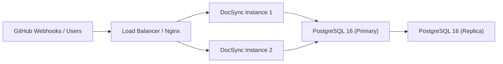

# Deployment Guide

This document covers how to build, configure, and deploy DocSync in local development, Docker, and production environments.

---

## Table of Contents

- [Prerequisites](#prerequisites)
- [Local Development Setup](#local-development-setup)
- [Environment Variables Reference](#environment-variables-reference)
- [Docker Build](#docker-build)
- [Docker Compose (Full Stack)](#docker-compose-full-stack)
- [Database Migration Strategy](#database-migration-strategy)
- [Health Check Verification](#health-check-verification)
- [Production Deployment](#production-deployment)
- [Rollback Procedures](#rollback-procedures)

---

## Prerequisites

| Tool             | Version  | Purpose                          |
|------------------|----------|----------------------------------|
| Java (JDK)       | 21+      | Application runtime & build      |
| Maven            | 3.9+     | Build automation                 |
| Docker           | 24+      | Container runtime                |
| Docker Compose   | 2.20+    | Multi-container orchestration    |
| PostgreSQL       | 16       | Primary data store               |
| Git              | 2.40+    | Source control                   |

> [!NOTE]
> PostgreSQL is only required for bare-metal local development. When using Docker Compose, PostgreSQL runs as a container.
>
> DocSync invokes the `git` binary at runtime to clone and fetch repositories, so `git` must
> be installed and on `PATH` in every runtime environment (including the container image).
> Repository code is never executed; only `git clone`/`fetch`/`reset`/`rev-parse` are run.

---

## Local Development Setup

### 1. Clone the Repository

```bash
git clone https://github.com/<org>/docsync.git
cd docsync
```

### 2. Start Infrastructure

Spin up PostgreSQL via Docker Compose:

```bash
docker-compose up -d postgres
```

This starts a PostgreSQL 16 instance on `localhost:5432` with the default credentials defined in `docker-compose.yml`.

### 3. Configure the Application

Copy the example environment file and edit it:

```bash
cp .env.example .env
```

Alternatively, configure `src/main/resources/application.yml` directly. Spring Boot resolves environment variables at startup, so either approach works.

Minimum required configuration for local development:

```yaml
spring:
  datasource:
    url: jdbc:postgresql://localhost:5432/docsync
    username: docsync
    password: docsync

docsync:
  github:
    app-id: ${GITHUB_APP_ID}
    private-key: ${GITHUB_APP_PRIVATE_KEY}
    webhook-secret: ${GITHUB_WEBHOOK_SECRET}
    api-url: ${GITHUB_API_URL:https://api.github.com}
  repository:
    workspace-root: ${REPOSITORY_WORKSPACE_ROOT:./data/workspaces}
    clone-host: ${REPOSITORY_CLONE_HOST:github.com}
    git-timeout-seconds: ${REPOSITORY_GIT_TIMEOUT_SECONDS:300}
  llm:
    provider: ${LLM_PROVIDER:openai}
    api-key: ${LLM_API_KEY}
    model: ${LLM_MODEL:gpt-4o}
  encryption:
    key: ${ENCRYPTION_KEY}

server:
  port: ${SERVER_PORT:8080}
```

### 4. Run Database Migrations

Migrations run **automatically** on startup via Flyway. No manual step is required. Migration scripts are located in `src/main/resources/db/migration/` and follow the naming convention `V<version>__<description>.sql`.

### 5. Build the Application

```bash
mvn clean package
```

To skip tests during build:

```bash
mvn clean package -DskipTests
```

### 6. Run the Application

**Option A — Executable JAR:**

```bash
java -jar target/docsync-*.jar
```

**Option B — Maven Spring Boot plugin:**

```bash
mvn spring-boot:run
```

The application starts on `http://localhost:8080` by default.

### 7. Run Tests

```bash
# Unit tests only
mvn test

# Unit + integration tests (uses Testcontainers — requires Docker running)
mvn verify
```

> [!IMPORTANT]
> Integration tests use [Testcontainers](https://testcontainers.com/) to spin up a PostgreSQL container automatically. Docker must be running before executing `mvn verify`.

---

## Environment Variables Reference

| Variable                  | Required | Default       | Description                                                  |
|---------------------------|----------|---------------|--------------------------------------------------------------|
| `DATABASE_URL`            | Yes      | —             | JDBC connection string, e.g. `jdbc:postgresql://host:5432/docsync` |
| `DATABASE_USERNAME`       | Yes      | —             | PostgreSQL username                                          |
| `DATABASE_PASSWORD`       | Yes      | —             | PostgreSQL password                                          |
| `GITHUB_APP_ID`           | Yes      | —             | GitHub App numeric ID                                        |
| `GITHUB_APP_PRIVATE_KEY`  | Yes      | —             | PEM-encoded private key for the GitHub App (base64 or file path) |
| `GITHUB_WEBHOOK_SECRET`   | Yes      | —             | Secret used to verify GitHub webhook signatures (HMAC-SHA256) |
| `GITHUB_API_URL`          | No       | `https://api.github.com` | GitHub API base URL (override for GitHub Enterprise/test doubles) |
| `GITHUB_RATE_LIMIT_WARNING_THRESHOLD` | No | `0.10` | Fraction of remaining GitHub quota below which non-critical calls return `503` |
| `REPOSITORY_WORKSPACE_ROOT` | No     | `./data/workspaces` | Absolute or relative root for per-repository checkouts; must be writable |
| `REPOSITORY_CLONE_HOST`   | No       | `github.com`  | Host used to build HTTPS clone URLs (must be a bare hostname) |
| `REPOSITORY_GIT_TIMEOUT_SECONDS` | No | `300`      | Timeout for each git command                          |
| `LLM_PROVIDER`            | Yes      | `openai`      | LLM provider identifier (`openai`, `anthropic`, etc.)        |
| `LLM_API_KEY`             | Yes      | —             | API key for the configured LLM provider                      |
| `LLM_MODEL`               | No       | `gpt-4o`      | Model name to use for documentation generation               |
| `ENCRYPTION_KEY`          | Yes      | —             | 256-bit AES key (base64-encoded) for encrypting stored credentials |
| `SERVER_PORT`             | No       | `8080`        | HTTP port the application listens on                         |
| `LOG_LEVEL`               | No       | `INFO`        | Root log level (`DEBUG`, `INFO`, `WARN`, `ERROR`)            |
| `SPRING_PROFILES_ACTIVE`  | No       | `default`     | Active Spring profiles (e.g. `dev`, `staging`, `prod`)       |

> [!CAUTION]
> `ENCRYPTION_KEY` must be generated securely (e.g. `openssl rand -base64 32`) and stored in a secrets manager in production. Losing this key means all encrypted credentials become unrecoverable.

---

## Docker Build

DocSync uses a **multi-stage Dockerfile** to produce a minimal runtime image.

### Dockerfile

```dockerfile
# Stage 1: Build
FROM eclipse-temurin:21-jdk AS build
WORKDIR /app
COPY pom.xml .
COPY src ./src
RUN --mount=type=cache,target=/root/.m2 \
    mvn clean package -DskipTests -q

# Stage 2: Runtime
FROM eclipse-temurin:21-jre
WORKDIR /app
COPY --from=build /app/target/docsync-*.jar app.jar

RUN groupadd -r docsync && useradd -r -g docsync docsync
USER docsync

EXPOSE 8080
HEALTHCHECK --interval=30s --timeout=5s --retries=3 \
    CMD curl -f http://localhost:8080/actuator/health/liveness || exit 1

ENTRYPOINT ["java", "-jar", "app.jar"]
```

### Build Command

```bash
docker build -t docsync:latest .
```

### Run Standalone

```bash
docker run -d \
  --name docsync \
  -p 8080:8080 \
  --env-file .env \
  docsync:latest
```

---

## Docker Compose (Full Stack)

The following `docker-compose.yml` runs the complete DocSync stack:

```yaml
version: "3.9"

services:
  postgres:
    image: postgres:16-alpine
    container_name: docsync-postgres
    restart: unless-stopped
    environment:
      POSTGRES_DB: docsync
      POSTGRES_USER: docsync
      POSTGRES_PASSWORD: ${DATABASE_PASSWORD:?error}
    ports:
      - "5432:5432"
    volumes:
      - pgdata:/var/lib/postgresql/data
    healthcheck:
      test: ["CMD-SHELL", "pg_isready -U docsync"]
      interval: 10s
      timeout: 5s
      retries: 5

  docsync:
    build: .
    container_name: docsync-app
    restart: unless-stopped
    depends_on:
      postgres:
        condition: service_healthy
    ports:
      - "8080:8080"
    environment:
      DATABASE_URL: jdbc:postgresql://postgres:5432/docsync
      DATABASE_USERNAME: docsync
      DATABASE_PASSWORD: ${DATABASE_PASSWORD:?error}
      GITHUB_APP_ID: ${GITHUB_APP_ID}
      GITHUB_APP_PRIVATE_KEY: ${GITHUB_APP_PRIVATE_KEY}
      GITHUB_WEBHOOK_SECRET: ${GITHUB_WEBHOOK_SECRET}
      LLM_PROVIDER: ${LLM_PROVIDER:-openai}
      LLM_API_KEY: ${LLM_API_KEY}
      LLM_MODEL: ${LLM_MODEL:-gpt-4o}
      ENCRYPTION_KEY: ${ENCRYPTION_KEY}
      SPRING_PROFILES_ACTIVE: prod
      LOG_LEVEL: ${LOG_LEVEL:-INFO}
    volumes:
      - applogs:/app/logs

volumes:
  pgdata:
    driver: local
  applogs:
    driver: local
```

**Start the full stack:**

```bash
docker-compose up -d
```

**View logs:**

```bash
docker-compose logs -f docsync
```

**Stop and remove:**

```bash
docker-compose down          # stop containers
docker-compose down -v       # stop and delete volumes (destroys data)
```

---

## Database Migration Strategy

DocSync uses **Flyway** for schema versioning. Key details:

| Aspect             | Detail                                                      |
|--------------------|-------------------------------------------------------------|
| Migration location | `src/main/resources/db/migration/`                          |
| Naming convention  | `V<version>__<description>.sql` (e.g. `V001__init_schema.sql`) |
| Execution          | Automatic on application startup                            |
| Tracking table     | `flyway_schema_history`                                     |
| Baseline           | Applied automatically on first run                          |

**Rules for writing migrations:**

1. Migrations are **immutable** — never edit a migration that has been applied.
2. Always write **backward-compatible** migrations (add columns as nullable, avoid renames).
3. For destructive changes, use a two-phase approach: deploy the code change first, then deploy the schema change in a subsequent release.
4. Test migrations locally against a copy of the production schema before merging.

**Run migrations manually (if needed):**

```bash
mvn flyway:migrate -Dflyway.url=jdbc:postgresql://localhost:5432/docsync \
                   -Dflyway.user=docsync \
                   -Dflyway.password=<password>
```

**Check migration status:**

```bash
mvn flyway:info -Dflyway.url=jdbc:postgresql://localhost:5432/docsync \
                -Dflyway.user=docsync \
                -Dflyway.password=<password>
```

---

## Health Check Verification

After starting the application, verify it is healthy:

```bash
# Liveness — is the process running?
curl -s http://localhost:8080/actuator/health/liveness | jq .

# Readiness — can it serve traffic?
curl -s http://localhost:8080/actuator/health/readiness | jq .

# Full health — all components
curl -s http://localhost:8080/actuator/health | jq .
```

Expected healthy response:

```json
{
  "status": "UP",
  "components": {
    "db": { "status": "UP" },
    "diskSpace": { "status": "UP" },
    "ping": { "status": "UP" }
  }
}
```

---

## Production Deployment

### Architecture Overview



### Reverse Proxy (Nginx)

Place Nginx in front of DocSync to handle TLS termination, rate limiting, and request buffering:

```nginx
upstream docsync {
    server 127.0.0.1:8080;
    keepalive 32;
}

server {
    listen 443 ssl http2;
    server_name docsync.example.com;

    ssl_certificate     /etc/ssl/certs/docsync.crt;
    ssl_certificate_key /etc/ssl/private/docsync.key;

    location / {
        proxy_pass http://docsync;
        proxy_set_header Host $host;
        proxy_set_header X-Real-IP $remote_addr;
        proxy_set_header X-Forwarded-For $proxy_add_x_forwarded_for;
        proxy_set_header X-Forwarded-Proto $scheme;

        # Webhook payloads can be large
        client_max_body_size 25m;
    }

    location /actuator/ {
        # Restrict actuator endpoints to internal networks
        allow 10.0.0.0/8;
        deny all;
        proxy_pass http://docsync;
    }
}
```

### TLS Termination

- Use [Let's Encrypt](https://letsencrypt.org/) with `certbot` for automated certificate provisioning.
- Ensure `X-Forwarded-Proto: https` is forwarded so Spring Boot generates correct redirect URLs.
- Set `server.forward-headers-strategy=native` in `application.yml`.

### Database Backup

Automate daily backups using `pg_dump`:

```bash
#!/bin/bash
TIMESTAMP=$(date +%Y%m%d_%H%M%S)
pg_dump -h localhost -U docsync -Fc docsync > /backups/docsync_${TIMESTAMP}.dump

# Retain last 30 days
find /backups -name "docsync_*.dump" -mtime +30 -delete
```

Schedule via cron:

```cron
0 2 * * * /opt/scripts/backup-db.sh >> /var/log/docsync-backup.log 2>&1
```

### Log Aggregation

- Configure structured JSON logging (see [OBSERVABILITY.md](OBSERVABILITY.md)).
- Ship logs to a centralized platform (ELK, Loki, CloudWatch) using Filebeat, Fluentd, or the Docker logging driver.
- Retain application logs for at least 30 days.

### Secrets Management

> [!WARNING]
> Never store secrets in `application.yml`, `docker-compose.yml`, or source control.

Recommended approaches by environment:

| Environment | Approach                                          |
|-------------|---------------------------------------------------|
| Local dev   | `.env` file (git-ignored)                         |
| CI/CD       | Pipeline secrets (GitHub Actions secrets, etc.)   |
| Production  | HashiCorp Vault, AWS Secrets Manager, or similar  |

---

## Rollback Procedures

### Application Rollback

1. **Identify the last known good version** from your container registry or artifact repository.

2. **Roll back the deployment:**

   ```bash
   # Docker Compose
   docker-compose down docsync
   docker pull docsync:<previous-version>
   # Update image tag in docker-compose.yml or override
   docker-compose up -d docsync
   ```

3. **Verify health:**

   ```bash
   curl -s http://localhost:8080/actuator/health | jq .status
   ```

### Database Rollback

Flyway does not support automatic rollback of applied migrations. If a migration must be reversed:

1. **Stop the application** to prevent further traffic.
2. **Write a corrective migration** (e.g. `V003__revert_v002_changes.sql`) that undoes the schema change.
3. **Alternatively, restore from backup** if the corrective migration is too complex:

   ```bash
   # Stop the application
   docker-compose stop docsync

   # Restore the database
   pg_restore -h localhost -U docsync -d docsync --clean /backups/docsync_<timestamp>.dump

   # Restart with the previous application version
   docker-compose up -d docsync
   ```

4. **Validate data integrity** after restore.

> [!CAUTION]
> Restoring from backup may cause data loss for any writes that occurred between the backup and the restore. Coordinate with stakeholders before proceeding.

### Emergency Checklist

- [ ] Identify the breaking change (application code vs. database schema)
- [ ] Notify the team via incident channel
- [ ] Stop the current deployment
- [ ] Deploy the previous known-good version
- [ ] Verify health checks pass
- [ ] Validate webhook processing resumes
- [ ] Write a post-incident report
