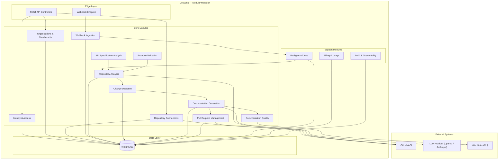
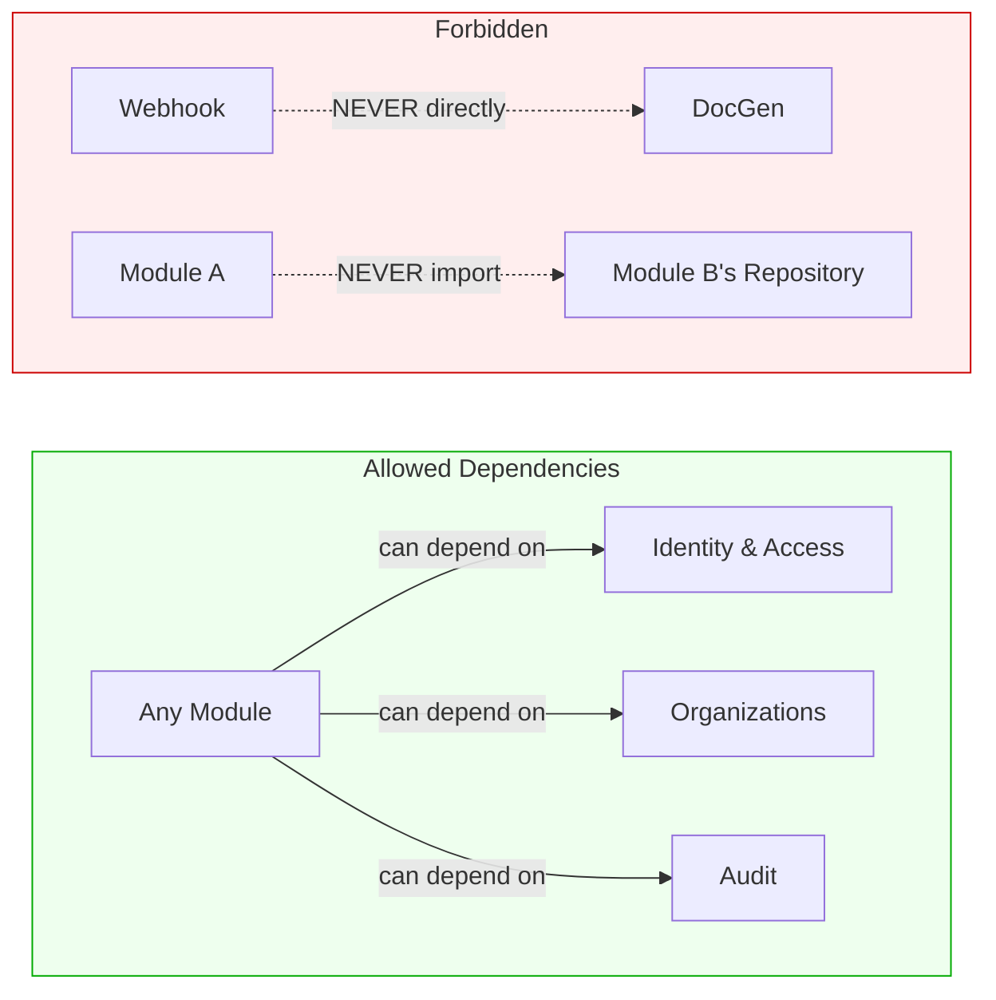
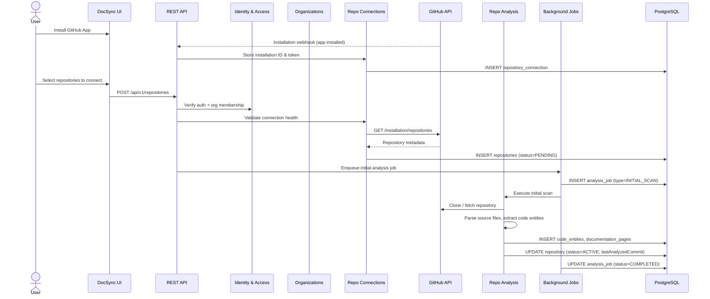
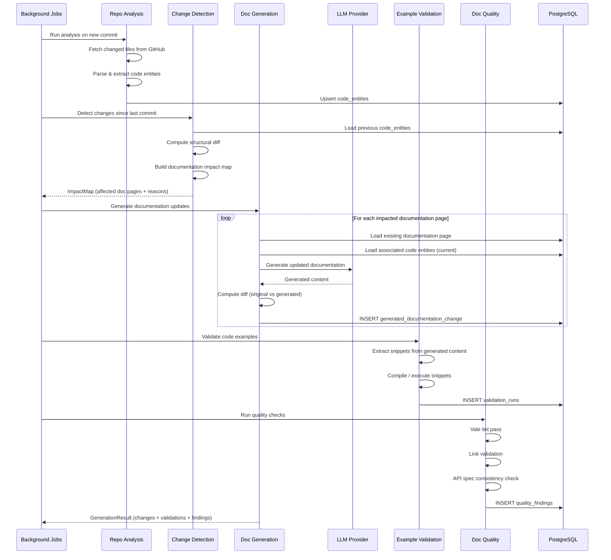
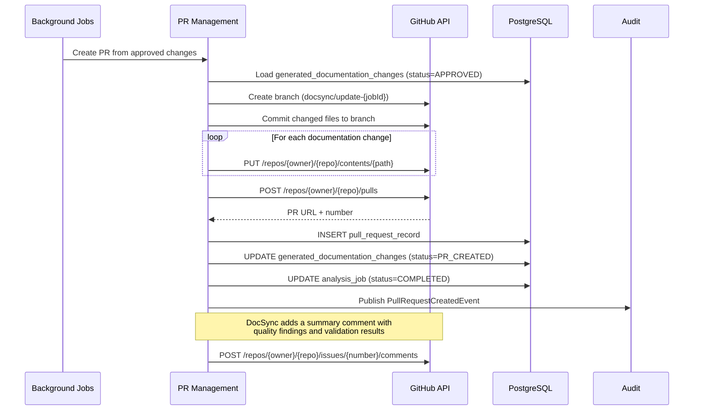
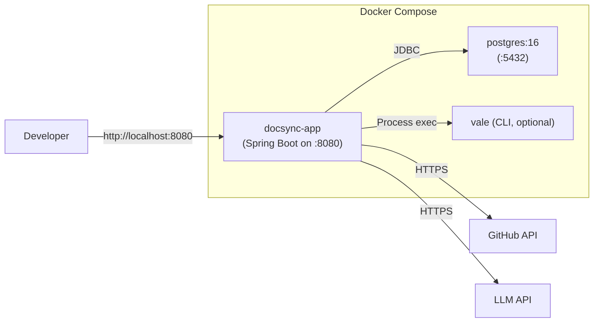
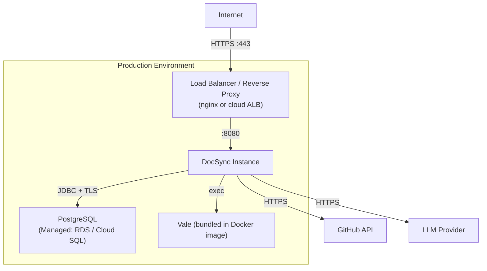
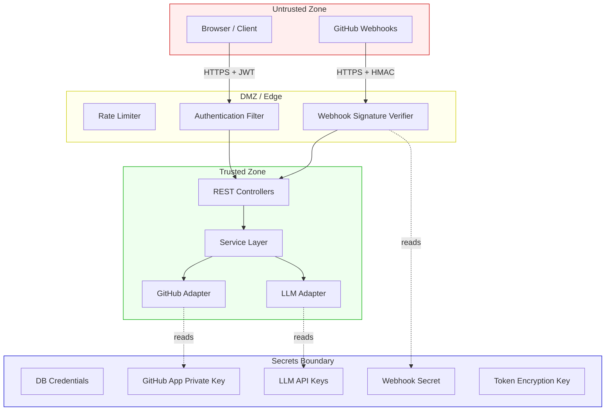

# DocSync — High-Level Design (HLD)

> **Version:** 1.0  
> **Last Updated:** 2026-10-30  
> **Status:** Draft

---

## 1. System Overview

DocSync is a **developer documentation automation platform** that monitors code repositories for changes, detects documentation impact, generates candidate documentation updates, validates them, and opens pull requests for human review. It bridges the persistent gap between evolving codebases and their accompanying documentation.

### 1.1 Problem Statement

Documentation drift is one of the most common and damaging problems in software projects. APIs change but their docs don't. Code examples rot. Links break. DocSync solves this by treating documentation as a continuously validated, automatically maintained artifact — not a manual afterthought.

### 1.2 Design Goals

| Goal | Description |
|------|-------------|
| **Correctness** | Generated documentation must be accurate and verifiable against the codebase |
| **Non-intrusiveness** | All changes are proposed via PR — humans always have final review |
| **Modularity** | Clean module boundaries to allow independent evolution and eventual extraction |
| **Simplicity** | Prefer straightforward solutions; avoid premature distribution |
| **Auditability** | Every action, generation, and decision is traceable |

---

## 2. Architecture Style: Modular Monolith

DocSync is built as a **modular monolith** — a single deployable unit with strict internal module boundaries.

### 2.1 Justification

| Factor | Monolith Advantage |
|--------|--------------------|
| **Team size** | Small team (1–5 engineers); microservices overhead is unjustified |
| **Deployment simplicity** | Single JAR + PostgreSQL; no service mesh, no inter-service networking |
| **Transaction integrity** | Cross-module transactions are trivial within a single process |
| **Iteration speed** | Refactoring across module boundaries requires no API versioning or contract negotiation |
| **Operational cost** | One process to monitor, one log stream to search, one deployment pipeline |

### 2.2 Module Isolation Strategy

Despite being a monolith, modules are isolated by:

- **Package boundaries:** Each module lives under `com.docsync.{module}` and exposes only a public service interface.
- **No cross-module repository access:** Modules never query another module's database tables directly; they call the owning module's service.
- **Event-based decoupling:** Modules communicate asynchronously via in-process application events (`ApplicationEventPublisher`) for side-effect workflows.
- **Separate Flyway migration directories:** Each module owns its schema migrations under `db/migration/{module}/`.

> [!IMPORTANT]
> If DocSync later needs to scale horizontally, individual modules (e.g., Documentation Generation) can be extracted into a separate service because the boundaries are already clean.

---

## 3. Logical Component Diagram



---

## 4. Module Responsibilities and Boundaries

### 4.1 Module Overview

| # | Module | Responsibility | Owns Tables |
|---|--------|----------------|-------------|
| 1 | **Identity & Access** | User authentication (GitHub OAuth), session management, API key issuance | `users` |
| 2 | **Organizations & Membership** | Multi-tenancy, team management, role-based access | `organizations`, `organization_memberships` |
| 3 | **Repository Connections** | GitHub App installation management, token lifecycle, connection health | `repository_connections` |
| 4 | **Webhook Ingestion** | Receive, verify, deduplicate, and persist incoming webhook events | `webhook_events` |
| 5 | **Repository Analysis** | Clone/fetch repository content, parse source files, extract code entities | `repositories`, `code_entities` |
| 6 | **Change Detection** | Diff analysis between commits, identify impacted documentation | (uses data from Analysis) |
| 7 | **Documentation Generation** | LLM-powered doc generation, diff creation, candidate management | `documentation_pages`, `documentation_code_references`, `generated_documentation_changes` |
| 8 | **API Specification Analysis** | Parse OpenAPI/Swagger specs, detect API changes, map to doc sections | (uses data from Analysis and DocGen) |
| 9 | **Example Validation** | Extract, compile, and execute code examples; report failures | `example_snippets`, `validation_runs` |
| 10 | **Documentation Quality** | Lint prose (Vale), check links, verify references, score quality | `quality_findings` |
| 11 | **Pull Request Management** | Create branches, commit changes, open/update/close PRs on GitHub | `pull_request_records` |
| 12 | **Background Jobs** | Durable job queue, scheduling, retry logic, dead-letter handling | `analysis_jobs` |
| 13 | **Billing & Usage** | Track usage (LLM tokens, API calls, repos), enforce plan limits | `subscription_plans`, `subscriptions`, `usage_records` |
| 14 | **Audit & Observability** | Record all significant actions, structured logging, metrics export | `audit_events` |

### 4.2 Module Dependency Rules



**Rules:**
1. Modules may depend on **Identity & Access** and **Organizations** for auth context.
2. Modules publish events; they never directly invoke downstream modules in the pipeline.
3. **Background Jobs** is the orchestrator — it invokes pipeline stages sequentially.
4. **Audit** is a listener — every module can publish audit events; Audit never calls back.

---

## 5. External Integrations

### 5.1 GitHub API

| Aspect | Detail |
|--------|--------|
| **Auth model** | GitHub App (installation tokens, short-lived) |
| **Operations** | Clone repo, read files, create branch, commit, open PR, post comments |
| **Rate limits** | 5,000 req/hr per installation; tracked and respected with backoff |
| **Webhook verification** | HMAC-SHA256 signature validation on every incoming event |

### 5.2 LLM Providers (OpenAI / Anthropic)

| Aspect | Detail |
|--------|--------|
| **Purpose** | Generate documentation prose, summarize changes, produce diffs |
| **Adapter pattern** | `LlmClient` interface with provider-specific implementations |
| **Resilience** | Retry with exponential backoff, circuit breaker, timeout (30s) |
| **Cost tracking** | Token usage recorded per request in `usage_records` |

### 5.3 Vale Linter

| Aspect | Detail |
|--------|--------|
| **Purpose** | Prose quality analysis (style, grammar, terminology consistency) |
| **Integration** | CLI invocation via `ProcessBuilder`; runs on generated Markdown |
| **Configuration** | `.vale.ini` per repository or organization default |

---

## 6. Data Flow Diagrams

### 6.1 Repository Onboarding Flow



### 6.2 Webhook Processing Flow

```mermaid
sequenceDiagram
    participant GH as GitHub
    participant WH as Webhook Endpoint
    participant SIG as Signature Verifier
    participant DEDUP as Deduplicator
    participant DB as PostgreSQL
    participant JOBS as Background Jobs
    participant AUDIT as Audit

    GH->>WH: POST /api/webhooks/github (push event)
    WH->>SIG: Verify HMAC-SHA256 signature
    alt Invalid Signature
        SIG-->>WH: Reject
        WH-->>GH: 401 Unauthorized
        WH->>AUDIT: Log rejected webhook
    end
    SIG-->>WH: Valid

    WH->>DEDUP: Check providerEventId uniqueness
    alt Duplicate Event
        DEDUP-->>WH: Already processed
        WH-->>GH: 200 OK (idempotent)
    end
    DEDUP-->>WH: New event

    WH->>DB: INSERT webhook_event (status=RECEIVED)
    WH-->>GH: 202 Accepted

    Note over WH,JOBS: Response returned immediately; processing is async

    WH->>JOBS: Enqueue analysis job
    JOBS->>DB: INSERT analysis_job (status=QUEUED)
    JOBS->>DB: UPDATE webhook_event (status=PROCESSING)

    Note over JOBS: Job poller picks up the job
```

### 6.3 Documentation Generation Flow



### 6.4 Pull Request Creation Flow



---

## 7. Deployment Architecture

### 7.1 Local Development (Docker Compose)



**Compose services:**
- `docsync-app` — Spring Boot application (hot-reload via Spring DevTools)
- `postgres` — PostgreSQL 16 with persistent volume
- `ngrok` (optional) — tunnel for receiving GitHub webhooks locally

### 7.2 Production Deployment



**Production characteristics:**
- Single Docker container (can scale to N instances behind a load balancer)
- Background job polling uses `SELECT ... FOR UPDATE SKIP LOCKED` to safely distribute work across instances
- Database connection pool: HikariCP (default 10 connections per instance)
- Health check: `/actuator/health` (liveness + readiness)
- Secrets via environment variables (never in config files)

---

## 8. Trust Boundaries



**Key trust boundary rules:**

| Boundary | Control |
|----------|---------|
| Browser → API | JWT-based authentication; CSRF protection on state-changing endpoints |
| GitHub → Webhook | HMAC-SHA256 signature verification on every request |
| App → GitHub API | Short-lived installation tokens; principle of least privilege scopes |
| App → LLM Provider | API key in `Authorization` header; TLS enforced |
| App → Database | Encrypted connection (TLS); parameterized queries only (JPA) |
| Token storage | `accessTokenEncrypted` uses AES-256-GCM; key from environment variable |

---

## 9. Technology Choices and Trade-Offs

| Choice | Rationale | Trade-Off |
|--------|-----------|-----------|
| **Java 21** | Virtual threads for concurrent I/O (GitHub API, LLM calls); mature ecosystem; strong typing | Higher memory baseline than Go/Rust; verbosity |
| **Spring Boot 3.x** | Convention-over-configuration; comprehensive ecosystem (Security, Data JPA, Web); production-ready defaults | Large dependency tree; opinionated |
| **PostgreSQL** | JSONB for flexible metadata; robust ACID; `FOR UPDATE SKIP LOCKED` for job queue; excellent tooling | Single-database bottleneck at extreme scale |
| **Flyway** | SQL-based migrations; version-controlled schema; rollback support | Must maintain migration ordering across modules |
| **Maven** | Stable, well-understood build tool; strong dependency management | XML verbosity; slower than Gradle for incremental builds |
| **DB-backed job queue** | No external broker dependency (Redis/RabbitMQ); transactional job creation alongside business data | Polling latency (mitigated by short poll interval); less throughput than dedicated brokers |
| **In-process events** | Zero-latency module communication; no serialization overhead | Lost if process crashes before handling (acceptable — jobs are durable) |

---

## 10. Scalability Considerations

### 10.1 Current Design (MVP — Single Instance)

- Single application instance handles all traffic and background jobs
- PostgreSQL handles all persistence and job coordination
- Sufficient for **~100 repositories**, **~1,000 webhook events/day**

### 10.2 Horizontal Scaling Path

| Bottleneck | Solution |
|------------|----------|
| Webhook volume | Add instances behind load balancer; deduplication is idempotent |
| Job processing | Multiple instances poll with `SKIP LOCKED`; work distributes naturally |
| LLM latency | Virtual threads ensure high concurrency without thread exhaustion |
| Database connections | PgBouncer connection pooler in front of PostgreSQL |
| Repository cloning | Shared filesystem or object storage for cloned repos (future) |

### 10.3 Module Extraction Candidates

If specific modules become bottlenecks, they can be extracted in this priority order:

1. **Documentation Generation** — CPU/network-intensive (LLM calls); stateless; easy to extract
2. **Repository Analysis** — I/O-intensive (git operations); can run on dedicated workers
3. **Webhook Ingestion** — High-throughput edge; could become an independent ingestion service

---

## 11. Cross-Cutting Concerns

### 11.1 Logging

- **Framework:** SLF4J + Logback
- **Format:** Structured JSON in production; human-readable in development
- **MDC fields:** `requestId`, `userId`, `organizationId`, `repositoryId`, `jobId`
- **Levels:** `ERROR` for failures, `WARN` for degraded operations, `INFO` for business events, `DEBUG` for development

### 11.2 Security

- **Authentication:** GitHub OAuth 2.0 (Authorization Code flow) → JWT session tokens
- **Authorization:** Role-based (OWNER, ADMIN, MEMBER) scoped to organization
- **Input validation:** Bean Validation (JSR-380) on all DTOs
- **SQL injection:** Prevented by JPA parameterized queries
- **Secrets management:** Environment variables; never logged or exposed via API
- **Dependency scanning:** Dependabot / OWASP dependency-check Maven plugin

### 11.3 Error Handling

- **Controller layer:** `@RestControllerAdvice` global exception handler returns consistent error DTOs
- **Service layer:** Checked business exceptions (`DocSyncException` hierarchy); unchecked for programming errors
- **External calls:** Retry with exponential backoff (GitHub, LLM); circuit breaker for sustained failures
- **Background jobs:** Failed jobs are retried up to 3 times with increasing delay; then moved to `DEAD_LETTER` status

### 11.4 Configuration

- **Profiles:** `local`, `test`, `production`
- **Externalized config:** `application.yml` with environment variable overrides
- **Sensitive values:** `DOCSYNC_DB_PASSWORD`, `DOCSYNC_GITHUB_APP_PRIVATE_KEY`, `DOCSYNC_LLM_API_KEY`, `DOCSYNC_WEBHOOK_SECRET`, `DOCSYNC_ENCRYPTION_KEY`
- **Feature flags:** Simple boolean properties (e.g., `docsync.features.example-validation.enabled=true`)

### 11.5 Observability

- **Health checks:** `/actuator/health` with custom indicators for DB, GitHub connectivity, LLM availability
- **Metrics:** Micrometer → Prometheus (job queue depth, processing latency, LLM token usage, webhook throughput)
- **Tracing:** Request correlation ID propagated through all layers via MDC
- **Alerting triggers:** Job failure rate > 10%, webhook rejection rate spike, LLM error rate > 5%
