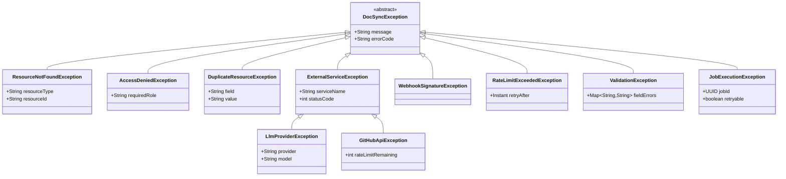

# DocSync — Low-Level Design (LLD)

> **Version:** 1.0  
> **Last Updated:** 2026-10-30  
> **Status:** Draft

---

## 1. Package Structure

```
com.docsync
├── identity/                    # Module 1: Identity & Access
│   ├── controller/
│   ├── service/
│   ├── repository/
│   ├── model/
│   ├── dto/
│   ├── config/
│   └── exception/
├── organization/                # Module 2: Organizations & Membership
│   ├── controller/
│   ├── service/
│   ├── repository/
│   ├── model/
│   ├── dto/
│   ├── event/
│   └── exception/
├── connection/                  # Module 3: Repository Connections
│   ├── controller/
│   ├── service/
│   ├── repository/
│   ├── model/
│   ├── dto/
│   ├── config/
│   └── exception/
├── webhook/                     # Module 4: Webhook Ingestion
│   ├── controller/
│   ├── service/
│   ├── repository/
│   ├── model/
│   ├── dto/
│   └── exception/
├── analysis/                    # Module 5: Repository Analysis
│   ├── controller/
│   ├── service/
│   ├── repository/
│   ├── model/
│   ├── dto/
│   ├── parser/
│   ├── event/
│   └── exception/
├── changedetection/             # Module 6: Change Detection
│   ├── service/
│   ├── model/
│   └── exception/
├── docgen/                      # Module 7: Documentation Generation
│   ├── controller/
│   ├── service/
│   ├── repository/
│   ├── model/
│   ├── dto/
│   ├── event/
│   └── exception/
├── apispec/                     # Module 8: API Specification Analysis
│   ├── service/
│   ├── model/
│   └── parser/
├── validation/                  # Module 9: Example Validation
│   ├── service/
│   ├── repository/
│   ├── model/
│   ├── dto/
│   ├── executor/
│   └── exception/
├── quality/                     # Module 10: Documentation Quality
│   ├── service/
│   ├── repository/
│   ├── model/
│   ├── dto/
│   └── linter/
├── pullrequest/                 # Module 11: Pull Request Management
│   ├── controller/
│   ├── service/
│   ├── repository/
│   ├── model/
│   ├── dto/
│   ├── event/
│   └── exception/
├── jobs/                        # Module 12: Background Jobs
│   ├── service/
│   ├── repository/
│   ├── model/
│   ├── config/
│   ├── runner/
│   └── exception/
├── billing/                     # Module 13: Billing & Usage
│   ├── controller/
│   ├── service/
│   ├── repository/
│   ├── model/
│   ├── dto/
│   └── exception/
├── audit/                       # Module 14: Audit & Observability
│   ├── service/
│   ├── repository/
│   ├── model/
│   ├── dto/
│   ├── event/
│   └── config/
└── common/                      # Shared kernel (minimal)
    ├── config/
    ├── exception/
    ├── security/
    ├── util/
    └── adapter/
        ├── github/
        └── llm/
```

> [!NOTE]
> The `common` package is deliberately minimal. It holds only true cross-cutting infrastructure: global exception handling, security filters, and external adapter interfaces. Business logic never belongs here.

---

## 2. Module-by-Module Detailed Design

### 2.1 Identity & Access (`com.docsync.identity`)

**Responsibility:** GitHub OAuth authentication, JWT issuance, user profile management.

#### Key Interfaces & Classes

```java
// --- Service Interface ---
public interface IdentityService {
    AuthResponse authenticateWithGitHub(String authorizationCode);
    User getCurrentUser();
    User getUserById(UUID userId);
    void updateProfile(UUID userId, UpdateProfileRequest request);
}

// --- Entity ---
@Entity
@Table(name = "users")
public class User {
    @Id @GeneratedValue(strategy = GenerationType.UUID)
    private UUID id;
    
    @Column(nullable = false, unique = true)
    private String email;
    
    @Column(nullable = false)
    private String displayName;
    
    private String avatarUrl;
    
    @Column(nullable = false, unique = true)
    private Long githubId;
    
    @Column(nullable = false, updatable = false)
    private Instant createdAt;
    
    @Column(nullable = false)
    private Instant updatedAt;
}

// --- DTOs ---
public record AuthResponse(String accessToken, String refreshToken, UserDto user) {}
public record UserDto(UUID id, String email, String displayName, String avatarUrl) {}
public record UpdateProfileRequest(@NotBlank String displayName) {}
```

#### Security Configuration

```java
@Configuration
@EnableWebSecurity
public class SecurityConfig {
    // - GitHub OAuth2 login endpoint
    // - JWT validation filter for API requests
    // - Webhook endpoint excluded from JWT auth (uses HMAC verification)
    // - Actuator endpoints secured separately
    // - CORS configured for frontend origin
}
```

---

### 2.2 Organizations & Membership (`com.docsync.organization`)

**Responsibility:** Multi-tenant organization management, membership, role-based authorization.

#### Key Interfaces & Classes

```java
// --- Service Interface ---
public interface OrganizationService {
    OrganizationDto createOrganization(CreateOrganizationRequest request);
    OrganizationDto getOrganization(UUID orgId);
    List<OrganizationDto> getUserOrganizations(UUID userId);
    void addMember(UUID orgId, AddMemberRequest request);
    void removeMember(UUID orgId, UUID userId);
    void updateMemberRole(UUID orgId, UUID userId, MemberRole newRole);
}

// --- Entities ---
@Entity
@Table(name = "organizations")
public class Organization {
    @Id @GeneratedValue(strategy = GenerationType.UUID)
    private UUID id;
    
    @Column(nullable = false)
    private String name;
    
    @Column(nullable = false, unique = true)
    private String slug;
    
    private String description;
    private Instant createdAt;
    private Instant updatedAt;
}

@Entity
@Table(name = "organization_memberships",
       uniqueConstraints = @UniqueConstraint(columns = {"user_id", "organization_id"}))
public class OrganizationMembership {
    @Id @GeneratedValue(strategy = GenerationType.UUID)
    private UUID id;
    
    @ManyToOne(fetch = FetchType.LAZY)
    @JoinColumn(name = "user_id", nullable = false)
    private User user;
    
    @ManyToOne(fetch = FetchType.LAZY)
    @JoinColumn(name = "organization_id", nullable = false)
    private Organization organization;
    
    @Enumerated(EnumType.STRING)
    @Column(nullable = false)
    private MemberRole role;  // OWNER, ADMIN, MEMBER
    
    private Instant joinedAt;
}

// --- DTOs ---
public record CreateOrganizationRequest(
    @NotBlank @Size(max = 100) String name,
    @NotBlank @Pattern(regexp = "^[a-z0-9-]+$") String slug,
    @Size(max = 500) String description
) {}

public record OrganizationDto(UUID id, String name, String slug, String description,
                               MemberRole currentUserRole) {}

public record AddMemberRequest(@NotNull UUID userId, @NotNull MemberRole role) {}
```

#### Authorization Check Pattern

```java
@Service
@Transactional(readOnly = true)
public class OrganizationAuthorizationService {

    /**
     * Verifies the current user has at least the required role in the organization.
     * Throws AccessDeniedException if not.
     */
    public void requireRole(UUID organizationId, MemberRole minimumRole) {
        UUID currentUserId = SecurityContextHolder.getCurrentUserId();
        OrganizationMembership membership = membershipRepository
            .findByUserIdAndOrganizationId(currentUserId, organizationId)
            .orElseThrow(() -> new AccessDeniedException("Not a member of this organization"));
        
        if (membership.getRole().ordinal() > minimumRole.ordinal()) {
            throw new AccessDeniedException("Insufficient role");
        }
    }
}
```

---

### 2.3 Repository Connections (`com.docsync.connection`)

**Responsibility:** GitHub App installation management, token lifecycle, connection health monitoring.

#### Key Interfaces & Classes

```java
// --- Service Interface ---
public interface RepositoryConnectionService {
    RepositoryConnectionDto createConnection(UUID orgId, CreateConnectionRequest request);
    RepositoryConnectionDto getConnection(UUID connectionId);
    List<RepositoryConnectionDto> getConnectionsForOrg(UUID orgId);
    String getValidAccessToken(UUID connectionId);  // Refreshes if expired
    void refreshToken(UUID connectionId);
    void revokeConnection(UUID connectionId);
    ConnectionHealthStatus checkHealth(UUID connectionId);
}

// --- Entity ---
@Entity
@Table(name = "repository_connections")
public class RepositoryConnection {
    @Id @GeneratedValue(strategy = GenerationType.UUID)
    private UUID id;
    
    @Column(name = "organization_id", nullable = false)
    private UUID organizationId;
    
    @Enumerated(EnumType.STRING)
    @Column(nullable = false)
    private Provider provider;  // GITHUB
    
    @Column(nullable = false)
    private Long installationId;
    
    @Column(nullable = false)
    private String accessTokenEncrypted;
    
    private Instant tokenExpiresAt;
    
    @Column(columnDefinition = "text[]")
    private String[] scopes;
    
    @Enumerated(EnumType.STRING)
    @Column(nullable = false)
    private ConnectionStatus status;  // ACTIVE, TOKEN_EXPIRED, REVOKED, ERROR
}
```

#### Token Refresh Flow

```java
@Service
public class RepositoryConnectionServiceImpl implements RepositoryConnectionService {

    @Transactional
    public String getValidAccessToken(UUID connectionId) {
        RepositoryConnection conn = connectionRepository.findById(connectionId)
            .orElseThrow(() -> new ConnectionNotFoundException(connectionId));
        
        if (conn.getTokenExpiresAt().isBefore(Instant.now().plus(5, ChronoUnit.MINUTES))) {
            // Token expiring soon — refresh proactively
            String newToken = gitHubAdapter.refreshInstallationToken(conn.getInstallationId());
            conn.setAccessTokenEncrypted(encryptionService.encrypt(newToken));
            conn.setTokenExpiresAt(Instant.now().plus(1, ChronoUnit.HOURS));
            conn.setStatus(ConnectionStatus.ACTIVE);
            connectionRepository.save(conn);
            return newToken;
        }
        
        return encryptionService.decrypt(conn.getAccessTokenEncrypted());
    }
}
```

---

### 2.4 Webhook Ingestion (`com.docsync.webhook`)

**Responsibility:** Receive, authenticate, deduplicate, and persist GitHub webhook events.

#### Key Interfaces & Classes

```java
// --- Controller ---
@RestController
@RequestMapping("/api/webhooks")
public class WebhookController {
    
    @PostMapping("/github")
    public ResponseEntity<Void> handleGitHubWebhook(
            @RequestHeader("X-Hub-Signature-256") String signature,
            @RequestHeader("X-GitHub-Event") String eventType,
            @RequestHeader("X-GitHub-Delivery") String deliveryId,
            @RequestBody String rawPayload) {
        
        webhookService.processIncoming(signature, eventType, deliveryId, rawPayload);
        return ResponseEntity.accepted().build();
    }
}

// --- Service Interface ---
public interface WebhookService {
    void processIncoming(String signature, String eventType, String deliveryId, String rawPayload);
}

// --- Entity ---
@Entity
@Table(name = "webhook_events",
       indexes = @Index(name = "idx_webhook_provider_event_id", 
                        columnList = "provider, providerEventId", unique = true))
public class WebhookEvent {
    @Id @GeneratedValue(strategy = GenerationType.UUID)
    private UUID id;
    
    @Enumerated(EnumType.STRING)
    private Provider provider;       // GITHUB
    
    @Column(nullable = false)
    private String providerEventId;  // X-GitHub-Delivery header
    
    @Column(nullable = false)
    private String eventType;        // push, pull_request, installation, etc.
    
    private UUID repositoryId;       // Resolved after parsing payload
    
    @JdbcTypeCode(SqlTypes.JSON)
    @Column(columnDefinition = "jsonb")
    private String payload;
    
    @Enumerated(EnumType.STRING)
    private WebhookEventStatus status;  // RECEIVED, PROCESSING, PROCESSED, FAILED, IGNORED
    
    private Instant receivedAt;
    private Instant processedAt;
}
```

#### Service Implementation

```java
@Service
@Slf4j
public class WebhookServiceImpl implements WebhookService {

    @Override
    @Transactional
    public void processIncoming(String signature, String eventType, 
                                 String deliveryId, String rawPayload) {
        // 1. Verify HMAC-SHA256 signature
        if (!signatureVerifier.verify(rawPayload, signature)) {
            auditService.record(AuditAction.WEBHOOK_REJECTED, "Invalid signature");
            throw new WebhookSignatureException("Invalid webhook signature");
        }
        
        // 2. Check for duplicate (idempotency)
        if (webhookEventRepository.existsByProviderAndProviderEventId(Provider.GITHUB, deliveryId)) {
            log.info("Duplicate webhook event ignored: {}", deliveryId);
            return;
        }
        
        // 3. Persist the event
        WebhookEvent event = WebhookEvent.builder()
            .provider(Provider.GITHUB)
            .providerEventId(deliveryId)
            .eventType(eventType)
            .payload(rawPayload)
            .status(WebhookEventStatus.RECEIVED)
            .receivedAt(Instant.now())
            .build();
        
        // 4. Resolve repository from payload
        event.setRepositoryId(resolveRepositoryId(rawPayload));
        webhookEventRepository.save(event);
        
        // 5. Enqueue a job for async processing
        if (isSupportedEvent(eventType)) {
            jobService.enqueue(event);
        } else {
            event.setStatus(WebhookEventStatus.IGNORED);
        }
    }
    
    private boolean isSupportedEvent(String eventType) {
        return Set.of("push", "pull_request", "installation").contains(eventType);
    }
}
```

---

### 2.5 Repository Analysis (`com.docsync.analysis`)

**Responsibility:** Fetch repository contents, parse source code, extract code entities and documentation pages.

#### Key Interfaces & Classes

```java
// --- Service Interface ---
public interface RepositoryAnalysisService {
    AnalysisResult analyzeRepository(UUID repositoryId, String commitSha);
    AnalysisResult analyzeChangedFiles(UUID repositoryId, String baseCommit, String headCommit);
    List<CodeEntity> getCodeEntities(UUID repositoryId, String commitSha);
}

// --- Entities ---
@Entity
@Table(name = "repositories")
public class Repository {
    @Id @GeneratedValue(strategy = GenerationType.UUID)
    private UUID id;
    
    @Column(name = "organization_id", nullable = false)
    private UUID organizationId;
    
    @Column(name = "connection_id", nullable = false)
    private UUID connectionId;
    
    @Column(nullable = false)
    private String providerRepoId;
    
    @Column(nullable = false)
    private String fullName;          // "owner/repo"
    
    @Column(nullable = false)
    private String defaultBranch;     // "main"
    
    private String language;
    private String description;
    
    @Column(name = "is_private")
    private boolean isPrivate;
    
    @Enumerated(EnumType.STRING)
    private RepositoryStatus status;  // PENDING, ACTIVE, PAUSED, ERROR
    
    private Instant lastAnalyzedAt;
    private String lastAnalyzedCommit;
    
    @JdbcTypeCode(SqlTypes.JSON)
    @Column(columnDefinition = "jsonb")
    private RepositoryConfig config;  // Analysis settings, doc paths, etc.
}

@Entity
@Table(name = "code_entities",
       indexes = {
           @Index(name = "idx_code_entity_repo_commit", columnList = "repositoryId, commitSha"),
           @Index(name = "idx_code_entity_qualified_name", columnList = "repositoryId, qualifiedName")
       })
public class CodeEntity {
    @Id @GeneratedValue(strategy = GenerationType.UUID)
    private UUID id;
    
    @Column(name = "repository_id", nullable = false)
    private UUID repositoryId;
    
    @Column(name = "analysis_job_id")
    private UUID analysisJobId;
    
    @Enumerated(EnumType.STRING)
    @Column(nullable = false)
    private CodeEntityType entityType;  // CLASS, INTERFACE, METHOD, FIELD, ENUM, RECORD
    
    @Column(nullable = false)
    private String qualifiedName;       // "com.example.UserService.createUser"
    
    @Column(nullable = false)
    private String filePath;
    
    private Integer startLine;
    private Integer endLine;
    private String signature;           // Method/class signature
    private String javadoc;             // Extracted Javadoc comment
    
    @Enumerated(EnumType.STRING)
    private Visibility visibility;      // PUBLIC, PROTECTED, PACKAGE_PRIVATE, PRIVATE
    
    @Column(nullable = false)
    private String commitSha;
}

@Entity
@Table(name = "documentation_pages")
public class DocumentationPage {
    @Id @GeneratedValue(strategy = GenerationType.UUID)
    private UUID id;
    
    @Column(name = "repository_id", nullable = false)
    private UUID repositoryId;
    
    @Column(nullable = false)
    private String filePath;            // "docs/api/user-service.md"
    
    private String title;
    private String contentHash;         // SHA-256 of content
    private String lastAnalyzedCommit;
    
    @Enumerated(EnumType.STRING)
    private DocumentationType documentationType;  // API_REFERENCE, GUIDE, TUTORIAL, README, CHANGELOG
    
    @JdbcTypeCode(SqlTypes.JSON)
    @Column(columnDefinition = "jsonb")
    private Map<String, Object> metadata;
}
```

#### Source Code Parser

```java
// --- Parser Interface ---
public interface SourceCodeParser {
    List<CodeEntity> parse(String filePath, String content, String commitSha);
    boolean supports(String filePath);
}

// --- Java Parser Implementation ---
@Component
public class JavaSourceParser implements SourceCodeParser {
    
    @Override
    public boolean supports(String filePath) {
        return filePath.endsWith(".java");
    }
    
    @Override
    public List<CodeEntity> parse(String filePath, String content, String commitSha) {
        // Uses Eclipse JDT or JavaParser library to extract:
        // - Classes, interfaces, enums, records
        // - Public/protected methods with signatures
        // - Fields with type information
        // - Javadoc comments
        // Returns a flat list of CodeEntity objects
    }
}

// --- Parser Registry ---
@Component
public class SourceCodeParserRegistry {
    private final List<SourceCodeParser> parsers;
    
    public Optional<SourceCodeParser> getParser(String filePath) {
        return parsers.stream()
            .filter(p -> p.supports(filePath))
            .findFirst();
    }
}
```

#### Repository File Access Abstraction

```java
// --- Abstraction ---
public interface RepositoryFileAccessor {
    /** List all files in the repository at the given commit. */
    List<RepositoryFile> listFiles(UUID repositoryId, String commitSha);
    
    /** Get file content at the given commit. */
    String getFileContent(UUID repositoryId, String filePath, String commitSha);
    
    /** Get the diff between two commits. */
    List<FileDiff> getDiff(UUID repositoryId, String baseCommit, String headCommit);
    
    /** Get changed file paths between two commits. */
    List<String> getChangedFiles(UUID repositoryId, String baseCommit, String headCommit);
}

public record RepositoryFile(String path, String name, FileType type, long size) {}
public record FileDiff(String path, DiffStatus status, String patch) {}

// --- GitHub Implementation ---
@Component
public class GitHubRepositoryFileAccessor implements RepositoryFileAccessor {
    
    private final GitHubAdapter gitHubAdapter;
    private final RepositoryConnectionService connectionService;
    
    @Override
    public String getFileContent(UUID repositoryId, String filePath, String commitSha) {
        Repository repo = repositoryRepository.findById(repositoryId).orElseThrow();
        String token = connectionService.getValidAccessToken(repo.getConnectionId());
        return gitHubAdapter.getFileContent(token, repo.getFullName(), filePath, commitSha);
    }
    
    // ... other methods delegate to GitHubAdapter
}
```

---

### 2.6 Change Detection (`com.docsync.changedetection`)

**Responsibility:** Analyze diffs between commits, determine which code entities changed, and map changes to impacted documentation.

#### Key Interfaces & Classes

```java
// --- Service Interface ---
public interface ChangeDetectionService {
    ChangeReport detectChanges(UUID repositoryId, String baseCommit, String headCommit);
}

// --- Models ---
public record ChangeReport(
    String baseCommit,
    String headCommit,
    List<CodeEntityChange> codeChanges,
    DocumentationImpactMap impactMap
) {}

public record CodeEntityChange(
    CodeEntity previousVersion,   // null if added
    CodeEntity currentVersion,    // null if removed
    ChangeType changeType,        // ADDED, MODIFIED, REMOVED
    List<String> changedAspects   // ["signature", "javadoc", "body"]
) {}

public record DocumentationImpactMap(
    List<ImpactedPage> pages
) {}

public record ImpactedPage(
    UUID pageId,
    String filePath,
    ImpactLevel impactLevel,       // HIGH, MEDIUM, LOW
    List<ImpactReason> reasons
) {}

public record ImpactReason(
    String description,             // "Method signature changed: UserService.createUser"
    CodeEntityChange sourceChange,
    UUID codeReferenceId           // Link to DocumentationCodeReference
) {}

public enum ImpactLevel { HIGH, MEDIUM, LOW }
```

#### Change Detection Algorithm

```java
@Service
@Slf4j
public class ChangeDetectionServiceImpl implements ChangeDetectionService {

    @Override
    @Transactional(readOnly = true)
    public ChangeReport detectChanges(UUID repositoryId, String baseCommit, String headCommit) {
        
        // STEP 1: Get changed files from the repository
        List<String> changedFiles = fileAccessor.getChangedFiles(repositoryId, baseCommit, headCommit);
        List<String> sourceFiles = changedFiles.stream()
            .filter(this::isSourceFile)
            .toList();
        
        // STEP 2: Load previous code entities for changed files
        Map<String, CodeEntity> previousEntities = codeEntityRepository
            .findByRepositoryIdAndCommitShaAndFilePathIn(repositoryId, baseCommit, sourceFiles)
            .stream()
            .collect(Collectors.toMap(CodeEntity::getQualifiedName, Function.identity()));
        
        // STEP 3: Load current code entities for changed files
        Map<String, CodeEntity> currentEntities = codeEntityRepository
            .findByRepositoryIdAndCommitShaAndFilePathIn(repositoryId, headCommit, sourceFiles)
            .stream()
            .collect(Collectors.toMap(CodeEntity::getQualifiedName, Function.identity()));
        
        // STEP 4: Compute structural diff
        List<CodeEntityChange> changes = computeEntityDiff(previousEntities, currentEntities);
        
        // STEP 5: Build documentation impact map
        DocumentationImpactMap impactMap = buildImpactMap(repositoryId, changes);
        
        return new ChangeReport(baseCommit, headCommit, changes, impactMap);
    }
    
    /**
     * ALGORITHM: Documentation Impact Mapping
     * 
     * For each changed code entity:
     * 1. Find all DocumentationCodeReferences pointing to this entity
     * 2. Resolve the DocumentationPage for each reference
     * 3. Classify impact level:
     *    - HIGH: Method signature changed, class removed, API endpoint changed
     *    - MEDIUM: Javadoc changed, method body significantly changed
     *    - LOW: Formatting changes, private method changes
     * 4. Aggregate reasons per page and deduplicate
     */
    private DocumentationImpactMap buildImpactMap(UUID repositoryId, 
                                                   List<CodeEntityChange> changes) {
        Map<UUID, List<ImpactReason>> pageReasons = new LinkedHashMap<>();
        
        for (CodeEntityChange change : changes) {
            String qualifiedName = change.currentVersion() != null
                ? change.currentVersion().getQualifiedName()
                : change.previousVersion().getQualifiedName();
            
            List<DocumentationCodeReference> refs = codeReferenceRepository
                .findByCodeEntityQualifiedNameAndRepositoryId(qualifiedName, repositoryId);
            
            for (DocumentationCodeReference ref : refs) {
                ImpactReason reason = new ImpactReason(
                    describeChange(change),
                    change,
                    ref.getId()
                );
                pageReasons.computeIfAbsent(ref.getPageId(), k -> new ArrayList<>()).add(reason);
            }
        }
        
        List<ImpactedPage> pages = pageReasons.entrySet().stream()
            .map(entry -> {
                ImpactLevel level = entry.getValue().stream()
                    .map(this::classifyImpact)
                    .max(Comparator.naturalOrder())
                    .orElse(ImpactLevel.LOW);
                DocumentationPage page = docPageRepository.findById(entry.getKey()).orElseThrow();
                return new ImpactedPage(entry.getKey(), page.getFilePath(), level, entry.getValue());
            })
            .sorted(Comparator.comparing(ImpactedPage::impactLevel).reversed())
            .toList();
        
        return new DocumentationImpactMap(pages);
    }
}
```

---

### 2.7 Documentation Generation (`com.docsync.docgen`)

**Responsibility:** Generate documentation updates using LLM, compute diffs, manage generated change records.

#### Key Interfaces & Classes

```java
// --- Service Interface ---
public interface DocumentationGenerationService {
    GenerationResult generateUpdates(UUID analysisJobId, DocumentationImpactMap impactMap);
    GeneratedDocumentationChange getChange(UUID changeId);
    List<GeneratedDocumentationChange> getChangesForJob(UUID analysisJobId);
    void approveChange(UUID changeId);
    void rejectChange(UUID changeId);
}

// --- Entity ---
@Entity
@Table(name = "generated_documentation_changes")
public class GeneratedDocumentationChange {
    @Id @GeneratedValue(strategy = GenerationType.UUID)
    private UUID id;
    
    @Column(name = "analysis_job_id", nullable = false)
    private UUID analysisJobId;
    
    @Column(name = "repository_id", nullable = false)
    private UUID repositoryId;
    
    @Column(nullable = false)
    private String filePath;
    
    @Enumerated(EnumType.STRING)
    @Column(nullable = false)
    private DocChangeType changeType;  // CREATE, UPDATE, DELETE
    
    @Column(columnDefinition = "text")
    private String originalContent;
    
    @Column(columnDefinition = "text", nullable = false)
    private String generatedContent;
    
    @Column(columnDefinition = "text")
    private String diffContent;         // Unified diff format
    
    @Column(columnDefinition = "text")
    private String provenance;          // Why this change was generated (LLM reasoning)
    
    @Enumerated(EnumType.STRING)
    @Column(nullable = false)
    private ChangeStatus status;        // PENDING, APPROVED, REJECTED, PR_CREATED
}

// --- Result Model ---
public record GenerationResult(
    UUID analysisJobId,
    List<GeneratedDocumentationChange> changes,
    int totalTokensUsed,
    Duration totalDuration
) {}
```

#### LLM Integration — Adapter Pattern

```java
// --- Adapter Interface (in common.adapter.llm) ---
public interface LlmClient {
    LlmResponse complete(LlmRequest request);
    LlmResponse completeWithRetry(LlmRequest request, RetryConfig retryConfig);
    boolean isAvailable();
}

public record LlmRequest(
    String systemPrompt,
    String userPrompt,
    String model,
    double temperature,
    int maxTokens,
    Map<String, String> metadata     // For tracking: jobId, repositoryId, etc.
) {}

public record LlmResponse(
    String content,
    int promptTokens,
    int completionTokens,
    int totalTokens,
    String model,
    Duration latency
) {}

// --- OpenAI Implementation ---
@Component
@ConditionalOnProperty(name = "docsync.llm.provider", havingValue = "openai")
public class OpenAiLlmClient implements LlmClient {
    
    private final RestClient restClient;
    private final LlmConfig config;
    
    @Override
    public LlmResponse complete(LlmRequest request) {
        // POST to https://api.openai.com/v1/chat/completions
        // Map LlmRequest → OpenAI-specific JSON
        // Map OpenAI response → LlmResponse
    }
}

// --- Anthropic Implementation ---
@Component
@ConditionalOnProperty(name = "docsync.llm.provider", havingValue = "anthropic")
public class AnthropicLlmClient implements LlmClient {
    // POST to https://api.anthropic.com/v1/messages
}
```

#### Prompt Construction

```java
@Component
public class DocumentationPromptBuilder {

    public LlmRequest buildUpdatePrompt(DocumentationPage page,
                                         String existingContent,
                                         List<CodeEntityChange> relevantChanges,
                                         List<CodeEntity> currentEntities) {
        String systemPrompt = """
            You are a technical documentation expert. Update the provided documentation
            to reflect code changes. Maintain the existing style, tone, and structure.
            Only modify sections affected by the code changes. Preserve all unrelated content.
            
            Rules:
            - Use accurate method signatures from the provided code entities
            - Keep code examples syntactically correct
            - Maintain existing heading hierarchy
            - Add deprecation notices for removed APIs
            - Output the complete updated document
            """;
        
        String userPrompt = """
            ## Current Documentation
            File: %s
            
            %s
            
            ## Code Changes
            %s
            
            ## Current Code Entities (for reference)
            %s
            
            Please update the documentation to reflect these changes.
            """.formatted(
                page.getFilePath(),
                existingContent,
                formatChanges(relevantChanges),
                formatEntities(currentEntities)
            );
        
        return new LlmRequest(systemPrompt, userPrompt, config.getModel(), 
                              0.2, 4096, Map.of("pageId", page.getId().toString()));
    }
}
```

#### Content Diff Generation Algorithm

```java
@Component
public class ContentDiffGenerator {
    
    /**
     * Generates a unified diff between original and generated content.
     * Uses line-by-line comparison with context lines.
     */
    public String generateUnifiedDiff(String original, String generated, String filePath) {
        List<String> originalLines = original != null 
            ? Arrays.asList(original.split("\n")) 
            : Collections.emptyList();
        List<String> generatedLines = Arrays.asList(generated.split("\n"));
        
        // Use Myers diff algorithm (via java-diff-utils library)
        Patch<String> patch = DiffUtils.diff(originalLines, generatedLines);
        
        List<String> unifiedDiff = UnifiedDiffUtils.generateUnifiedDiff(
            "a/" + filePath,
            "b/" + filePath,
            originalLines,
            patch,
            3  // context lines
        );
        
        return String.join("\n", unifiedDiff);
    }
}
```

---

### 2.8 Pull Request Management (`com.docsync.pullrequest`)

**Responsibility:** Create Git branches, commit documentation changes, open/update PRs on GitHub.

#### Key Interfaces & Classes

```java
// --- Service Interface ---
public interface PullRequestService {
    PullRequestRecord createPullRequest(UUID analysisJobId);
    PullRequestRecord getPullRequest(UUID prRecordId);
    List<PullRequestRecord> getPullRequestsForRepo(UUID repositoryId);
    void syncPullRequestStatus(UUID prRecordId);
    void closePullRequest(UUID prRecordId);
}

// --- Entity ---
@Entity
@Table(name = "pull_request_records",
       indexes = @Index(name = "idx_pr_repo_status", columnList = "repositoryId, status"))
public class PullRequestRecord {
    @Id @GeneratedValue(strategy = GenerationType.UUID)
    private UUID id;
    
    @Column(name = "repository_id", nullable = false)
    private UUID repositoryId;
    
    @Column(name = "analysis_job_id", nullable = false)
    private UUID analysisJobId;
    
    private Long providerPrId;
    private Integer prNumber;
    
    @Column(nullable = false)
    private String title;
    
    @Column(nullable = false)
    private String branchName;
    
    @Enumerated(EnumType.STRING)
    @Column(nullable = false)
    private PullRequestStatus status;  // CREATING, OPEN, MERGED, CLOSED, ERROR
    
    private String url;
    private Instant createdAt;
    private Instant mergedAt;
    private Instant closedAt;
}
```

#### GitHub Adapter

```java
// --- Adapter Interface (in common.adapter.github) ---
public interface GitHubAdapter {
    // --- Authentication ---
    String refreshInstallationToken(Long installationId);
    
    // --- Repository Operations ---
    GitHubRepository getRepository(String token, String fullName);
    List<GitHubRepository> listInstallationRepositories(String token);
    String getFileContent(String token, String fullName, String path, String ref);
    List<GitHubFileDiff> compareBranches(String token, String fullName, String base, String head);
    
    // --- Branch & Commit Operations ---
    String createBranch(String token, String fullName, String branchName, String fromSha);
    String commitFile(String token, String fullName, String path, String content,
                      String message, String branchName, String existingSha);
    
    // --- Pull Request Operations ---
    GitHubPullRequest createPullRequest(String token, String fullName, 
                                         CreatePrRequest request);
    void addComment(String token, String fullName, int prNumber, String body);
    GitHubPullRequest getPullRequest(String token, String fullName, int prNumber);
    void closePullRequest(String token, String fullName, int prNumber);
}

// --- GitHub REST Implementation ---
@Component
@Slf4j
public class GitHubRestAdapter implements GitHubAdapter {
    
    private final RestClient restClient;
    
    public GitHubRestAdapter(RestClient.Builder restClientBuilder, GitHubConfig config) {
        this.restClient = restClientBuilder
            .baseUrl("https://api.github.com")
            .defaultHeader("Accept", "application/vnd.github+json")
            .defaultHeader("X-GitHub-Api-Version", "2022-11-28")
            .build();
    }
    
    @Override
    public GitHubPullRequest createPullRequest(String token, String fullName, 
                                                CreatePrRequest request) {
        return restClient.post()
            .uri("/repos/{fullName}/pulls", fullName)
            .header("Authorization", "Bearer " + token)
            .body(request)
            .retrieve()
            .body(GitHubPullRequest.class);
    }
}
```

---

### 2.9 Background Jobs (`com.docsync.jobs`)

**Responsibility:** Durable job queue backed by PostgreSQL, polling, retry logic, dead-letter handling.

#### Design: Database-Backed Queue

> [!IMPORTANT]
> The job queue uses PostgreSQL's `SELECT ... FOR UPDATE SKIP LOCKED` for safe concurrent polling across multiple application instances. No external broker (Redis, RabbitMQ) is needed for MVP.

#### Key Interfaces & Classes

```java
// --- Entity ---
@Entity
@Table(name = "analysis_jobs",
       indexes = {
           @Index(name = "idx_job_status_created", columnList = "status, createdAt"),
           @Index(name = "idx_job_repo", columnList = "repositoryId")
       })
public class AnalysisJob {
    @Id @GeneratedValue(strategy = GenerationType.UUID)
    private UUID id;
    
    @Column(name = "repository_id", nullable = false)
    private UUID repositoryId;
    
    @Column(name = "webhook_event_id")
    private UUID webhookEventId;
    
    @Enumerated(EnumType.STRING)
    @Column(nullable = false)
    private JobType jobType;        // INITIAL_SCAN, PUSH_ANALYSIS, SCHEDULED_SCAN
    
    @Enumerated(EnumType.STRING)
    @Column(nullable = false)
    private JobStatus status;       // QUEUED, RUNNING, COMPLETED, FAILED, DEAD_LETTER
    
    private String triggerCommit;
    private Instant createdAt;
    private Instant startedAt;
    private Instant completedAt;
    
    @Column(columnDefinition = "text")
    private String errorMessage;
    
    @Column(nullable = false)
    private int retryCount;
    
    @JdbcTypeCode(SqlTypes.JSON)
    @Column(columnDefinition = "jsonb")
    private Map<String, Object> metadata;
}

// --- Job Service ---
public interface JobService {
    AnalysisJob enqueue(WebhookEvent event);
    AnalysisJob enqueue(UUID repositoryId, JobType type, String commitSha);
    Optional<AnalysisJob> pollNext();
    void markRunning(UUID jobId);
    void markCompleted(UUID jobId);
    void markFailed(UUID jobId, String errorMessage);
}

// --- Job Repository (custom query) ---
public interface AnalysisJobRepository extends JpaRepository<AnalysisJob, UUID> {
    
    @Query(value = """
        SELECT * FROM analysis_jobs
        WHERE status = 'QUEUED'
        ORDER BY created_at ASC
        LIMIT 1
        FOR UPDATE SKIP LOCKED
        """, nativeQuery = true)
    Optional<AnalysisJob> findNextQueuedJob();
}
```

#### Job Poller

```java
@Component
@Slf4j
public class JobPoller {
    
    private final JobService jobService;
    private final JobExecutor jobExecutor;
    
    private static final int POLL_INTERVAL_MS = 2_000;
    private static final int MAX_RETRIES = 3;
    private static final int[] RETRY_DELAYS_SEC = {30, 120, 600};
    
    @Scheduled(fixedDelay = POLL_INTERVAL_MS)
    @Transactional
    public void poll() {
        jobService.pollNext().ifPresent(this::executeJob);
    }
    
    private void executeJob(AnalysisJob job) {
        log.info("Executing job {} (type={}, repo={})", job.getId(), job.getJobType(), 
                 job.getRepositoryId());
        
        jobService.markRunning(job.getId());
        
        try {
            jobExecutor.execute(job);
            jobService.markCompleted(job.getId());
            log.info("Job {} completed successfully", job.getId());
            
        } catch (Exception e) {
            log.error("Job {} failed: {}", job.getId(), e.getMessage(), e);
            
            if (job.getRetryCount() < MAX_RETRIES) {
                job.setRetryCount(job.getRetryCount() + 1);
                job.setStatus(JobStatus.QUEUED);
                // Next poll won't pick it up until the delay expires
                job.setCreatedAt(Instant.now().plusSeconds(RETRY_DELAYS_SEC[job.getRetryCount() - 1]));
                log.info("Job {} scheduled for retry #{}", job.getId(), job.getRetryCount());
            } else {
                jobService.markFailed(job.getId(), e.getMessage());
                job.setStatus(JobStatus.DEAD_LETTER);
                log.error("Job {} moved to dead letter after {} retries", 
                          job.getId(), MAX_RETRIES);
            }
        }
    }
}
```

#### Job Executor (Pipeline Orchestrator)

```java
@Component
@Slf4j
public class JobExecutor {
    
    private final RepositoryAnalysisService analysisService;
    private final ChangeDetectionService changeDetectionService;
    private final DocumentationGenerationService docGenService;
    private final ExampleValidationService validationService;
    private final DocumentationQualityService qualityService;
    private final PullRequestService prService;
    private final UsageTrackingService usageService;
    
    public void execute(AnalysisJob job) {
        switch (job.getJobType()) {
            case INITIAL_SCAN -> executeInitialScan(job);
            case PUSH_ANALYSIS -> executePushAnalysis(job);
            case SCHEDULED_SCAN -> executeScheduledScan(job);
        }
    }
    
    private void executePushAnalysis(AnalysisJob job) {
        Repository repo = repositoryRepository.findById(job.getRepositoryId()).orElseThrow();
        String baseCommit = repo.getLastAnalyzedCommit();
        String headCommit = job.getTriggerCommit();
        
        // 1. Analyze repository at new commit
        AnalysisResult analysis = analysisService.analyzeChangedFiles(
            job.getRepositoryId(), baseCommit, headCommit);
        
        // 2. Detect changes
        ChangeReport changes = changeDetectionService.detectChanges(
            job.getRepositoryId(), baseCommit, headCommit);
        
        if (changes.impactMap().pages().isEmpty()) {
            log.info("No documentation impact detected for job {}", job.getId());
            return;
        }
        
        // 3. Generate documentation updates
        GenerationResult genResult = docGenService.generateUpdates(
            job.getId(), changes.impactMap());
        usageService.recordLlmUsage(repo.getOrganizationId(), genResult.totalTokensUsed());
        
        // 4. Validate examples in generated docs
        validationService.validateExamples(job.getId(), genResult.changes());
        
        // 5. Run quality checks
        qualityService.runQualityChecks(job.getId(), genResult.changes());
        
        // 6. Create PR (only if there are approved/pending changes)
        if (genResult.changes().stream().anyMatch(c -> c.getStatus() == ChangeStatus.PENDING)) {
            prService.createPullRequest(job.getId());
        }
    }
}
```

---

### 2.10 Example Validation (`com.docsync.validation`)

**Responsibility:** Extract code examples from documentation, compile/execute them, report failures.

```java
// --- Service Interface ---
public interface ExampleValidationService {
    List<ValidationRun> validateExamples(UUID analysisJobId, 
                                          List<GeneratedDocumentationChange> changes);
}

// --- Entities ---
@Entity
@Table(name = "example_snippets")
public class ExampleSnippet {
    @Id @GeneratedValue(strategy = GenerationType.UUID)
    private UUID id;
    
    @Column(name = "page_id", nullable = false)
    private UUID pageId;
    
    @Column(nullable = false)
    private String language;
    
    @Column(columnDefinition = "text", nullable = false)
    private String code;
    
    @Column(columnDefinition = "text")
    private String expectedOutput;
    
    private Integer startLine;
    private Integer endLine;
}

@Entity
@Table(name = "validation_runs")
public class ValidationRun {
    @Id @GeneratedValue(strategy = GenerationType.UUID)
    private UUID id;
    
    @Column(name = "analysis_job_id", nullable = false)
    private UUID analysisJobId;
    
    @Column(name = "snippet_id", nullable = false)
    private UUID snippetId;
    
    @Enumerated(EnumType.STRING)
    @Column(nullable = false)
    private ValidationStatus status;  // PASSED, FAILED, SKIPPED, ERROR
    
    @Column(columnDefinition = "text")
    private String output;
    
    @Column(columnDefinition = "text")
    private String errorOutput;
    
    private Integer durationMs;
    private Instant executedAt;
}

// --- Snippet Executor ---
public interface SnippetExecutor {
    ExecutionResult execute(ExampleSnippet snippet, Duration timeout);
    boolean supports(String language);
}
```

---

### 2.11 Documentation Quality (`com.docsync.quality`)

```java
// --- Service Interface ---
public interface DocumentationQualityService {
    List<QualityFinding> runQualityChecks(UUID analysisJobId, 
                                           List<GeneratedDocumentationChange> changes);
}

// --- Entity ---
@Entity
@Table(name = "quality_findings")
public class QualityFinding {
    @Id @GeneratedValue(strategy = GenerationType.UUID)
    private UUID id;
    
    @Column(name = "analysis_job_id", nullable = false)
    private UUID analysisJobId;
    
    @Column(name = "repository_id", nullable = false)
    private UUID repositoryId;
    
    @Column(name = "page_id")
    private UUID pageId;
    
    @Enumerated(EnumType.STRING)
    @Column(nullable = false)
    private FindingCategory category;   // STYLE, GRAMMAR, BROKEN_LINK, STALE_REFERENCE, 
                                        // API_MISMATCH, MISSING_SECTION
    
    @Enumerated(EnumType.STRING)
    @Column(nullable = false)
    private FindingSeverity severity;   // ERROR, WARNING, SUGGESTION
    
    @Column(nullable = false)
    private String message;
    
    private String filePath;
    private Integer lineNumber;
    
    @Column(columnDefinition = "text")
    private String evidence;
    
    @Enumerated(EnumType.STRING)
    @Column(nullable = false)
    private FindingStatus status;       // OPEN, RESOLVED, SUPPRESSED
}

// --- Vale Linter Integration ---
@Component
public class ValeLinterService {
    
    private final ValeLinterConfig config;
    
    public List<QualityFinding> lint(String content, String filePath) {
        // 1. Write content to a temp file
        // 2. Execute: vale --output=JSON <tempFile>
        // 3. Parse JSON output into QualityFinding list
        // 4. Clean up temp file
        
        ProcessBuilder pb = new ProcessBuilder(
            config.getBinaryPath(), "--output=JSON", tempFile.toString());
        pb.redirectErrorStream(true);
        
        Process process = pb.start();
        String output = new String(process.getInputStream().readAllBytes());
        int exitCode = process.waitFor();
        
        return parseValeOutput(output, filePath);
    }
}
```

---

### 2.12 Billing & Usage (`com.docsync.billing`)

```java
// --- Entities ---
@Entity
@Table(name = "subscription_plans")
public class SubscriptionPlan {
    @Id @GeneratedValue(strategy = GenerationType.UUID)
    private UUID id;
    
    @Column(nullable = false, unique = true)
    private String name;
    
    private int repositoryLimit;
    private int memberLimit;
    
    @JdbcTypeCode(SqlTypes.JSON)
    @Column(columnDefinition = "jsonb")
    private Map<String, Boolean> features;
    
    @Column(nullable = false)
    private int monthlyPriceCents;
    
    @Column(nullable = false)
    private boolean active;
}

@Entity
@Table(name = "subscriptions")
public class Subscription {
    @Id @GeneratedValue(strategy = GenerationType.UUID)
    private UUID id;
    
    @Column(name = "organization_id", nullable = false, unique = true)
    private UUID organizationId;
    
    @Column(name = "plan_id", nullable = false)
    private UUID planId;
    
    @Enumerated(EnumType.STRING)
    @Column(nullable = false)
    private SubscriptionStatus status;  // ACTIVE, PAST_DUE, CANCELLED, TRIALING
    
    private Instant currentPeriodStart;
    private Instant currentPeriodEnd;
}

@Entity
@Table(name = "usage_records")
public class UsageRecord {
    @Id @GeneratedValue(strategy = GenerationType.UUID)
    private UUID id;
    
    @Column(name = "organization_id", nullable = false)
    private UUID organizationId;
    
    @Enumerated(EnumType.STRING)
    @Column(nullable = false)
    private UsageRecordType recordType;  // LLM_TOKENS, API_CALLS, ANALYSIS_RUNS, PR_CREATED
    
    @Column(nullable = false)
    private long quantity;
    
    @Column(nullable = false)
    private Instant recordedAt;
    
    @JdbcTypeCode(SqlTypes.JSON)
    @Column(columnDefinition = "jsonb")
    private Map<String, Object> metadata;
}
```

---

### 2.13 Audit & Observability (`com.docsync.audit`)

```java
// --- Entity ---
@Entity
@Table(name = "audit_events",
       indexes = {
           @Index(name = "idx_audit_org_timestamp", columnList = "organizationId, timestamp"),
           @Index(name = "idx_audit_user_action", columnList = "userId, action")
       })
public class AuditEvent {
    @Id @GeneratedValue(strategy = GenerationType.UUID)
    private UUID id;
    
    @Column(name = "organization_id")
    private UUID organizationId;
    
    @Column(name = "user_id")
    private UUID userId;
    
    @Column(nullable = false)
    private String action;           // "REPOSITORY_CONNECTED", "PR_CREATED", "WEBHOOK_RECEIVED", etc.
    
    private String resourceType;     // "Repository", "PullRequest", "WebhookEvent"
    private String resourceId;
    
    @JdbcTypeCode(SqlTypes.JSON)
    @Column(columnDefinition = "jsonb")
    private Map<String, Object> details;
    
    private String ipAddress;
    
    @Column(nullable = false)
    private Instant timestamp;
}

// --- Event Listener ---
@Component
@Slf4j
public class AuditEventListener {
    
    private final AuditEventRepository auditEventRepository;
    
    @TransactionalEventListener(phase = TransactionPhase.AFTER_COMMIT)
    @Async
    public void onAuditableEvent(AuditableEvent event) {
        AuditEvent auditEvent = AuditEvent.builder()
            .organizationId(event.organizationId())
            .userId(event.userId())
            .action(event.action())
            .resourceType(event.resourceType())
            .resourceId(event.resourceId())
            .details(event.details())
            .ipAddress(event.ipAddress())
            .timestamp(Instant.now())
            .build();
        
        auditEventRepository.save(auditEvent);
        log.info("Audit: {} by user {} on {} {}", 
                 event.action(), event.userId(), event.resourceType(), event.resourceId());
    }
}
```

---

## 3. Service Layer Patterns

### 3.1 Transaction Boundaries

```java
// PATTERN: Read-only transactions for queries
@Service
@Transactional(readOnly = true)  // Class-level default
public class RepositoryQueryService {
    
    public RepositoryDto getRepository(UUID id) { /* ... */ }
    public List<RepositoryDto> listByOrganization(UUID orgId) { /* ... */ }
}

// PATTERN: Write transactions on specific methods
@Service
public class RepositoryCommandService {
    
    @Transactional
    public RepositoryDto createRepository(CreateRepositoryRequest request) {
        // Authorization check
        // Validation
        // Persist entity
        // Publish domain event
    }
    
    @Transactional
    public void deleteRepository(UUID id) { /* ... */ }
}
```

### 3.2 DTO Conventions

```
Request DTOs:   {Action}{Resource}Request    → CreateRepositoryRequest
Response DTOs:  {Resource}Dto                → RepositoryDto
                {Resource}SummaryDto          → RepositorySummaryDto (list views)
                {Resource}DetailDto           → RepositoryDetailDto (detail views)
Event DTOs:     {Resource}{Action}Event      → RepositoryConnectedEvent
```

> [!TIP]
> All request DTOs use Java records with Jakarta Bean Validation annotations. Response DTOs also use records for immutability. Mapping from entity to DTO is done via static factory methods or a dedicated mapper class — never expose entities in API responses.

---

## 4. Exception Hierarchy



#### Global Exception Handler

```java
@RestControllerAdvice
@Slf4j
public class GlobalExceptionHandler {
    
    @ExceptionHandler(ResourceNotFoundException.class)
    public ResponseEntity<ErrorResponse> handleNotFound(ResourceNotFoundException ex) {
        return ResponseEntity.status(404).body(
            new ErrorResponse(ex.getErrorCode(), ex.getMessage(), null));
    }
    
    @ExceptionHandler(AccessDeniedException.class)
    public ResponseEntity<ErrorResponse> handleAccessDenied(AccessDeniedException ex) {
        return ResponseEntity.status(403).body(
            new ErrorResponse("ACCESS_DENIED", ex.getMessage(), null));
    }
    
    @ExceptionHandler(ValidationException.class)
    public ResponseEntity<ErrorResponse> handleValidation(ValidationException ex) {
        return ResponseEntity.status(422).body(
            new ErrorResponse("VALIDATION_ERROR", ex.getMessage(), ex.getFieldErrors()));
    }
    
    @ExceptionHandler(ExternalServiceException.class)
    public ResponseEntity<ErrorResponse> handleExternalService(ExternalServiceException ex) {
        log.error("External service error: {} (status={})", ex.getServiceName(), 
                  ex.getStatusCode(), ex);
        return ResponseEntity.status(502).body(
            new ErrorResponse("EXTERNAL_SERVICE_ERROR", 
                             "An upstream service is unavailable", null));
    }
    
    @ExceptionHandler(Exception.class)
    public ResponseEntity<ErrorResponse> handleGeneric(Exception ex) {
        log.error("Unhandled exception", ex);
        return ResponseEntity.status(500).body(
            new ErrorResponse("INTERNAL_ERROR", "An unexpected error occurred", null));
    }
}

public record ErrorResponse(String code, String message, Map<String, String> details) {}
```

---

## 5. Event Contracts Between Modules

Modules communicate via Spring's `ApplicationEventPublisher` for decoupled side-effects.

| Event | Published By | Consumed By | Purpose |
|-------|-------------|-------------|---------|
| `WebhookReceivedEvent` | Webhook | Jobs, Audit | Trigger job creation; log receipt |
| `RepositoryConnectedEvent` | Connection | Jobs, Audit | Trigger initial scan; log connection |
| `AnalysisCompletedEvent` | Analysis | Audit, Billing | Log analysis; track usage |
| `DocumentationGeneratedEvent` | DocGen | Audit, Billing | Log generation; track LLM tokens |
| `PullRequestCreatedEvent` | PR Management | Audit, Billing | Log PR creation; track PR count |
| `PullRequestMergedEvent` | PR Management | Audit | Log merge |
| `QualityCheckCompletedEvent` | Quality | Audit | Log quality run |
| `MemberAddedEvent` | Organization | Audit | Log membership changes |

#### Event Base Class

```java
public abstract class DocSyncEvent {
    private final UUID eventId = UUID.randomUUID();
    private final Instant timestamp = Instant.now();
    private final UUID organizationId;
    
    protected DocSyncEvent(UUID organizationId) {
        this.organizationId = organizationId;
    }
}

public class PullRequestCreatedEvent extends DocSyncEvent {
    private final UUID repositoryId;
    private final UUID pullRequestRecordId;
    private final UUID analysisJobId;
    private final String prUrl;
    private final int prNumber;
    
    // Constructor, getters
}
```

---

## 6. Configuration Classes

```java
@Configuration
@ConfigurationProperties(prefix = "docsync.github")
public class GitHubConfig {
    private String appId;
    private String privateKeyPath;     // Path to .pem file
    private String webhookSecret;
    private String apiBaseUrl = "https://api.github.com";
}

@Configuration
@ConfigurationProperties(prefix = "docsync.llm")
public class LlmConfig {
    private String provider;           // "openai" or "anthropic"
    private String apiKey;
    private String model = "gpt-4o";
    private double temperature = 0.2;
    private int maxTokens = 4096;
    private int timeoutSeconds = 30;
    private int maxRetries = 3;
}

@Configuration
@ConfigurationProperties(prefix = "docsync.jobs")
public class JobConfig {
    private int pollIntervalMs = 2000;
    private int maxRetries = 3;
    private int[] retryDelaysSeconds = {30, 120, 600};
    private int maxConcurrentJobs = 2;
}

@Configuration
@ConfigurationProperties(prefix = "docsync.security")
public class SecurityConfig {
    private String jwtSecret;
    private int jwtExpirationMinutes = 60;
    private String encryptionKey;       // AES-256 key for token encryption
    private List<String> corsAllowedOrigins;
}

@Configuration
@ConfigurationProperties(prefix = "docsync.quality")
public class QualityConfig {
    private String valeBinaryPath = "vale";
    private String defaultValeConfig;   // Default .vale.ini content
    private boolean exampleValidationEnabled = true;
    private int exampleExecutionTimeoutSeconds = 30;
}
```

---

## 7. REST API Endpoints Summary

| Method | Path | Module | Description |
|--------|------|--------|-------------|
| `POST` | `/api/auth/github/callback` | Identity | GitHub OAuth callback |
| `GET` | `/api/v1/users/me` | Identity | Get current user |
| `PUT` | `/api/v1/users/me` | Identity | Update profile |
| `POST` | `/api/v1/organizations` | Organization | Create organization |
| `GET` | `/api/v1/organizations` | Organization | List user's organizations |
| `GET` | `/api/v1/organizations/{id}` | Organization | Get organization |
| `POST` | `/api/v1/organizations/{id}/members` | Organization | Add member |
| `DELETE` | `/api/v1/organizations/{id}/members/{userId}` | Organization | Remove member |
| `POST` | `/api/v1/connections` | Connection | Create repository connection |
| `GET` | `/api/v1/connections/{id}` | Connection | Get connection |
| `POST` | `/api/v1/repositories` | Analysis | Connect a repository |
| `GET` | `/api/v1/repositories` | Analysis | List repositories |
| `GET` | `/api/v1/repositories/{id}` | Analysis | Get repository detail |
| `DELETE` | `/api/v1/repositories/{id}` | Analysis | Disconnect repository |
| `POST` | `/api/v1/repositories/{id}/scan` | Jobs | Trigger manual scan |
| `GET` | `/api/v1/repositories/{id}/jobs` | Jobs | List jobs for repository |
| `GET` | `/api/v1/jobs/{id}` | Jobs | Get job details |
| `GET` | `/api/v1/jobs/{id}/changes` | DocGen | List generated changes for job |
| `GET` | `/api/v1/changes/{id}` | DocGen | Get change detail with diff |
| `POST` | `/api/v1/changes/{id}/approve` | DocGen | Approve a generated change |
| `POST` | `/api/v1/changes/{id}/reject` | DocGen | Reject a generated change |
| `GET` | `/api/v1/repositories/{id}/pull-requests` | PR | List PRs for repository |
| `GET` | `/api/v1/pull-requests/{id}` | PR | Get PR details |
| `GET` | `/api/v1/repositories/{id}/quality` | Quality | Get quality findings |
| `POST` | `/api/webhooks/github` | Webhook | GitHub webhook receiver |
| `GET` | `/api/v1/organizations/{id}/usage` | Billing | Get usage stats |
| `GET` | `/api/v1/organizations/{id}/audit` | Audit | Get audit log |
| `GET` | `/actuator/health` | Infrastructure | Health check |
