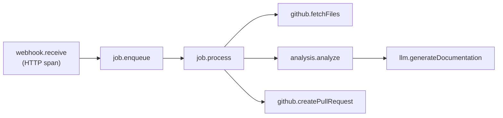

# Observability

This document defines the logging, metrics, tracing, and alerting strategy for DocSync.

---

## Table of Contents

- [Logging Strategy](#logging-strategy)
- [Metrics (Micrometer + Prometheus)](#metrics-micrometer--prometheus)
- [Traces (OpenTelemetry)](#traces-opentelemetry)
- [Health Checks](#health-checks)
- [Dashboards (Grafana)](#dashboards-grafana)
- [Alerting Rules](#alerting-rules)

---

## Logging Strategy

### Format: Structured JSON

DocSync uses **Logback** with the **Logstash encoder** to emit structured JSON logs. This format is machine-parseable and integrates seamlessly with log aggregation platforms (ELK, Loki, CloudWatch).

**Dependency (already included via Spring Boot):**

```xml
<dependency>
    <groupId>net.logstash.logback</groupId>
    <artifactId>logstash-logback-encoder</artifactId>
    <version>7.4</version>
</dependency>
```

**Logback configuration (`logback-spring.xml`):**

```xml
<configuration>
    <appender name="CONSOLE" class="ch.qos.logback.core.ConsoleAppender">
        <encoder class="net.logstash.logback.encoder.LogstashEncoder">
            <includeMdcKeyName>traceId</includeMdcKeyName>
            <includeMdcKeyName>spanId</includeMdcKeyName>
            <includeMdcKeyName>jobId</includeMdcKeyName>
            <includeMdcKeyName>repositoryFullName</includeMdcKeyName>
        </encoder>
    </appender>

    <root level="${LOG_LEVEL:-INFO}">
        <appender-ref ref="CONSOLE" />
    </root>
</configuration>
```

### Log Format Example

```json
{
  "@timestamp": "2025-01-15T14:23:45.123Z",
  "level": "INFO",
  "logger_name": "com.docsync.webhook.WebhookController",
  "message": "Webhook received and queued for processing",
  "thread_name": "http-nio-8080-exec-3",
  "traceId": "abc123def456",
  "spanId": "789ghi012",
  "jobId": "job-550e8400-e29b",
  "repositoryFullName": "acme/backend-api",
  "eventType": "push",
  "deliveryId": "gh-delivery-12345"
}
```

### Log Levels by Package

| Package / Logger                        | Level   | Rationale                                      |
|-----------------------------------------|---------|-------------------------------------------------|
| `root`                                  | `INFO`  | Default for all loggers                        |
| `com.docsync`                           | `INFO`  | Application code                               |
| `com.docsync.webhook`                   | `INFO`  | Webhook receipt and validation                 |
| `com.docsync.job`                       | `INFO`  | Job lifecycle events                           |
| `com.docsync.analysis`                  | `INFO`  | Analysis processing (set to `DEBUG` to see file-level detail) |
| `com.docsync.llm`                       | `INFO`  | LLM API interactions (never log prompts at INFO) |
| `com.docsync.github`                    | `INFO`  | GitHub API calls                               |
| `org.springframework`                   | `WARN`  | Framework internals                            |
| `org.hibernate`                         | `WARN`  | ORM internals                                  |
| `org.flywaydb`                          | `INFO`  | Migration execution                            |
| `com.zaxxer.hikari`                     | `INFO`  | Connection pool events                         |
| `org.apache.http`                       | `WARN`  | HTTP client internals                          |

Override per-package levels via environment variables:

```bash
LOGGING_LEVEL_COM_DOCSYNC_ANALYSIS=DEBUG
LOGGING_LEVEL_ORG_SPRINGFRAMEWORK=INFO
```

### Correlation IDs

Every request and job is tagged with correlation IDs propagated via MDC (Mapped Diagnostic Context):

| MDC Key              | Source                                     | Purpose                          |
|----------------------|--------------------------------------------|----------------------------------|
| `traceId`            | OpenTelemetry / Spring Cloud Sleuth        | Distributed trace correlation    |
| `spanId`             | OpenTelemetry / Spring Cloud Sleuth        | Span-level correlation           |
| `jobId`              | Set by job worker on job pickup            | Correlate all logs for a job     |
| `repositoryFullName` | Extracted from webhook payload             | Filter logs by repository        |
| `installationId`     | GitHub App installation                    | Filter logs by GitHub installation |

### What to Log

✅ **DO log:**

- Webhook receipt (event type, delivery ID, repository)
- Job lifecycle transitions (PENDING → PROCESSING → COMPLETED/FAILED)
- API call outcomes (status code, latency) to GitHub and LLM providers
- Error details with stack traces
- Configuration changes and startup parameters
- Migration execution results
- Authentication/authorization decisions

❌ **DO NOT log:**

- API keys, tokens, or secrets (even partially masked)
- Full webhook payloads (may contain repository content)
- Source code content from analyzed repositories
- LLM prompts or responses (may contain proprietary code)
- Database credentials or connection strings
- Personal data (email addresses, usernames beyond GitHub handle)
- Full HTTP request/response bodies

> [!CAUTION]
> Logging secrets, tokens, or repository source code is a **security incident**. Use log scanning tools to detect accidental secret exposure. Sanitize all log messages in code review.

---

## Metrics (Micrometer + Prometheus)

DocSync exposes metrics via **Micrometer** with a **Prometheus** registry. Metrics are available at `/actuator/prometheus`.

### Configuration

```yaml
management:
  endpoints:
    web:
      exposure:
        include: health, info, prometheus, metrics
  metrics:
    tags:
      application: docsync
      environment: ${SPRING_PROFILES_ACTIVE:default}
    distribution:
      percentiles-histogram:
        http.server.requests: true
        docsync.jobs.duration: true
```

### JVM Metrics (Auto-Configured)

| Metric                              | Type    | Description                              |
|--------------------------------------|---------|------------------------------------------|
| `jvm.memory.used`                   | Gauge   | Current memory usage by area (heap/non-heap) |
| `jvm.memory.max`                    | Gauge   | Maximum memory by area                   |
| `jvm.gc.pause`                      | Timer   | GC pause duration and count              |
| `jvm.threads.live`                  | Gauge   | Current live thread count                |
| `jvm.threads.peak`                  | Gauge   | Peak thread count                        |
| `process.cpu.usage`                 | Gauge   | Process CPU usage (0.0 to 1.0)           |
| `process.uptime`                    | Gauge   | Process uptime in seconds                |

### HTTP Request Metrics (Auto-Configured)

| Metric                              | Type    | Tags                                    |
|--------------------------------------|---------|------------------------------------------|
| `http.server.requests`              | Timer   | `method`, `uri`, `status`, `outcome`    |

### Custom Business Metrics

| Metric                                        | Type    | Tags                        | Description                                  |
|------------------------------------------------|---------|-----------------------------|----------------------------------------------|
| `docsync.webhooks.received`                   | Counter | `eventType`                 | Total webhooks received, by GitHub event type |
| `docsync.jobs.processed`                      | Counter | `status`                    | Jobs completed, by outcome (success/failure)  |
| `docsync.jobs.duration`                       | Timer   | `jobType`                   | End-to-end job processing duration            |
| `docsync.analysis.files.processed`            | Counter | —                           | Total source files analyzed                   |
| `docsync.documentation.changes.generated`     | Counter | —                           | Documentation changes produced by analysis    |
| `docsync.pullrequests.created`                | Counter | —                           | Pull requests successfully created            |
| `docsync.github.api.calls`                    | Counter | `endpoint`                  | GitHub API calls, by endpoint category        |
| `docsync.llm.requests`                        | Counter | `provider`                  | LLM API requests, by provider                 |
| `docsync.llm.tokens.used`                     | Counter | `type` (prompt/completion)  | LLM token consumption, by type                |

**Example metric instrumentation in code:**

```java
@Component
@RequiredArgsConstructor
public class WebhookMetrics {
    private final MeterRegistry registry;

    public void recordWebhookReceived(String eventType) {
        registry.counter("docsync.webhooks.received", "eventType", eventType).increment();
    }
}
```

### Database Connection Pool Metrics (Auto-Configured via HikariCP)

| Metric                                  | Type    | Description                          |
|------------------------------------------|---------|--------------------------------------|
| `hikaricp.connections.active`           | Gauge   | Currently active connections         |
| `hikaricp.connections.idle`             | Gauge   | Idle connections in the pool         |
| `hikaricp.connections.pending`          | Gauge   | Threads waiting for a connection     |
| `hikaricp.connections.max`              | Gauge   | Maximum pool size                    |
| `hikaricp.connections.usage`            | Timer   | Time connections are in use          |
| `hikaricp.connections.creation`         | Timer   | Time to create new connections       |
| `hikaricp.connections.timeout`          | Counter | Connection acquisition timeouts      |

---

## Traces (OpenTelemetry)

DocSync uses **OpenTelemetry** for distributed tracing, integrated via **Micrometer Tracing** and the OpenTelemetry SDK.

### Span Structure for Key Operations



| Span Name                        | Attributes                                              |
|----------------------------------|---------------------------------------------------------|
| `webhook.receive`               | `http.method`, `http.route`, `github.event_type`, `github.delivery_id` |
| `job.enqueue`                   | `job.id`, `job.type`, `repository.full_name`           |
| `job.process`                   | `job.id`, `job.type`, `job.status`                     |
| `github.fetchFiles`             | `repository.full_name`, `files.count`, `github.api.status` |
| `analysis.analyze`              | `files.count`, `analysis.duration_ms`                  |
| `llm.generateDocumentation`     | `llm.provider`, `llm.model`, `llm.tokens.prompt`, `llm.tokens.completion` |
| `github.createPullRequest`      | `repository.full_name`, `pr.number`, `github.api.status` |

### Context Propagation

- **Inbound:** Trace context is extracted from incoming HTTP headers (`traceparent`, `tracestate`) using W3C Trace Context propagation.
- **Internal:** MDC is populated with `traceId` and `spanId` automatically for log correlation.
- **Async jobs:** The `traceId` is stored with the job record in PostgreSQL and restored when the job worker picks up the job, ensuring end-to-end trace continuity.
- **Outbound:** Trace context is injected into outgoing HTTP requests to GitHub API and LLM APIs.

### Configuration

```yaml
management:
  tracing:
    sampling:
      probability: 1.0  # Sample 100% in dev; reduce in production (e.g. 0.1)

# OpenTelemetry exporter (OTLP)
otel:
  exporter:
    otlp:
      endpoint: http://otel-collector:4318
      protocol: http/protobuf
  service:
    name: docsync
```

---

## Health Checks

### Endpoint: `/actuator/health`

DocSync exposes health checks via Spring Boot Actuator with the following components:

| Component     | Check                                              | Failure Impact                  |
|---------------|----------------------------------------------------|---------------------------------|
| `db`          | PostgreSQL connection and query (`SELECT 1`)       | Application cannot process jobs |
| `diskSpace`   | Available disk space > 10MB                        | Cannot write logs or temp files |
| `github`      | GitHub API reachable, App authentication valid     | Cannot fetch files or create PRs |
| `jobQueue`    | No stuck jobs (PROCESSING > 1 hour), queue depth < 500 | Job processing degraded    |

### Readiness vs. Liveness

| Probe     | Endpoint                             | Purpose                                         | Components Checked         |
|-----------|--------------------------------------|--------------------------------------------------|----------------------------|
| Liveness  | `/actuator/health/liveness`          | Is the JVM alive and not deadlocked?             | JVM internal checks        |
| Readiness | `/actuator/health/readiness`         | Can the app serve traffic?                       | `db`, `diskSpace`          |

**Kubernetes probe configuration example:**

```yaml
livenessProbe:
  httpGet:
    path: /actuator/health/liveness
    port: 8080
  initialDelaySeconds: 30
  periodSeconds: 15
  failureThreshold: 3

readinessProbe:
  httpGet:
    path: /actuator/health/readiness
    port: 8080
  initialDelaySeconds: 15
  periodSeconds: 10
  failureThreshold: 3
```

---

## Dashboards (Grafana)

### Suggested Dashboard Panels

#### Overview Dashboard

| Panel                        | Visualization | Query / Metric                                                 |
|------------------------------|---------------|----------------------------------------------------------------|
| Service Uptime               | Stat          | `up{application="docsync"}`                                    |
| Request Rate                 | Time series   | `rate(http_server_requests_seconds_count[5m])`                 |
| Error Rate (%)               | Gauge         | `rate(http_server_requests_seconds_count{status=~"5.."}[5m]) / rate(http_server_requests_seconds_count[5m]) * 100` |
| Request Latency (p99)        | Time series   | `histogram_quantile(0.99, rate(http_server_requests_seconds_bucket[5m]))` |
| Webhooks Received            | Time series   | `rate(docsync_webhooks_received_total[5m])`                    |
| Active Jobs                  | Stat          | Custom query against job table or a gauge metric               |

#### Job Processing Dashboard

| Panel                        | Visualization | Query / Metric                                                 |
|------------------------------|---------------|----------------------------------------------------------------|
| Jobs Processed (success/fail)| Stacked bar   | `rate(docsync_jobs_processed_total[5m])` by `status`           |
| Job Duration (p50, p95, p99) | Time series   | `histogram_quantile(0.95, rate(docsync_jobs_duration_seconds_bucket[5m]))` |
| Files Analyzed               | Time series   | `rate(docsync_analysis_files_processed_total[5m])`             |
| PRs Created                  | Counter       | `increase(docsync_pullrequests_created_total[1h])`             |
| Doc Changes Generated        | Counter       | `increase(docsync_documentation_changes_generated_total[1h])`  |

#### LLM & External APIs Dashboard

| Panel                        | Visualization | Query / Metric                                                 |
|------------------------------|---------------|----------------------------------------------------------------|
| LLM Requests                 | Time series   | `rate(docsync_llm_requests_total[5m])` by `provider`          |
| LLM Token Usage              | Stacked area  | `rate(docsync_llm_tokens_used_total[5m])` by `type`           |
| GitHub API Calls             | Time series   | `rate(docsync_github_api_calls_total[5m])` by `endpoint`      |
| GitHub Rate Limit Remaining  | Gauge         | Custom metric or external query                                |

#### Infrastructure Dashboard

| Panel                        | Visualization | Query / Metric                                                 |
|------------------------------|---------------|----------------------------------------------------------------|
| JVM Heap Usage               | Time series   | `jvm_memory_used_bytes{area="heap"}`                           |
| GC Pause Duration            | Time series   | `rate(jvm_gc_pause_seconds_sum[5m])`                           |
| Thread Count                 | Time series   | `jvm_threads_live_threads`                                     |
| DB Connection Pool Active    | Time series   | `hikaricp_connections_active`                                  |
| DB Connection Pool Pending   | Time series   | `hikaricp_connections_pending`                                 |
| CPU Usage                    | Gauge         | `process_cpu_usage`                                            |
| Disk Space Available         | Gauge         | `disk_free_bytes`                                              |

### Key SLIs (Service Level Indicators)

| SLI                            | Target   | Measurement                                                              |
|--------------------------------|----------|--------------------------------------------------------------------------|
| **Availability**               | 99.9%    | Percentage of time `/actuator/health` returns `UP`                       |
| **Webhook Processing Latency** | p95 < 5s | Time from webhook receipt to job enqueue                                 |
| **Job Success Rate**           | > 98%    | `docsync_jobs_processed_total{status="success"}` / total jobs            |
| **PR Creation Success Rate**   | > 95%    | `docsync_pullrequests_created_total` / total completed analyses          |
| **Job Processing Duration**    | p95 < 5m | `docsync_jobs_duration_seconds` 95th percentile                          |

---

## Alerting Rules

### Prometheus Alerting Rules

```yaml
groups:
  - name: docsync-alerts
    rules:

      # --- Availability ---
      - alert: DocSyncHighErrorRate
        expr: >
          rate(http_server_requests_seconds_count{application="docsync", status=~"5.."}[5m])
          / rate(http_server_requests_seconds_count{application="docsync"}[5m]) > 0.05
        for: 5m
        labels:
          severity: critical
        annotations:
          summary: "DocSync error rate exceeds 5%"
          description: "{{ $value | humanizePercentage }} of requests are returning 5xx errors."
          runbook: "Check application logs for the most common exception. See OPERATIONS_RUNBOOK.md."

      # --- Job Queue ---
      - alert: DocSyncJobQueueBacklog
        expr: >
          docsync_job_queue_depth > 100
        for: 10m
        labels:
          severity: warning
        annotations:
          summary: "DocSync job queue depth exceeds 100"
          description: "{{ $value }} jobs are pending. Workers may be stuck or overwhelmed."
          runbook: "Check for stuck jobs. See OPERATIONS_RUNBOOK.md#job-processing-stuck."

      # --- GitHub API ---
      - alert: DocSyncGitHubRateLimitApproaching
        expr: >
          docsync_github_ratelimit_remaining < 500
        for: 5m
        labels:
          severity: warning
        annotations:
          summary: "GitHub API rate limit approaching"
          description: "Only {{ $value }} API calls remaining before rate limit reset."
          runbook: "Reduce concurrent processing. See OPERATIONS_RUNBOOK.md#github-api-rate-limiting."

      # --- Database ---
      - alert: DocSyncDBConnectionPoolExhaustion
        expr: >
          hikaricp_connections_pending{pool="HikariPool-1"} > 0
        for: 5m
        labels:
          severity: critical
        annotations:
          summary: "Database connection pool has pending requests"
          description: "{{ $value }} threads are waiting for a database connection."
          runbook: "Check for long-running queries. See OPERATIONS_RUNBOOK.md#database-connection-failures."

      # --- JVM ---
      - alert: DocSyncHighMemoryUsage
        expr: >
          jvm_memory_used_bytes{area="heap", application="docsync"}
          / jvm_memory_max_bytes{area="heap", application="docsync"} > 0.85
        for: 10m
        labels:
          severity: warning
        annotations:
          summary: "DocSync JVM heap usage exceeds 85%"
          description: "Heap usage is at {{ $value | humanizePercentage }}. Risk of OOM."
          runbook: "See OPERATIONS_RUNBOOK.md#high-memory-usage."

      # --- Job Failures ---
      - alert: DocSyncHighJobFailureRate
        expr: >
          rate(docsync_jobs_processed_total{status="failure"}[15m])
          / rate(docsync_jobs_processed_total[15m]) > 0.1
        for: 10m
        labels:
          severity: critical
        annotations:
          summary: "DocSync job failure rate exceeds 10%"
          description: "{{ $value | humanizePercentage }} of jobs are failing."
          runbook: "Check failed job error messages. See OPERATIONS_RUNBOOK.md#reprocessing-failed-jobs."

      # --- Health ---
      - alert: DocSyncHealthCheckFailing
        expr: >
          up{application="docsync"} == 0
        for: 2m
        labels:
          severity: critical
        annotations:
          summary: "DocSync instance is down"
          description: "Health check has been failing for 2 minutes."
          runbook: "Check container status and logs. Restart if necessary."
```

### Alert Routing (Alertmanager Example)

```yaml
route:
  receiver: default
  group_by: [alertname]
  group_wait: 30s
  group_interval: 5m
  repeat_interval: 4h
  routes:
    - match:
        severity: critical
      receiver: pagerduty-critical
      repeat_interval: 1h
    - match:
        severity: warning
      receiver: slack-warnings
      repeat_interval: 4h

receivers:
  - name: default
    slack_configs:
      - channel: '#docsync-alerts'
  - name: pagerduty-critical
    pagerduty_configs:
      - service_key: '<pagerduty-service-key>'
  - name: slack-warnings
    slack_configs:
      - channel: '#docsync-alerts'
```
