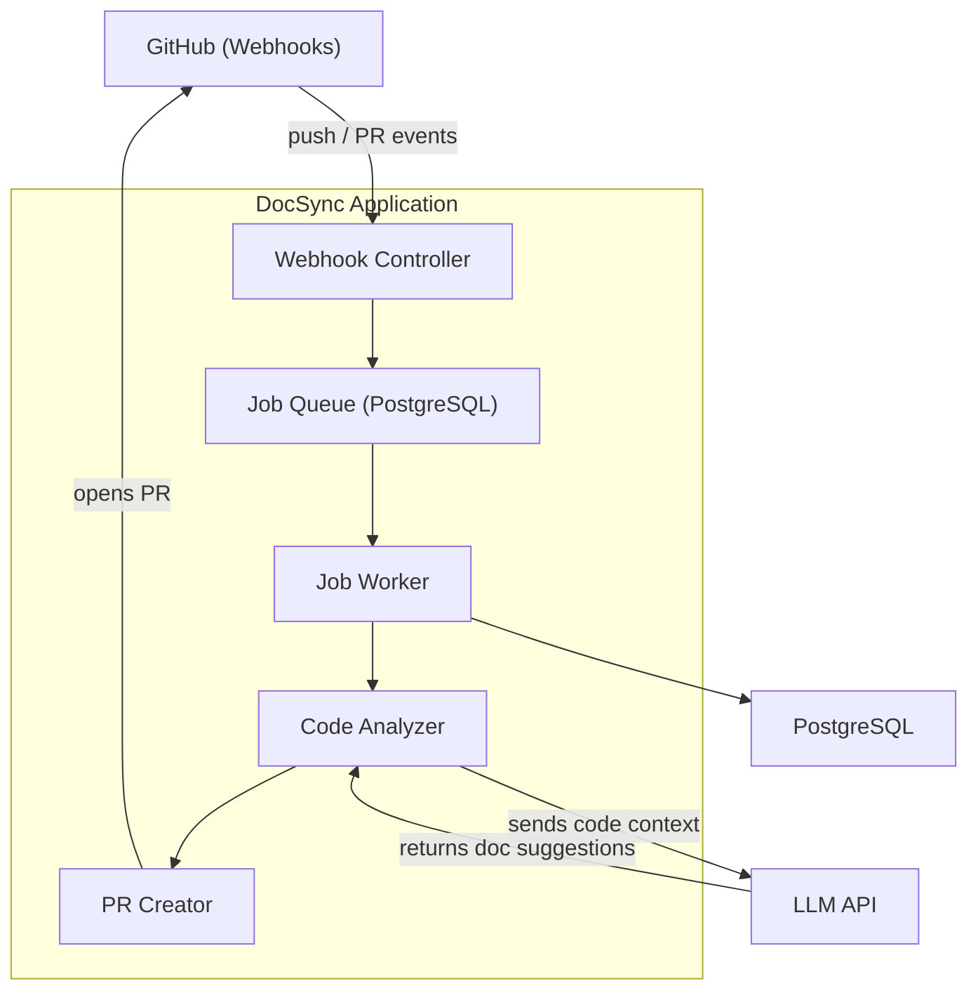
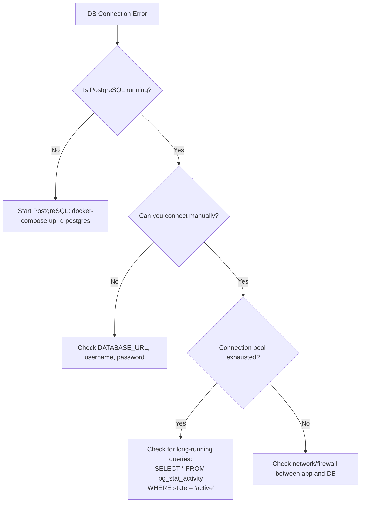

# Operations Runbook

This runbook provides step-by-step procedures for operating, troubleshooting, and maintaining the DocSync platform.

---

## Table of Contents

- [Service Overview](#service-overview)
- [Common Operations](#common-operations)
- [Troubleshooting Guide](#troubleshooting-guide)
- [Recovery Procedures](#recovery-procedures)
- [Alerting Response Procedures](#alerting-response-procedures)
- [Maintenance Tasks](#maintenance-tasks)

---

## Service Overview

### What Is DocSync?

DocSync is a documentation automation platform that monitors code repositories via GitHub webhooks, analyzes code changes using an LLM, and generates documentation updates as pull requests.

### Architecture



### Key Components

| Component           | Description                                        | Port  |
|---------------------|----------------------------------------------------|-------|
| Spring Boot App     | Main application process                           | 8080  |
| PostgreSQL 16       | Primary data store, job queue, webhook event log    | 5432  |
| GitHub App          | Repository integration (webhooks, API access)      | —     |
| LLM API             | External service for documentation generation      | —     |

### Key Endpoints

| Endpoint                          | Purpose                        |
|-----------------------------------|--------------------------------|
| `POST /api/webhooks/github`       | GitHub webhook receiver        |
| `GET  /actuator/health`           | Full health check              |
| `GET  /actuator/health/liveness`  | Liveness probe (k8s)           |
| `GET  /actuator/health/readiness` | Readiness probe (k8s)          |
| `GET  /actuator/prometheus`       | Prometheus metrics scrape      |
| `GET  /actuator/info`             | Application info & version     |

---

## Common Operations

### Starting the Service

```bash
# Docker Compose (recommended)
docker-compose up -d

# Verify startup
docker-compose logs -f docsync --tail=50
```

### Stopping the Service

```bash
# Graceful shutdown (waits for in-flight requests)
docker-compose stop docsync

# Full stack shutdown
docker-compose down
```

> [!IMPORTANT]
> Always use `stop` (graceful) rather than `kill` unless the process is unresponsive. The application has a 30-second graceful shutdown window configured via `spring.lifecycle.timeout-per-shutdown-phase`.

### Checking Health and Readiness

```bash
# Quick health check
curl -sf http://localhost:8080/actuator/health | jq .

# Individual components
curl -sf http://localhost:8080/actuator/health/db | jq .
curl -sf http://localhost:8080/actuator/health/diskSpace | jq .

# Readiness (all dependencies available)
curl -sf http://localhost:8080/actuator/health/readiness | jq .

# Liveness (process alive)
curl -sf http://localhost:8080/actuator/health/liveness | jq .
```

### Viewing Logs

```bash
# Tail application logs
docker-compose logs -f docsync --tail=100

# Search for errors
docker-compose logs docsync | grep -i "error\|exception" | tail -20

# Filter by traceId (structured JSON logs)
docker-compose logs docsync | jq 'select(.traceId == "<trace-id>")'
```

### Running Database Migrations Manually

Flyway migrations run automatically on startup. To run them manually without starting the full application:

```bash
mvn flyway:migrate \
  -Dflyway.url=jdbc:postgresql://localhost:5432/docsync \
  -Dflyway.user=docsync \
  -Dflyway.password=<password>

# Check migration status
mvn flyway:info \
  -Dflyway.url=jdbc:postgresql://localhost:5432/docsync \
  -Dflyway.user=docsync \
  -Dflyway.password=<password>
```

### Rotating Credentials

#### Rotate Database Password

1. Update the password in PostgreSQL:
   ```sql
   ALTER USER docsync WITH PASSWORD 'new-password-here';
   ```
2. Update the `DATABASE_PASSWORD` environment variable (or secrets manager entry).
3. Restart the application:
   ```bash
   docker-compose restart docsync
   ```
4. Verify health: `curl -sf http://localhost:8080/actuator/health/db | jq .`

#### Rotate GitHub Webhook Secret

1. Generate a new secret: `openssl rand -hex 32`
2. Update the webhook secret in the GitHub App settings.
3. Update the `GITHUB_WEBHOOK_SECRET` environment variable.
4. Restart the application.
5. Send a test webhook from GitHub to verify signature validation.

#### Rotate LLM API Key

1. Generate a new API key from the LLM provider dashboard.
2. Update the `LLM_API_KEY` environment variable.
3. Restart the application.
4. Verify by checking logs for successful LLM API calls.

#### Rotate Encryption Key

> [!CAUTION]
> Rotating `ENCRYPTION_KEY` requires re-encrypting all stored credentials. This is a **destructive operation** if not done correctly. Follow the migration tool documentation before proceeding.

1. Generate a new key: `openssl rand -base64 32`
2. Run the key rotation tool: `java -jar docsync.jar --rotate-encryption-key --old-key=<old> --new-key=<new>`
3. Update the `ENCRYPTION_KEY` environment variable.
4. Restart the application.

---

## Troubleshooting Guide

### Application Won't Start

| Symptom | Likely Cause | Resolution |
|---------|-------------|------------|
| `Port 8080 already in use` | Another process on the port | `lsof -i :8080` to find and stop it, or change `SERVER_PORT` |
| `Cannot connect to database` | PostgreSQL not running or wrong credentials | Check `docker-compose ps postgres`, verify `DATABASE_URL` |
| `Flyway migration failed` | Conflicting or corrupted migration | Check `flyway_schema_history` table; see [Recovery Procedures](#recovery-procedures) |
| `Failed to decode GITHUB_APP_PRIVATE_KEY` | Malformed PEM key | Ensure the key is correctly base64-encoded or the file path is accessible |
| `Bean creation exception` | Missing required environment variables | Check all **Required** variables in the [env reference](DEPLOYMENT.md#environment-variables-reference) |
| `OutOfMemoryError` on startup | Insufficient heap | Set `-Xmx` appropriately (minimum 512m recommended) |

**General debugging steps:**

```bash
# 1. Check if the container is running
docker-compose ps

# 2. Check container exit code
docker inspect docsync-app --format='{{.State.ExitCode}}'

# 3. View full startup logs
docker-compose logs docsync | head -100

# 4. Try running with DEBUG logging
LOG_LEVEL=DEBUG docker-compose up docsync
```

### Database Connection Failures



**Check connection pool status:**

```bash
curl -s http://localhost:8080/actuator/metrics/hikaricp.connections.active | jq .
curl -s http://localhost:8080/actuator/metrics/hikaricp.connections.pending | jq .
```

**Kill long-running queries:**

```sql
SELECT pid, now() - pg_stat_activity.query_start AS duration, query
FROM pg_stat_activity
WHERE state = 'active' AND (now() - pg_stat_activity.query_start) > interval '5 minutes';

-- Kill a specific query
SELECT pg_terminate_backend(<pid>);
```

### GitHub API Rate Limiting

**Symptoms:** HTTP 403 responses from GitHub API, log entries containing `rate limit exceeded`.

**Diagnosis:**

```bash
# Check current rate limit status from the app metrics
curl -s http://localhost:8080/actuator/metrics/docsync.github.api.calls | jq .

# Check GitHub rate limit directly (using an installation token)
curl -H "Authorization: token <token>" https://api.github.com/rate_limit
```

**Resolution:**

1. GitHub Apps get 5,000 requests/hour per installation. If this is insufficient, optimize API call patterns.
2. Check for retry storms — a failing webhook can cause repeated API calls.
3. Wait for the rate limit to reset (check the `X-RateLimit-Reset` header).
4. If multiple installations are active, verify calls are distributed correctly.

### Webhook Delivery Failures

**Symptoms:** GitHub shows failed webhook deliveries, no new jobs being processed.

**Diagnosis:**

1. Check GitHub App → Settings → Advanced → Recent Deliveries for error details.
2. Verify the webhook endpoint is reachable: `curl -s -o /dev/null -w "%{http_code}" http://localhost:8080/api/webhooks/github`
3. Check application logs for signature validation failures:
   ```bash
   docker-compose logs docsync | grep -i "webhook" | tail -20
   ```

**Common causes:**

| Cause | Fix |
|-------|-----|
| Webhook secret mismatch | Ensure `GITHUB_WEBHOOK_SECRET` matches the value in GitHub App settings |
| Endpoint unreachable | Check firewall, DNS, reverse proxy configuration |
| Payload too large | Increase `client_max_body_size` in Nginx and `server.max-http-request-header-size` in Spring |
| Application not running | Check health endpoint, restart if needed |

### Job Processing Stuck

**Symptoms:** Jobs remain in `PROCESSING` state indefinitely, no new PRs created.

**Diagnosis:**

```sql
-- Check for stuck jobs (processing for more than 30 minutes)
SELECT id, job_type, status, created_at, updated_at
FROM jobs
WHERE status = 'PROCESSING'
  AND updated_at < NOW() - INTERVAL '30 minutes';

-- Count jobs by status
SELECT status, COUNT(*) FROM jobs GROUP BY status;
```

**Resolution:** See [Clearing Stuck Jobs](#clearing-stuck-jobs) in Recovery Procedures.

### High Memory Usage

**Symptoms:** Container OOM-killed, `OutOfMemoryError` in logs, high GC pressure.

**Diagnosis:**

```bash
# Check JVM memory via actuator
curl -s http://localhost:8080/actuator/metrics/jvm.memory.used | jq .
curl -s http://localhost:8080/actuator/metrics/jvm.gc.pause | jq .

# Check container memory usage
docker stats docsync-app --no-stream
```

**Resolution:**

1. Increase container memory limit in `docker-compose.yml`:
   ```yaml
   deploy:
     resources:
       limits:
         memory: 2g
   ```
2. Tune JVM heap: add `JAVA_OPTS: -Xms512m -Xmx1536m` to environment.
3. Check for memory leaks by enabling heap dumps on OOM:
   ```
   JAVA_OPTS: -XX:+HeapDumpOnOutOfMemoryError -XX:HeapDumpPath=/app/logs/
   ```
4. Analyze the heap dump with Eclipse MAT or VisualVM.

### Slow Analysis Processing

**Symptoms:** Jobs take significantly longer than usual to complete.

**Diagnosis:**

```bash
# Check job processing duration
curl -s http://localhost:8080/actuator/metrics/docsync.jobs.duration | jq .

# Check LLM API latency
curl -s http://localhost:8080/actuator/metrics/docsync.llm.requests | jq .
```

**Common causes:**

| Cause | Fix |
|-------|-----|
| LLM API latency spike | Check LLM provider status page; consider switching models |
| Large repository / many files | Expected behavior; monitor but no action needed |
| GitHub API rate limiting | Reduce concurrent jobs, wait for rate limit reset |
| Database slow queries | Check `pg_stat_statements` for slow queries, add indexes |

---

## Recovery Procedures

### Database Restore from Backup

1. **Stop the application:**
   ```bash
   docker-compose stop docsync
   ```

2. **Identify the backup to restore:**
   ```bash
   ls -lt /backups/docsync_*.dump | head -5
   ```

3. **Restore the database:**
   ```bash
   # Drop and recreate the database
   psql -h localhost -U postgres -c "DROP DATABASE IF EXISTS docsync;"
   psql -h localhost -U postgres -c "CREATE DATABASE docsync OWNER docsync;"

   # Restore from backup
   pg_restore -h localhost -U docsync -d docsync --clean --if-exists /backups/docsync_<timestamp>.dump
   ```

4. **Restart the application:**
   ```bash
   docker-compose up -d docsync
   ```

5. **Verify health and data integrity:**
   ```bash
   curl -sf http://localhost:8080/actuator/health | jq .
   ```

### Reprocessing Failed Jobs

```sql
-- List recently failed jobs
SELECT id, job_type, status, error_message, created_at
FROM jobs
WHERE status = 'FAILED'
ORDER BY created_at DESC
LIMIT 20;

-- Requeue specific failed jobs for retry
UPDATE jobs
SET status = 'PENDING', error_message = NULL, updated_at = NOW(), retry_count = retry_count + 1
WHERE id IN ('<job-id-1>', '<job-id-2>');

-- Requeue all failed jobs from the last 24 hours
UPDATE jobs
SET status = 'PENDING', error_message = NULL, updated_at = NOW(), retry_count = retry_count + 1
WHERE status = 'FAILED'
  AND created_at > NOW() - INTERVAL '24 hours';
```

> [!WARNING]
> Before reprocessing, investigate **why** the jobs failed. Blindly retrying may cause duplicate PRs or hit rate limits.

### Clearing Stuck Jobs

```sql
-- Mark stuck jobs as failed so they can be retried
UPDATE jobs
SET status = 'FAILED',
    error_message = 'Manually cleared: stuck in PROCESSING state',
    updated_at = NOW()
WHERE status = 'PROCESSING'
  AND updated_at < NOW() - INTERVAL '30 minutes';
```

After clearing, restart the application to ensure worker threads are healthy:

```bash
docker-compose restart docsync
```

### Token Refresh Failures

**Symptoms:** GitHub API calls return 401, logs show `installation token expired`.

**Resolution:**

1. Verify the GitHub App is still installed on the target repositories.
2. Check that `GITHUB_APP_PRIVATE_KEY` is valid and not expired.
3. Verify the App's permissions haven't been revoked by the organization admin.
4. Restart the application to force a fresh token acquisition:
   ```bash
   docker-compose restart docsync
   ```
5. If the private key is compromised, regenerate it in GitHub App settings and update `GITHUB_APP_PRIVATE_KEY`.

---

## Alerting Response Procedures

| Alert | Severity | Response |
|-------|----------|----------|
| **High error rate (>5% of requests)** | P1 | Check logs for the most common exception. If it's a dependency failure (DB, GitHub, LLM), check that dependency. If it's application code, consider rolling back. |
| **Job queue depth > 100** | P2 | Check if workers are processing. If stuck, clear stuck jobs. If load spike, scale workers or wait for drain. |
| **GitHub API rate limit > 80%** | P2 | Reduce concurrent processing. Check for retry storms. Wait for rate limit reset window. |
| **Database connection pool exhaustion** | P1 | Kill long-running queries. Increase pool size if appropriate. Check for connection leaks. Restart if necessary. |
| **Health check failing** | P1 | Identify which component is DOWN via `/actuator/health`. Fix the dependency or restart the application. |
| **Disk space > 90%** | P2 | Clean up old logs, temp files, and expired data. See [Database Cleanup](#database-cleanup-old-data). |
| **JVM heap usage > 85%** | P2 | Check for memory leaks. Increase heap size. Restart if GC overhead exceeds 50%. |

---

## Maintenance Tasks

### Database Cleanup (Old Data)

Run periodically (weekly recommended) to remove expired data:

```sql
-- Delete webhook events older than 90 days
DELETE FROM webhook_events
WHERE created_at < NOW() - INTERVAL '90 days';

-- Delete completed/failed jobs older than 30 days
DELETE FROM jobs
WHERE status IN ('COMPLETED', 'FAILED')
  AND updated_at < NOW() - INTERVAL '30 days';

-- Vacuum to reclaim space
VACUUM ANALYZE webhook_events;
VACUUM ANALYZE jobs;
```

Automate via cron:

```bash
#!/bin/bash
# /opt/scripts/cleanup-db.sh
psql -h localhost -U docsync -d docsync <<'SQL'
DELETE FROM webhook_events WHERE created_at < NOW() - INTERVAL '90 days';
DELETE FROM jobs WHERE status IN ('COMPLETED', 'FAILED') AND updated_at < NOW() - INTERVAL '30 days';
VACUUM ANALYZE webhook_events;
VACUUM ANALYZE jobs;
SQL
```

```cron
0 3 * * 0 /opt/scripts/cleanup-db.sh >> /var/log/docsync-cleanup.log 2>&1
```

### Log Rotation

If writing logs to disk (in addition to stdout), configure logback to rotate:

```xml
<!-- logback-spring.xml -->
<appender name="FILE" class="ch.qos.logback.core.rolling.RollingFileAppender">
    <file>/app/logs/docsync.log</file>
    <rollingPolicy class="ch.qos.logback.core.rolling.SizeAndTimeBasedRollingPolicy">
        <fileNamePattern>/app/logs/docsync.%d{yyyy-MM-dd}.%i.log.gz</fileNamePattern>
        <maxFileSize>100MB</maxFileSize>
        <maxHistory>30</maxHistory>
        <totalSizeCap>3GB</totalSizeCap>
    </rollingPolicy>
</appender>
```

For Docker-based deployments, configure the Docker logging driver:

```yaml
# docker-compose.yml
services:
  docsync:
    logging:
      driver: "json-file"
      options:
        max-size: "50m"
        max-file: "5"
```

### Certificate Renewal

If using Let's Encrypt with certbot:

```bash
# Test renewal
certbot renew --dry-run

# Force renewal
certbot renew --force-renewal

# Reload Nginx to pick up new certs
nginx -s reload
```

Automate via cron (certbot usually installs its own timer, but verify):

```cron
0 0 1,15 * * certbot renew --quiet && nginx -s reload
```

### Dependency Updates

**Monthly cadence recommended:**

1. Check for dependency updates:
   ```bash
   mvn versions:display-dependency-updates
   mvn versions:display-plugin-updates
   ```

2. Update the Docker base image:
   ```bash
   docker pull eclipse-temurin:21-jre
   ```

3. Check for Spring Boot patch releases at [spring.io](https://spring.io/projects/spring-boot#support).

4. After updating, run the full test suite:
   ```bash
   mvn clean verify
   ```

5. Deploy to a staging environment before production.
